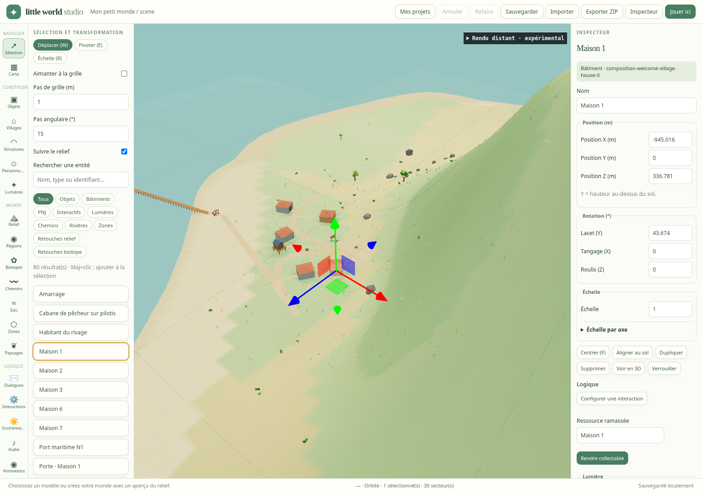
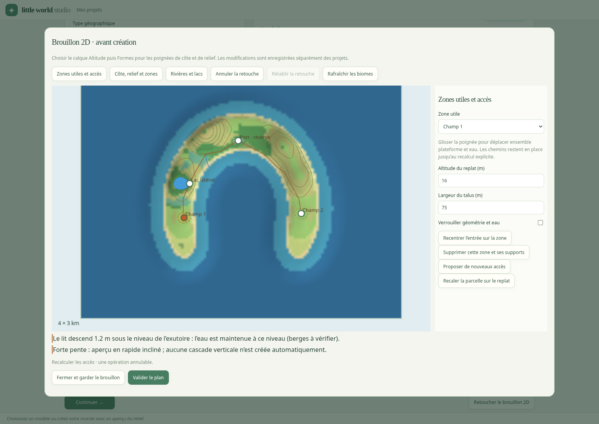

# Little World

**Un petit monde 3D à explorer, mais aussi à créer.** Little World réunit un jeu d'exploration paisible en troisième personne et **Little World Studio**, un environnement intégré pour **générer, composer, éditer, peupler et tester des îles**. Le projet est développé avec **TypeScript, Three.js/WebGL et Vite**, et peut fonctionner entièrement dans le navigateur, sans serveur de jeu.

> **État du projet — 19 novembre 2026 : prototype solo jouable et Studio fonctionnel, développement actif.** Cette présentation décrit les modules présents sur `main`, mais ne signifie pas que chaque fonction est terminée, testée sur tous les appareils ou activée dans l'île publiée. Le multijoueur est une évolution future.

> **Graphismes et performances : les modèles 3D ne sont pas encore optimisés globalement.** Des mécanismes d'instanciation, de réutilisation, de LOD et de culling existent, mais les géométries, matériaux, animations, draw calls et budgets CPU/GPU nécessitent encore une campagne d'optimisation et de qualification. Les captures montrent un état de travail, pas le rendu final.

## Découvrir le projet

| Accès | Description |
| --- | --- |
| **[Jouer à Little World](https://glloq.github.io/little-world/)** | Jeu solo, exploration et activités sur une île de démonstration |
| **[Ouvrir Little World Studio](https://glloq.github.io/little-world/studio/)** | Créer un projet, travailler sur une carte 2D ou dans la scène 3D, sauvegarder et tester |
| **[Code et suivi](https://github.com/glloq/little-world)** | Sources TypeScript, tests, documentation et développement |
| **[Historique des builds](https://github.com/glloq/little-world/actions)** | Statut des tests et de la publication GitHub Pages |

L’archipel du build comprend cinq îles reliées par navette. Le **Volcan** est le point d’entrée historique. Le **Val forestier** propose la quête de Mésange. Les **Trois vagues** réunissent un hameau, trois parcours de surf et un tour des fanions. Les **Cimes** ont une piste de ski, un télésiège et une descente de roulade. Les **Moissons** réunissent jardins du joueur, champs des habitants, moulin et comptoir de semences.

Dans Studio, **Explorer un monde prêt** ouvre la source de chacune de ces îles. Dans le générateur, **Style de l’île → Zones utiles et accès → Activité du village** choisit la spécialisation du village d’accueil. Le générateur valide les emprises et les accès sur le relief choisi.

## Ce qui est développé aujourd'hui

Les statuts ci-dessous décrivent la présence du code sur `main`, non un niveau de finition artistique.

| Domaine | Fonctionnalités présentes | Maturité |
| --- | --- | --- |
| **Little World Studio** | Projets, assistant de création, édition géographique 2D, scène 3D, modules spécialisés, sauvegarde, ZIP, test local, validation/compilation | **Fonctionnel ; UX et validation à poursuivre** |
| **Géographie et nature** | Formes d'îles, relief, biotopes, provinces, eau, rivières, falaises, paysages, végétation procédurale | **Implémenté, perfectionnement en cours** |
| **Construction et peuplement** | Objets/prefabs, assemblages, structures naturelles, villages/villes, habitants et services | **Implémenté partiellement** |
| **Déplacements** | Hamster, roulade, saut, planeur, nage/plongée, escalade, bateau ; mouvements spécialisés expérimentaux | **Jouable, physique et contrôles à régler** |
| **Activités** | Collecte, agriculture, mine, pêche, courses, interactions, inventaire, commerce | **Jouable ou prototype suivant l'activité** |
| **Vie locale** | PNJ hamsters, métiers, trajets jour/nuit et dialogues contextuels | **V1 intégrée, qualification et enrichissement restants** |
| **Archipel et économie** | Catalogue de deux îles, transition en solo, marchés, ateliers, transport de marchandises et comptoirs | **Premières versions, progression à compléter** |
| **Rendu, son et ambiance** | Météo, ciel, cycle temporel, audio contextuel, MIDI, profils de qualité, LOD partiels | **Implémenté, optimisation et calibration nécessaires** |
| **Quêtes automatiques / monde complet** | Contrats, audit, roadmaps et composants génériques d'interactions | **Générateur complet non livré** |
| **Multijoueur** | Études et contrats d'architecture | **Non implémenté** |

## Little World Studio : le cœur de la création

Le Studio n'est pas un simple outil de placement d'objets. Il regroupe une interface de production de mondes **en 2D et en 3D**, avec un document de projet partagé, un historique d'édition et une prévisualisation jouable.

### 1. Créer et composer une île

- **Assistant de création** : choisir un paysage, une graine, les dimensions et les grandes caractéristiques du monde, puis observer le résultat avant de confirmer.
- **Styles géographiques** : îles douces, massifs, volcans, caldeiras et plateaux, avec compositions organiques ; génération déterministe et besoins de carte versionnés.
- **Brouillon cartographique 2D** : modifier les contours, montagnes, falaises, hauteurs, lacs, eau et secteurs avant la création définitive.
- **Cartes de contrôle** : altitude, biotopes, pentes, hydrographie et coupes de terrain.
- **Composition/régénération** : comparer un nouvel aménagement, préserver des corrections et diagnostiquer les contraintes géographiques ; les cas complexes restent en cours de qualification.

### 2. Éditer réellement le terrain et les décors

| Outil Studio | Possibilités déjà présentes |
| --- | --- |
| **Carte globale** | Manipulation des couches géographiques, sélection et outils 2D |
| **Relief** | Élever, abaisser, aplanir et lisser dans la vue 3D |
| **Régions / paysages** | Délimiter des zones, appliquer recettes écologiques et variations de relief |
| **Biotopes** | Peindre les milieux, corriger la végétation, poser des masques d'exclusion |
| **Eau / chemins** | Tracer rivières, lacs, cascades, passages et itinéraires ; contrôles des raccordements |
| **Objets** | Bibliothèque d'assets, placement, rotation, échelle, sélection et transformation |
| **Construction** | Assemblages, clôtures, ponts, structures naturelles, motifs et dispersion |
| **Lumières / ambiance** | Sources lumineuses, paramètres d'environnement, météo et audio |
| **Historique** | Annuler/refaire, propriétés par inspecteur et sauvegarde locale |

Le Studio s'appuie notamment sur `src/studio/` (interface et viewport), `src/studio-core/` (commandes, données, composition et validations), `src/geography/`, `src/water/` et `src/settlements/`. Les modifications restent dans le projet éditable ; elles ne modifient pas automatiquement le jeu publié.

### 3. Créer des villages et donner de la vie au monde

- **Villages et villes** : outils d'implantation de hameaux, villages et villes jusqu'à environ 80 maisons dans la recette actuelle, avec rues, espaces, ajustements et protections des retouches.
- **Implantations contextuelles** : accès, berges, relief, rivières, bords de mer, ponts, services et commerces, avec limites et diagnostics d'accessibilité.
- **Habitants** : création dans la vue 3D, morphologie hamster par défaut, choix des rôles, dialogues et interactions, routines locales.
- **Activités** : zones de mine, agriculture et autres lieux d'activité, courses avec portes/checkpoints, modules expérimentaux de surf, sons et éclairages.

La génération d'une **ville entièrement autonome et immédiatement jouable** n'est pas encore garantie. Campements complets, intérieurs, terriers habitables, grottes complexes et cheminements sans défaut restent dans la roadmap.

### 4. Éditer le gameplay et tester sur place

Les modules **Personnages, Dialogues, Interactions, Zones, Courses, Environnement, Audio, Animations du hamster** et **Validation / compilation** sont accessibles depuis le Studio.

- **`Jouer ici`** ouvre le monde édité dans une session de test.
- **`Importer` / `Exporter ZIP`** permettent de reprendre ou partager les projets.
- L'**historique Undo/Redo** et la sauvegarde locale évitent de tout reconstruire à chaque essai.
- Les outils de validation contrôlent différentes erreurs de géographie, de données, de compilation et de contenu ; ils ne certifient pas encore la jouabilité de chaque monde généré.
- Pour publier une nouvelle carte dans le jeu GitHub Pages, il faut **compiler et déployer** les données correspondantes : un projet sauvegardé dans le navigateur ne remplace pas automatiquement l'île officielle.

**Parcours conseillé :** créer un projet → composer la carte 2D → régler relief/régions/eau → ajouter végétation et bâtiments → relier les chemins → peupler et placer les activités → configurer dialogues/interactions → valider → `Jouer ici`.

Références : [Studio et architecture UX](docs/13-STUDIO-UX-ARCHITECTURE.md), [schémas V3](docs/15-STUDIO-DATA-SCHEMAS-V3.md), [édition 3D](docs/32-STUDIO-EDITEUR-3D.md), [géographie V2](docs/53-STUDIO-GEOGRAPHY-PRODUCTION-V2.md), [villages](docs/75-SETTLEMENTS-SURFACE-V1.md), [audit des mondes complets](docs/92-COMPLETE-WORLDS-STUDIO-AUDIT.md).

## Le jeu : exploration, activités et habitants

### Déplacements et personnages

Le joueur est un **hamster low-poly** : marche, course, roulade selon le relief, saut, planage avec un **planeur en V déployé depuis le sac**, nage, plongée, escalade et pilotage d'une embarcation. Les systèmes de caméra, commandes mobiles et collisions évoluent encore ; certaines mécaniques disposent d'un mode de démonstration technique.

Les habitants humanoïdes partagent désormais la base visuelle du hamster, pour éviter de multiplier les rigs. La faune peut conserver d'autres morphologies. La compatibilité des anciennes données d'écureuil est maintenue par conversion à l'affichage. Les routines professionnelles jour/nuit, domiciles, chemins et dialogues contextuels disposent d'une première implémentation ; évitement complexe, groupes, intérieurs et comportements sociaux avancés restent à faire.

### Activités et économie

- **Explorer et collecter** : fruits, bois, minerais et objets, avec un sac V3, équipements/favoris et actions contextuelles.
- **Cultiver** : parcelles, semences, croissance et récolte.
- **Miner** : mine multinéiveau 2,5D, extraction progressive, fissures et mécanique rythmique ; rendus et récompenses encore à équilibrer.
- **Pêcher** : mini-jeu de capture/tension avec rendu et audio low-poly, premières versions intégrées ; validation finale des sensations et contrôles restante.
- **Commercer et transformer** : achat, revente, stocks locaux, ateliers, premiers circuits de production et importations maritimes ; progression de l'écosystème économique non achevée.
- **Voyager** : catalogue statique de deux îles et premiers trajets inter-îles en solo, sans backend.
- **Participer à des activités** : courses de roulade et de vol avec checkpoints ; surf, neige/ski et remontées mécaniques sous forme de prototypes à stabiliser.
- **Discuter et interagir** : dialogues à choix, variables, actions, objectifs et habitants à horaires ; **génération automatique complète de quêtes par île non livrée**.

La musique MIDI, les instruments interactifs expérimentaux et l'audio contextuel complètent l'ambiance. Il n'y a **ni combat ni RPG lourd** : l'objectif reste un monde calme, curieux et vivant.

## Ce qui reste à faire

Les grands axes de développement sont :

1. **Optimisation 3D et performances** : auditer les modèles, nettoyer les meshes, réduire les matériaux/draw calls, mutualiser les ressources, calibrer instanciation/LOD/imposteurs/culling et vérifier les budgets mémoire/CPU/GPU. **Les modèles 3D ne sont pas encore optimisés pour leur version finale.**
2. **Qualification matérielle** : mesurer FPS, frametime, RAM et mémoire graphique sur PC avec 4–8 Go de RAM, notamment pendant les déplacements rapides en planeur ; viser 30 FPS en nominal et 20 FPS en secours sans promettre ces valeurs aujourd'hui.
3. **Jouabilité et cohérence des mondes** : relier villages, commerces, ressources, transports, mines, quêtes et activités en une génération complète, accessible et vérifiée.
4. **Vie des PNJ** : fiabiliser routes, métiers, horaires et dialogues ; développer rassemblements, animations, comportement social et validation sur grandes populations.
5. **Finitions du gameplay** : physique et collisions détaillées, transitions du planeur, pêche, mines, snowboard/ski, surf, courses et contrôles PC/mobile ; audio et HUD associés.
6. **Studio et édition** : améliorer les parcours utilisateurs, le placement intelligent, la visualisation des erreurs, l'édition non destructive et les scénarios de validation.
7. **Extension de l'archipel** : autres îles spécialisées, ports de niveaux supérieurs, commerce inter-îles et progression.
8. **Multijoueur futur** : serveur autoritaire, persistance partagée, synchronisation adaptative, joueurs et PNJ distants. **Aucun multijoueur actif** dans le prototype GitHub Pages.

**Précision importante :** avoir du code, un test unitaire ou un document de conception ne signifie pas que le système est achevé. Les prototypes surf et ski, les générations complexes et les performances sur machine modeste doivent encore être validés en navigateur réel.

## Démarrer en local

Pré-requis : **Node.js 22** et npm.

~~~bash
git clone https://github.com/glloq/little-world.git
cd little-world
npm ci
npm run dev
~~~

- Jeu : `http://localhost:5173/little-world/`
- Studio : `http://localhost:5173/little-world/studio/`

~~~bash
npm test             # tests unitaires et règles techniques
npm run typecheck    # typage TypeScript
npm run build        # build Vite et données statiques pour Pages
npm run preview      # prévisualiser la publication
npm run test:studio  # contrôle navigateur Studio (Chromium requis)
npm run test:gameplay
npm run test:surf    # parcours navigateur du prototype de surf
npm run benchmark    # mesures CPU/rendu selon script et environnement
~~~

Les tests navigateur demandent Chromium/Playwright. Les mesures avec navigateur logiciel/SwiftShader dans la CI **ne sont pas des benchmarks de GPU intégré**. Voir [plan de tests](docs/09-BROWSER-TEST-PLAN.md) et [politique LOW-RESOURCE](docs/11-LOW-RESOURCE-POLICY.md).

### Contrôles de base du jeu

| Entrée | Action |
| --- | --- |
| `ZQSD` / `WASD` | Se déplacer |
| Clic gauche maintenu et glissé | Orienter la caméra |
| `Shift` | Roulade / accélération selon le mode |
| `X` | Basculer la posture en boule |
| `Espace` | Saut, puis déploiement du planeur en l'air ; actions adaptées en nage |
| `E` | Interaction contextuelle : parler, ramasser, embarquer, utiliser un lieu |
| `I` / `J` / `M` | Inventaire, journal, carte |
| `Échap` | Fermer la fenêtre ou ouvrir le menu |
| `A` maintenu | Accessoires et émotions, suivant les contrôles actifs |

Les modules surf, instruments, mine, ski et bateau utilisent des commandes contextuelles supplémentaires, indiquées dans leur interface ou documentation. Sur mobile, la disposition tactile et les contrôles restent en évolution.

## Architecture et documentation technique

~~~text
index.html                    Jeu Three.js
studio/index.html             Little World Studio
src/main.ts                   Orchestration de la session de jeu
src/world.ts                  Scène, décors et chargement du monde
src/hamster/                  Personnage, animation et planeur
src/player.ts                 Déplacements et états
src/studio/                   Interface Studio, panneaux et viewport
src/studio-core/              Projet V3, outils et modifications
src/geography/ et src/water/  Géographie et hydrologie
src/settlements/              Villages, implantation et services
src/npc-life/                 Vie logique des habitants
src/gameplay/                 Activités, dialogues, économie et sauvegardes
src/archipelago/              Registre, voyages et fret maritime
src/render/                   Rendu et optimisations progressives
src/audio/                    Sons, musique et moteurs audio
assets/ et public/models/     Catalogues et modèles 3D
public/archipelago/           Îles statiques disponibles
tests/                        Régressions et validations
docs/                         Études, contrats et roadmaps
~~~

### Pour approfondir

- **Vision et jalons** : [vision](docs/01-VISION.md), [périmètre](docs/12-PROJECT-SCOPE.md), [roadmap générale](docs/07-ROADMAP.md), [architecture](docs/05-TECHNICAL-ARCHITECTURE.md).
- **Studio et mondes** : [UX Studio](docs/13-STUDIO-UX-ARCHITECTURE.md), [V3](docs/15-STUDIO-DATA-SCHEMAS-V3.md), [géographie](docs/53-STUDIO-GEOGRAPHY-PRODUCTION-V2.md), [création de mondes complets](docs/92-COMPLETE-WORLDS-STUDIO-AUDIT.md).
- **Gameplay et PNJ** : [jeu complet V1](docs/42-JEU-COMPLET-V1.md), [vie des PNJ](docs/96-NPC-LIFE-DIALOGUES-SCHEDULE-AUDIT.md), [implémentation PNJ V1](docs/98-NPC-LIFE-V1-IMPLEMENTATION.md), [quêtes automatiques prévues](docs/95-QUESTS-IMPLEMENTATION-ROADMAP.md).
- **Îles et économie** : [archipel](docs/73-ARCHIPEL-VISION-DECISIONS.md), [voyages](docs/75-ISLAND-TRAVEL-FERRIES-PORTS.md), [économie](docs/82-ECONOMY-PRODUCTION-ROADMAP.md), [ports](docs/86-MARITIME-TRADE-PLACEMENT-N1-N3.md).
- **Activités spécialisées** : [pêche](docs/FISHING-MINIGAME-ROADMAP.md), [surf](docs/93-SURF-PROTOTYPE-PROGRESS.md), [ski](docs/89-SNOW-ISLAND-SLIDE-PISTES-LIFT.md), [courses](docs/81-MODULAR-RACE-TRACKS.md).
- **Rendu et machines modestes** : [ressources](docs/22-RESOURCE-BUDGET-MANAGER.md), [audit du moteur](docs/81-RENDER-PERFORMANCE-CODE-AUDIT.md), [roadmap d'optimisation](docs/82-PERFORMANCE-GRAPHICS-IMPLEMENTATION-ROADMAP.md), [cible PC 4–8 Go](docs/80-OLD-PC-HARDWARE-AUTO-QUALITY.md).
- **Évolutions** : [multijoueur futur](docs/16-FUTURE-MULTIPLAYER.md), [décisions](docs/DECISIONS.md), [déploiement Pages](docs/08-GITHUB-PAGES.md), [consignes de contribution](AGENTS.md).

**Licence :** aucune licence de code n'est encore définie dans le dépôt. Ne pas supposer qu'il est librement réutilisable.
