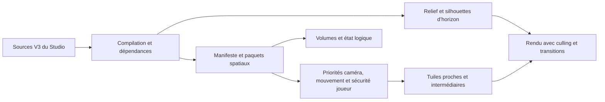

# Audit et plan de préparation — Studio et île de 3 × 8 km

**Date : 13 novembre 2026. Référence de code : `a7a6f88`.**
**Nature du livrable : audit, inventaire et plan de travail. Aucune fonctionnalité, valeur de rendu ou configuration du jeu n’est modifiée par cet audit.**

## 1. État de main et objectif retenu

Les modifications de `feat/studio-v3`, de `feat/living-world-editor` et de la branche locale `work` sont déjà contenues dans `main`. Au début de l’audit, `main` et `feat/studio-v3` pointent sur `a7a6f88` ; la branche historique `feat/living-world-editor` n’a aucun commit absent de main. Aucun faux merge ni écrasement de branche n’est nécessaire.

La demande actuelle fixe une **nouvelle scène cible : une île dans une emprise de projet de 3 000 × 8 000 m, soit 24 km²**, avec volcan, plusieurs petites rivières, forêt, village, agriculture et mine. La taille géographique, la densité de contenu et le budget de ressources sont trois paramètres distincts. La marge maritime et la hauteur du volcan restent des paramètres de conception à fixer ; une éruption active n’est pas demandée.

Cette cible agrandit le scénario d’environ **1 km²** du [cadrage B1](26-BETA-B1-OBJECTIFS.md). Conserver cette petite scène comme **référence de régression et tranche fonctionnelle**, puis qualifier aussi l’île entière. Le document 26 reste la référence des fonctions B1 ; sa cible géographique est actualisée par la présente demande, avec priorité Studio/rendu. La limite de format de 10 km par axe n’est pas une preuve de performances.

**Résultat attendu :** créer et modifier l’île rapidement depuis le Studio ; parcourir et regarder le paysage sans secteurs manquants, côtes interrompues ou montagnes qui disparaissent ; garder la simulation, l’eau, les collisions et les sauvegardes correctes lorsque le détail graphique diminue.

## 2. Diagnostic vérifié dans le code

| Point observé | État réel et conséquence | Sources |
| --- | --- | --- |
| Secteurs « 30/50 » | Aucun plafond explicite de 30 ou 50 secteurs trouvé. Le nombre varie avec rayon, position, taille de secteur et chargements en attente. Le compteur `active` n’est pas le nombre de secteurs réellement dessinés à l’écran. | [chunks](../src/chunks.ts), [terrain-view](../src/terrain-view.ts), [HUD](../src/main.ts) |
| Intérêt spatial | `planChunks(config,x,z)` ne reçoit ni caméra, ni orientation, ni vitesse. Tri par distance au point ; dans le jeu, ce point est **le joueur**, via `world.update(delta,player.position)`. | [planChunks](../src/chunks.ts), [world.update](../src/world.ts), [boucle du jeu](../src/main.ts) |
| Rotation seule | Replanification déclenchée par déplacement supérieur à `chunkSize/8`, pas par rotation de caméra. Le frustum Three.js évite déjà de dessiner certains meshes hors écran, mais ne réoriente pas leur génération/résidence. | [TerrainView.update](../src/terrain-view.ts) |
| Portée | `viewDistance=240 m` par défaut ; le contrat V2 le borne à 96–400 m. La caméra de jeu a `near=0.1` et `far=750 m`. Aucun horizon géographique indépendant ne complète les secteurs proches. | [WorldConfig](../src/world-data.ts), [caméra](../src/main.ts), [terrain-view](../src/terrain-view.ts) |
| LOD et continuité | Trois LOD selon distance ; pas d’erreur projetée en pixels. Jupes vers le bas et hystérésis présentes. Un ancien LOD peut rester pendant un changement de détail ; les nouveaux secteurs n’ont pas de représentation de secours garantie. | [chunks](../src/chunks.ts), [terrain-view](../src/terrain-view.ts) |
| Génération et cache | Au plus deux géométries créées par mise à jour, sans quota de millisecondes ; cache limité en **nombre** de géométries, pas en octets. Un gros secteur peut donc produire une longue image malgré cette limite. | [terrain-view](../src/terrain-view.ts) |
| V3 → jeu | Les sources V3 acceptent jusqu’à 10 km par axe. Le test Studio refuse plus de 2 km par axe, puis convertit vers la représentation V2. Le jeu charge un monde JSON complet, pas le manifeste V3 avec streaming des secteurs compilés. | [schema V3](../src/studio-core/schema.ts), [preview](../src/studio/shell.ts), [adaptateur](../src/studio-core/migration.ts), [main](../src/main.ts) |
| Compilateur | Manifestes, hashes, descripteurs de secteurs et fonctions de lecture existent. Les capacités déclarent honnêtement `bakedMeshes:false` et `bakedLOD:false`. Ces fonctions de lecture ne constituent pas encore le lecteur du jeu. Les paquets source sont épars : absence de paquet auteur ne doit pas signifier absence de terrain. | [compile](../src/world-compiler/compile.ts), [load](../src/world-compiler/load.ts), [manifests](../src/world-compiler/manifests.ts) |
| Géographie | Relief trigonométrique de vallée, rivière de démonstration, littoral déterminé notamment par Z. Le relief de base ne dépend pas de la graine ; celle-ci sert à d’autres générations. Pas de source d’île/volcan ni de côte fermée autour d’une île. | [terrain](../src/terrain.ts) |
| Décor de démonstration | Forêt principale limitée à l’ancienne vallée : environ `360*density` arbres et six groupes longitudinaux ; village, moulin, chemin et bateau sont également construits par du code de démonstration. Pas de génération forestière complète des 24 km². | [createForest/createVillage](../src/world.ts), [biomes](../src/biomes.ts) |
| Objets | Les placements sont instanciés au démarrage ; leur visibilité est ensuite coupée par distance. Cacher un objet ne décharge pas ses ressources et ne produit pas une silhouette lointaine. | [main](../src/main.ts), [world.update](../src/world.ts) |
| Transformations | La source sait décrire XYZ/quaternion/échelles XYZ et parents. L’adaptateur de représentation réduit les props à X/Z, rotation Y et échelle uniforme ; le viewport local réapplique davantage d’informations. Risque d’écart Studio/jeu. | [types](../src/studio-core/types.ts), [toRuntimeWorld](../src/studio-core/migration.ts), [local-view](../src/studio/local-view.ts) |
| Studio global | Carte 2D, objets, retouches et recherche existent. L’accueil propose 200 × 600 ou 1 000 × 1 000, pas 3 000 × 8 000. La carte globale principale n’est pas un aperçu topographique complet ; le module Eau a son propre aperçu de relief. | [shell](../src/studio/shell.ts), [map-view](../src/studio/map-view.ts), [water-view](../src/studio/water-view.ts) |
| Relief auteur | Pinceaux locaux présents, mais le mode `smooth` de la fonction de hauteur suit actuellement le même chemin d’interpolation vers une hauteur cible que l’aplanissement. Pas de vrai lissage spatial ni d’outil macro île/cratère. Limites d’altitude et rayons encore hérités du prototype. | [terrain](../src/terrain.ts), [validateTerrainEdit](../src/studio-core/schema.ts) |
| Eau | Profils terrain/manuels, lit, sections communes 3D/volume, diagnostics, historique et dépendances amont sont présents. Lacs polygonaux, graphe de jonctions/exutoires, cascades, courants et WaterLOD restent à construire. | [29 — Eau](29-WATER-PROFILES.md), [water](../src/water/profile.ts) |
| Mine et agriculture | Requêtes de collision par étage et historique climatique sont des fondations réelles. Pas de mine excavable, moteur agricole ou éditeurs correspondants dans le code audité. | [physics](../src/physics/collision-world.ts), [climat](../src/environment/climate.ts), [modules Studio](../src/studio/shell.ts) |

**Conclusion technique :** augmenter une dimension, le nombre de secteurs ou `camera.far` ne lève pas ces blocages. Le raccord du lecteur V3, la géographie source et la représentation lointaine sont nécessaires ensemble.

## 3. Afficher proprement l’île : architecture à compléter

« Voir la carte complète » signifie garder une représentation des reliefs, côtes, forêts et grands repères **dans le champ de vision et selon l’occlusion naturelle**. Cela ne demande pas de dessiner le dos du volcan à travers celui-ci, ni de charger tous les arbres et tous les colliders de l’île.

| Couche | Représentation nécessaire | Politique |
| --- | --- | --- |
| Horizon géographique | Relief très simplifié de toute l’emprise, côtes, volcan, océan et repères majeurs | Disponible indépendamment des secteurs détaillés ; dessiner la portion visible ; coût borné |
| Paysage intermédiaire | Tuiles simplifiées, masses de forêt, silhouettes des bâtiments et champs, eau simplifiée | LOD par taille/erreur projetée ; chargement et remplacement progressifs |
| Proche visible | Terrain détaillé, objets utiles, végétation et eau locales | Priorité au frustum élargi et à l’importance ; mise en cache bornée |
| Sécurité autour du joueur | Sol, collisions, eau, éléments interactifs immédiatement nécessaires | Petit voisinage **360°**, indépendant de la direction regardée et des LOD visuels |
| État logique | Missions, inventaire, PNJ dormants, mine, parcelles et horloge | Persistance et événements indépendants de la présence de meshes |

### Priorité à la caméra, sans provoquer de trous à la rotation

- Séparer la position du joueur, la caméra réelle et la direction/vitesse du déplacement.
- Classer les demandes selon frustum élargi, importance/erreur à l’écran, distance, altitude et destination prédite. Réévaluer sur rotation significative, téléportation et modification du relief.
- Précharger devant le regard **et** le mouvement ; garder une marge latérale et un petit cache arrière pour un demi-tour rapide.
- Dessiner seulement ce qui est visible ; conserver les données de sécurité proches et l’horizon de secours même derrière la caméra.
- Préparer le remplacement avant de retirer l’ancien terrain. En retard de génération/téléchargement, conserver le proxy ou le dernier LOD valide.
- Utiliser d’abord les volumes englobants et le culling hiérarchique. L’occlusion GPU, les workers ou un changement de moteur nécessitent une mesure justifiant leur coût.
- Traiter la profondeur d’affichage : l’emprise a une diagonale d’environ **8,54 km**. Étudier le rendu d’horizon et sa profondeur séparément ; ne pas simplement passer la caméra proche à un `far` énorme ou activer un buffer logarithmique global.

Références déjà validées : [17 — HZ](17-DISTANT-VIEW-RENDERING.md), [22 — PERF](22-RESOURCE-BUDGET-MANAGER.md). Aucun brouillard utilisé pour masquer les limites de rendu.

### Faut-il agrandir les secteurs ?

**Oui, c’est une variante à comparer ; pas une solution suffisante ni une valeur à figer aujourd’hui.** Distinguer secteur source/logique, tuile de rendu, cellule de végétation et proxy lointain. Ils n’ont pas besoin d’avoir la même taille.

Calculs effectués avec le planificateur pur existant, monde 3 000 × 8 000, point central, rayon 240 m :

| Côté du secteur | Grille couvrant l’emprise | Secteurs planifiés au centre | Triangles de surface d’un secteur LOD0 complet avec le maillage actuel |
| ---: | ---: | ---: | ---: |
| 64 m | 5 875 | 61 | 2 048 |
| 128 m | 1 512 | 20 | 8 192 |
| 256 m | 384 | 7 | 32 768 |
| 512 m | 96 | 4 | 131 072 |

Ces nombres ne sont **ni des secteurs tous chargés, ni un benchmark GPU**. Les triangles excluent les jupes et les secteurs partiels. Le prototype 200 × 600 m possède seulement 40 cases théoriques à 64 m, ce qui contribue aussi à expliquer les compteurs observés.

Doubler le côté multiplie par quatre le coût géométrique d’un secteur à résolution identique : moins de draw calls, mais génération/upload plus gros, culling moins précis, davantage de terrain inutile hors écran et invalidation plus large. Le contrat V2 borne actuellement `chunkSize` à 128 m ; les variantes supérieures demandent d’abord le raccord V3.

**Comparaison proposée :** 64/128 m pour le détail proche, agrégation/tuiles plus grandes ou hiérarchie pour le paysage intermédiaire et l’horizon. Comparer aussi 256 m lorsque le lecteur V3 est prêt. Les 512 m sont surtout une hypothèse de représentation grossière à évaluer, pas une recommandation de détail proche. Choisir après mesures à densité, caméra, résolution et itinéraire identiques. Repartitionner les secteurs d’un projet existant exige une migration des propriétaires/références ; ne pas changer la taille sous des IDs existants sans conversion.

## 4. Inventaire des objectifs B1 : ce qui n’est pas terminé

Légende : **partiel** = fondation ou parcours présent, objectif complet non démontré ; **absent** = fonctionnalité métier non implémentée ; **qualification** = couverture automatique présente, validation humaine/matérielle à faire.

| Objectif | État constaté | À terminer ou renforcer |
| --- | --- | --- |
| B1-01 Monde continu | Partiel ; nouvelle cible 24 km² bloquée | Lecteur V3, génération île, horizon, streaming et scénario d’île complet |
| B1-02 Déplacements/caméra | Base implémentée et testée | Traversées longues, terrain/objets complexes, eau et bateau, collisions/intérieurs ; qualification 20/30 FPS |
| B1-03 Jour/nuit/météo | Horloge, climat périodique et rendu simple présents | Cohérence des régions utiles à l’île, aperçu Studio, intégration agriculture/routines et qualification visuelle |
| B1-04 Biomes/eau/navigation | Partiel | Forêt réellement sectorisée, exclusions, côtes d’île, bassins/raccords et parcours bateau ; LOD visuel sans effet sur volumes |
| B1-05 PNJ animaux | Création, rig, mouvements simples et dialogues présents | Navigation fiable dans village/secteurs, routines simples, état pertinent sauvegardé ; 3–5 habitants de référence |
| B1-06 Inventaire/collecte | Base fonctionnelle testée | Catalogue auteur exploitable, ressources mine/cultures, erreurs de capacité et atomicité des nouvelles actions |
| B1-07 Mission/énigme | Scénario de référence fonctionnel | Auteur de conditions/séquences plus complet, raccord des effets/déclencheurs utiles, scénario de l’île sauvegardable |
| B1-08 Sauvegardes | Slots, inventaire, flags, progression et position présents | Mine, agriculture, espace/étage, état du bateau/PNJ pertinent, migrations et reprise après changement de monde |
| B1-09 Mine | Absente, primitives de collision disponibles | Source/editor, 2–3 niveaux, excavation/récolte atomique, connexions, rendu local et persistance |
| B1-10 Agriculture | Absente, horloge/climat disponibles | 1–3 parcelles, trois cultures, semer/arroser/croître/récolter, calcul différé, sauvegarde et affichage |
| B1-11 Audio | Palette cinq timbres, MIDI, WAV, mixeur, moteur et Studio présents | Écoute réelle/Firefox, profils de zones et raccord au budget transversal ; aucun besoin de réécrire le moteur |
| B1-12 Studio utile | Modules existants, couverture partielle | Grande carte, outils macro, bâtiments/prefabs/assets, chemins, mine/parcelles, diagnostics et ergonomie de production |
| B1-13 Formats/migration | Source V3/migration et compilateur de descripteurs présents | Lecteur V3 bout en bout, contrats source/compilé/partie des nouveaux systèmes et migrations sans perte |
| B1-14 Archives/historique/test | Base réelle, avec limites | Ressources GLB personnalisées portables, gros projets sans copie monolithique/sessionStorage, contexte complet et récupération guidée |
| B1-15 Qualification | Suites automatisées et contrôle public présents | Benchmarks île/GPU intégré/Firefox, sessions longues, ressources, parcours humain et critères de sortie tracés |

**Référence de tests existante :** 147 tests unitaires/intégration et 19 contrôles spécifiques à l’eau, en plus des parcours navigateur préexistants ; [validation de `a7a6f88`](https://github.com/glloq/little-world/actions/runs/43408023690) et [publication contrôlée](https://github.com/glloq/little-world/actions/runs/43408381251). Cet audit ne réexécute pas ces suites et ne les transforme pas en qualification d’une île de 24 km².

## 5. Backlog technique priorisé et critères de fin

**P0** : bloque la création/le rendu fiable de l’île. **P1** : nécessaire à une bêta fonctionnelle et simple à produire. **P2** : renforcement après la première bêta solide, sauf besoin explicite du scénario. Ces priorités de backlog ne sont pas les classes de jobs du scheduler.

### A. Lecteur, visibilité et ressources

| ID | Priorité | Travail restant | Critère vérifiable |
| --- | --- | --- | --- |
| R-01 | P0 | Instrumentation : p50/p95/p99, longues images, génération, IO/upload, GPU si disponible, mémoire estimée, LOD/visible/résident/file | Une même route produit un rapport comparable ; absence GPU explicitée, durée JS non présentée comme GPU |
| R-02 | P0 | Raccorder manifestes/secteurs compilés au jeu et au test Studio ; générer le terrain de base des secteurs sans override auteur ; sortir de la conversion V2/JSON intégral pour les grands mondes | Une carte 3 × 8 km s’ouvre, se parcourt et se sauvegarde sans augmenter simplement les plafonds V2 |
| R-03 | P0 | Horizon géométrique léger, côtes, volcan et repères ; fallback avant chargement du détail | Depuis mer, crête et planage, silhouettes stables et aucun trou lorsque le détail manque |
| R-04 | P0 | Priorités caméra/mouvement/altitude, frustum élargi, réévaluation sur rotation, marge proche 360° | Rotation brusque et marche à reculons sans vide ; moins de travaux détaillés inutiles derrière la vue |
| R-05 | P0 | Hiérarchie de tuiles/LOD, erreur écran, bornes de hauteur, raccords/morphing si nécessaire et hystérésis | Frontières sans trous/flashs ; sculpture et changements de LOD conservent relief et niveau logique |
| R-06 | P0 | Scheduler par temps et quantité, IO/upload bornés, priorités, annulation par révision, maintien du fallback | Téléportation/planage n’affichent pas de résultats périmés ; gros secteur n’impose pas un travail monolithique bloquant |
| R-07 | P0 | Budgets CPU/RAM/GPU estimée, cache en octets, ownership/refcount des assets partagés, éviction et restauration WebGL | Traversées/retours stabilisent les caches ; aucun objet actif détruit et aucune croissance mémoire inexpliquée |
| R-08 | P0 | Faire évoluer `PresentationBudget` en arbitre commun mesuré ; terrain, eau, végétation, météo, PNJ et audio consommateurs | Un seul contrôleur ; dégrader détails/effets/résolution sans effacer l’horizon ni modifier la simulation |
| R-09 | P1 | Proxies de forêts, village, bâtiments remarquables et parcelles ; instancing par groupe spatial | Les ensembles restent reconnaissables au loin sans tous leurs meshes détaillés ; coût et overdraw comparés |
| R-10 | P0 | Océan/côtes adaptés à une île et représentation d’eau lointaine à faible coût | Vue 360° autour de l’île ; pas de mer au-dessus des terres ni de coupure au bord des secteurs proches |

Ancrages : [terrain-view](../src/terrain-view.ts), [chunks](../src/chunks.ts), [world](../src/world.ts), [load](../src/world-compiler/load.ts), [FrameClock/PresentationBudget](../src/frame-clock.ts), spécifications [17](17-DISTANT-VIEW-RENDERING.md) et [22](22-RESOURCE-BUDGET-MANAGER.md).

### B. Studio et production rapide du monde

| ID | Priorité | Travail restant | Critère vérifiable |
| --- | --- | --- | --- |
| S-01 | P0 | Création rectangulaire 3 × 8 km, dimensions/graine/niveau marin, origine et paramètres source explicites | Créer l’île depuis un formulaire, sauvegarder/réouvrir les mêmes données sans JSON manuel |
| S-02 | P0 | Générateur/preset d’île : masque terre/mer, côtes, plateaux, pentes, volcan/cratère ; seed/version et régénération locale préservant overrides | Même source = même géographie ; changer une option n’efface pas village, eau ou interactions |
| S-03 | P0 | Outils macro et couches de terrain/heightfields tuilés ; vrai lissage, nivellement, pentes et aperçu ; harmoniser les bornes d’altitude | Former île/volcan sans milliers de petites retouches ; relief identique dans carte, horizon, collision et jeu |
| S-04 | P0 | Carte globale topographique complète à résolutions multiples, couches, coordonnées, régions/repères et navigation directe | Se repérer sur 8 km et rejoindre une zone sans ouvrir toutes ses géométries détaillées |
| S-05 | P1 | Vue 3D locale mieux navigable, cadrage/vol libre contrôlé, caméra/orientation/zoom conservés, vue panoramique de contrôle | Aller global → local → test → retour conserve le contexte ; voir les limites/LOD sans modifier les sources |
| S-06 | P0 | Respect des transformations complètes et parents entre Studio, compilation, jeu et collisions | Bâtiment tourné/incliné, altitude et échelles non uniformes ne changent pas de forme ou de place au test |
| S-07 | P1 | Bibliothèque de prefabs/variantes éditable, duplication, multisélection/groupes, alignement au sol et points d’ancrage | Assembler/repositionner une petite place de village en quelques opérations réversibles |
| S-08 | P1 | Chemins/sentiers, ponts et quais : tracé, largeur/pente, raccord eau/sol, exclusions et navigation | Relier village, ferme, mine et port sans chemin enterré ni végétation sur les accès |
| S-09 | P1 | Import catalogue GLB minimal sécurisé : licence, taille, unités/pivot, matériaux/colliders, coût et proxy ; dépendances réellement portables | Un asset importé/exporté est retrouvé sur un autre navigateur ; les ressources manquantes bloquent proprement le préflight |
| S-10 | P1 | Diagnostics continus et navigables, préflight strict et erreurs métier ; pas de formulaire JSON nécessaire pour les opérations fréquentes | Un raccord d’eau, une référence ou un accès invalide conduit à sa zone et ne publie pas silencieusement une erreur |
| S-11 | P1 | Stockage/historique grand projet : cache source évictable, sauvegardes différentielles, conflits multi-onglets, copie/récupération et quotas | Parcourir beaucoup de zones n’hydrate pas le monde pour toujours ; fermeture/conflit/import ne perdent pas le brouillon |
| S-12 | P0 | « Jouer ici » et aperçu panoramique utilisent le même lecteur compilé que le jeu ; éviter l’archive complète en sessionStorage | Tester une sélection sur l’île entière, revenir au même contexte et garder les vrais slots séparés |
| S-13 | P1 | Compilation incrémentale exploitable : dépendances terrain/eau/biomes/navigation/proxies, jobs annulables, rapport et publication de carte explicite | Une retouche locale ne reconstruit pas l’île entière ; le site charge bien le build du monde choisi |

Ancrages : [shell](../src/studio/shell.ts), [local](../src/studio/local-view.ts), [map](../src/studio/map-view.ts), [session](../src/studio/session.ts), [source](../src/studio-core/source.ts), [store](../src/studio-core/project-store.ts), [archive](../src/studio-core/archive.ts), [migration](../src/studio-core/migration.ts). La limite actuelle d’historique (4 Mio/150 transactions par défaut) doit être évaluée pour les gestes macro ; la porter arbitrairement plus haut n’est pas un plan mémoire.

### C. Eau, forêt, biotopes et village

| ID | Priorité | Travail restant | Critère vérifiable |
| --- | --- | --- | --- |
| N-01 | P1 | Forêt générée par régions/secteurs et biotopes réels, espèces/densités/exclusions ; supprimer les dépendances à la vallée dans le nouveau preset | Peindre une forêt dans n’importe quelle zone de l’île produit le même résultat après éviction/rechargement |
| N-02 | P1 | Régénération locale cohérente : arbres/sol/faune, rives, chemins, maisons et parcelles ; silhouettes de massifs | Une rivière ou une ferme modifiée ne laisse pas de végétation incohérente ; la forêt lointaine ne s’évanouit pas |
| N-03 | P1 | Réseau d’eau : jonctions/exutoires, lacs polygonaux horizontaux et raccords à la mer ; corrections de profils et diagnostics | Plusieurs ruisseaux se réunissent puis atteignent bassin/mer sans conflit d’altitude, doublon ni scintillement |
| N-04 | P1 | Volumes indexés, navigation bateau/profondeur/courants nécessaires ; caméra immergée avec hystérésis ; chutes explicites si utilisées | Même nage/bateau à tous LOD, aucun bateau traité comme navigant sur une chute verticale |
| N-05 | P2 | Herbes shader/vent/réaction et enrichissement de faune selon doc 18 ; détails de cascades/écume selon doc 21 | Mesure de coût favorable ; réduction des détails ne retire ni gameplay ni silhouette |
| V-01 | P1 | Kit de village : maisons modulaires, portes, intérieurs simples, pont/quai, colliders et repères auteur | Le village et ses accès sont construits et déplaçables depuis les données, pas ajoutés dans `createVillage` |
| V-02 | P1 | Navigation PNJ inter-secteurs + obstacles/portails, zones/patrouilles dessinées et routines à horloge commune | 3–5 animaux se déplacent autour des bâtiments sans traverser les murs ni oublier leur état à un rechargement |
| V-03 | P1 | Conditions/actions et dialogues : compléter formulaires, déclencheurs de zones, raccord animations/déplacements/effets utiles | Un type accepté par le schéma a un résultat réel et testable ; aucun simple message « non pris en charge » pour le scénario |
| V-04 | P1 | Mission/énigme de l’île, ressources, progression facultative, reprise/idempotence et diagnostic auteur | Boucle complète découverte → action → sauvegarde → reprise, sans rétribution dupliquée |

Les modèles déclaratifs et le moteur d’actions existants sont à compléter, pas à remplacer. `game-view.ts` traite aujourd’hui réellement certaines présentations, mais plusieurs effets (`playAnimation`, `playEffect`, `moveNPCTo`) restent signalés comme non pris en charge. Les déclencheurs de zone possèdent un schéma ; leur production effective depuis les volumes de scène doit être raccordée et testée.

### D. Mine, agriculture, sauvegardes et qualification

| ID | Priorité | Travail restant | Critère vérifiable |
| --- | --- | --- | --- |
| M-01 | P1 | Source de mine 2,5D, éditeur plan/coupe, emprise, entrée, 2–3 niveaux, connecteurs et gisements | Placer/configurer une mine depuis Studio sans creuser toute la surface ni superposer les étages |
| M-02 | P1 | Excavation des cellules exposées, faces fusionnées, ressources/inventaire atomiques et état persistant | Creuser et récolter, sauvegarder/revenir : ni roche ni minerai ne réapparaissent à tort |
| M-03 | P1 | Mesh/collision/navigation des chunks et voisins touchés, culling des galeries et chargement local | Mine absente du coût de surface sauf son entrée ; accès/sols/plafonds corrects dans chaque espace/étage |
| A-01 | P1 | Source/éditeur de 1–3 parcelles et trois cultures, zones, sol et irrigation simples, séparation état auteur/partie | Dessiner une parcelle et définir ses cultures sans objets logiques par plant |
| A-02 | P1 | Semer/arroser/croître/récolter via calcul différé, temps/climat communs et opérations atomiques | Même intervalle de temps/climat = même résultat ; reprise et inventaire cohérents, aucune boucle par plante |
| A-03 | P1 | Rendu cultures proches instanciées, groupes intermédiaires, couleurs de champs lointains, interface de gestion | Champs visibles depuis le volcan sans simuler chaque plant ; LOD indépendant du rôle de consultation |
| P-01 | P1 | Étendre GameSave aux nouveaux systèmes et espaces/étages ; bateau/PNJ utiles ; migrations et versions de monde | Recharger restaure tout le parcours B1, avec incompatibilités diagnostiquées et aucun reset silencieux |
| P-02 | P1 | Recovery/import/export de partie, source et dépendances ; quotas navigateur et dossiers de gros projets | Projet source, artefacts compilés et sauvegardes restent séparés ; quota/erreur n’écrase pas l’existant |
| Q-01 | P0 | Scènes/trajectoires de benchmark répétables et machine réelle de référence | Rapports Firefox/Chromium, résolution commune, p95/p99, ressources et traces de qualité ; SwiftShader non présenté comme GPU intégré |
| Q-02 | P1 | Session longue, context lost/restored, réseau lent/cache froid, rotation/téléportation, sauvegarde et aller-retour Studio | Pas de fuite non bornée, trou persistant, crash ni état perdu sur les parcours définis |
| Q-03 | P1 | Scénario B1 complet sur une zone, puis sur l’île ; contrôle public des ressources et version déployée | Tous les objectifs B1 obligatoires ont une preuve ou un blocage nommé avant d’annoncer une bêta prête |
| Q-04 | P1 | Licence du code à figer, inventaire de licences et redistribution des nouveaux assets | Ressources de l’île publiables et archive portable accompagnée de provenance |

Ancrages : [24 — Mines](24-MINES-MULTILEVEL-LOW-RESOURCE.md), [25 — Agriculture](25-AGRICULTURE-PARCELS-LOW-RESOURCE.md), [GameSave](../src/gameplay/save.ts), [CollisionWorld](../src/physics/collision-world.ts), [26 — B1](26-BETA-B1-OBJECTIFS.md). Les primitives de collisions sur trois étages et le climat périodique ne valent pas livraison de la mine ou des cultures.

### E. Autres domaines du dépôt à ne pas oublier

| Domaine | Déjà utile | Renforcement nécessaire et place dans la bêta |
| --- | --- | --- |
| Horloge/météo | Temps commun, météo périodique, lumière/fond jour-nuit, pluie GPU locale | P1 : cohérence climat/routines/agriculture, lecture des régions, aperçu et budget. Politique d’absence à fixer : temps figé hors application est une proposition du cadrage, pas une décision nouvelle de cet audit. |
| Étoiles/lunes/neige/ombres | Spécifications détaillées ; pas de rendu complet correspondant | P2 selon cadrage B1 : ciel étoilé/lunes indépendantes, neige accumulée, orages et ombre solaire locale sous budget ; ne pas en faire un préalable au lecteur de carte. |
| Audio | MIDI/5 timbres, WAV courts, mixeur, index/voix/PCM bornés et Studio | P1 : écoute/Firefox, ambiances des lieux/biomes et adaptation au manager commun. Ogg/Opus, outils musicaux avancés et HRTF restent P2, sans nouvelle banque massive. |
| Personnages/animations | Rig rigide original, personnalisation et clips de base | P1 : transitions, collisions/routines et effets du scénario. P2 : nouvelles familles de rigs, skinning pondéré et outils d’animation/import plus larges si réellement nécessaires. |
| Blender/presets | Catalogue d’assets et ressources originaux, archive JSON et ressources audio incluses | P1 : import GLB/presets minimal et autonomie des ressources utilisées. P2 : round-trip complet sélection/scène + sidecar, diff de réimport, packs et heightfields importés avancés. |
| Agriculture et mines étendues | Contrats riches des docs 24/25 | P2 : agronomie détaillée (rotation, fertilité, parasites/maladies, qualité), grandes exploitations et mines plus vastes. Le minimum P1 demeure la mine 2–3 niveaux et les trois cultures avec sauvegardes fiables. |
| Gameplay complémentaire | Inventaire/missions/actions et templates de fondation | Compléter ce que le scénario utilise ; pêche légère à qualifier si retenue. Pas de combat/survie punitive ou économie complexe ajoutés par cet audit. |
| Réseau/futur | Contrats de compatibilité documentés | Multijoueur/comptes/serveur, mobile/manette, foules 200/500 : hors gate de cette bêta solo. Leur présence dans les docs n’exige pas de les coder maintenant. |

Les priorités futures détaillées restent dans les documents [18 à 25](07-ROADMAP.md). Cette table garde leur visibilité sans transformer toutes les options finales du projet en dépendances bloquantes de la première bêta.

## 6. Plan de production de l’île dans le Studio

L’objectif « facilement et rapidement » requiert **des générateurs et presets réutilisables**, pas un ajout de décors en dur ni des milliers de clics.

| Élément de l’île | Action auteur à rendre simple | Dérivés attendus |
| --- | --- | --- |
| Île et côtes | Choisir dimensions, graine et preset ; ajuster masque/pentes/plages avec aperçu avant application | Terrain tuilé, limites terre/eau, collisions, miniatures et horizon |
| Volcan | Placer un preset paramétrique de relief/cratère et régler hauteur/rayon/pentes | Même relief dans jeu/collision/horizon ; repère visible au loin ; pas de simulation d’éruption obligatoire |
| Petites rivières | Placer sources/points/exutoires, lire le profil, choisir les jonctions et un bassin si utile | Lit/berges, sections/volumes, eau et silhouettes dérivés |
| Forêt | Peindre une région, choisir espèces/densité et exclusions | Instances proches, masses lointaines et distribution déterministe par secteur |
| Village et port | Poser/dupliquer des prefabs, aligner, tracer sentiers/pont/quai | Colliders, accès, repères, proxies et interactions liés à des IDs stables |
| Agriculture | Dessiner parcelles/sous-zones et choisir trois profils de cultures | Sources de culture, emprises/exclusions, rendu multi-distance ; états de partie séparés |
| Mine | Définir entrée, plan/étages/liaisons et gisements depuis un preset | Source 2,5D, volumes, maillages/collisions locaux et états de partie séparés |
| Habitants/activités | Placer des animaux et zones/routines ; lier dialogues et templates de mission | Logique déclarative, navigation, sons et progression persistante |
| Qualification/publication | Choisir points de vue/routes, lancer préflight/benchmark puis compiler/publier | Artefacts identifiables, rapport de ressources et scénario jouable reproductible |

**Parcours auteur cible :** nouveau projet → aperçu macro de l’île → ajuster volcan/côtes → rivières → régions de forêt → village/accès → ferme/mine/PNJ → vérifier panoramas et erreurs → jouer sur copie → exporter/réimporter → compiler/publier. Toutes les opérations restent réversibles et la génération respecte les retouches manuelles.

La position précise des lieux, leur densité et l’itinéraire ne sont pas figés ici. Prévoir au minimum des points de vue de contrôle : mer vers volcan, cratère/crête vers côtes, forêt vers village, village vers parcelles, entrée de mine vers extérieur. Une implantation qui facilite ces comparaisons accélérera les tests.

## 7. Ordre de réalisation proposé

| Lot | Travail principal et dépendances | Condition de sortie |
| --- | --- | --- |
| L0 — Baseline et contrats | Scène actuelle conservée, paramètres de l’île, rapport initial R-01/Q-01, séparation source/compilé/partie et règles de version | Blocages et protocole mesurables, aucune régression masquée |
| L1 — Grande géographie visible | R-02/R-03, S-01/S-02, base R-10 : lecteur V3, île peu dense, volcan/côtes et horizon | Ouvrir 3 × 8 km, tourner/regarder de loin et se déplacer sans géographie manquante |
| L2 — Streaming et ressources | R-04 à R-08, raccords R-05, comparaison 64/128/256, proxies R-09 | Absence de trous lors de rotations/planage et ressources bornées sur routes identiques |
| L3 — Outils de production | S-03 à S-13 selon dépendances, N-01/N-02 et kit V-01 | Produire rapidement les lieux depuis Studio ; résultat identique dans le jeu et les archives |
| L4 — Tranche de bêta complète | Eau N-03/N-04, PNJ/mission V-02 à V-04, M-01 à M-03, A-01 à A-03, sauvegardes P-01 | Une boucle complète village → eau → mission → mine → culture → sauvegarde/reprise |
| L5 — Île peuplée et cohérence | Répartir les mêmes systèmes sur l’île, ambiances/biomes, invalidations et parcours auteur sans perte | La grande carte n’est pas uniquement un terrain vide ; tous ses grands ensembles restent visibles au bon détail |
| L6 — Qualification | Q-01 à Q-04, UI/ergonomie, sessions longues, Firefox/Chromium et contrôle public | Bêta déclarée testable avec preuves, limites connues et critères bloquants résolus |

Des tâches métier mine/agriculture peuvent ensuite avancer indépendamment une fois leurs contrats prêts ; elles ne doivent pas retarder le premier contrôle d’horizon d’une île peu dense. Inversement, attendre la fin du décor détaillé pour découvrir que le lecteur ne supporte pas 8 km ferait perdre le plus de temps.

**Premier lot de code recommandé après validation de ce plan :** baseline de rendu + chemin V3 minimal + île/volcan basse densité avec horizon continu. Pas de réécriture globale de tous les modules, pas de hausse aveugle des distances et pas d’engagement chiffré de délai sans découpage des lots.

## 8. Critères de qualification à préparer avant le code

| Scénario | Vérification obligatoire |
| --- | --- |
| Projet neuf 3 × 8 km | Création, sauvegarde, réouverture et déterminisme des sources ; absence de troncature à 2 km |
| Vue du volcan et depuis le volcan | Côtes et massifs dans le champ, parallaxe correcte, profondeur stable et absence de fog-cache |
| Rotation rapide sur place | La file est réorientée ; fallback présent jusqu’au détail ; aucun secteur géographique vide |
| Traversée marche/course/planage/bateau | Continuité, anticipation, annulation de travaux périmés, mêmes déplacements à 20/30 FPS |
| Téléportation ou changement de zone | Sol/eau/collisions sûrs, proxies immédiats, compléments progressifs sans résultat d’un ancien monde |
| Frontières et retouches | Changement de LOD, sculpture, rivière et forêt à cheval sur secteurs : pas de fissure, références résiduelles ni invalidation globale injustifiée |
| Village/forêt/parcelles denses | Silhouettes reconnaissables au loin, culling efficace, ressources et fill-rate mesurés |
| Courants/bassins/mer et immersion | Hauteurs/volumes/bateau invariants avec les LOD ; transitions caméra stables et raccords sans doublon |
| Mine | Trois niveaux distincts si ce format est retenu, cellules exposées, coûts locaux, ressources persistantes et non dupliquées |
| Cultures | Actions/croissance différée/reprise déterministes selon temps et climat, récolte atomique |
| Auteur → jeu → archive → auteur | Transformations/IDs/liens/assets/niveaux conservés, historique commun et copie de test isolée |
| Session longue et GPU | Aller-retour sur les lieux, caches stabilisés, perte/restauration de contexte, réseau lent et quota gérés |
| Publication | Manifeste/hash/révision attendus, ressources servies, trois interfaces et monde sélectionné réellement testés |

**Mesurer au minimum :** p50/p95/p99, frames >100 ms selon protocole, CPU par sous-système, GPU asynchrone si disponible, rendu/culling/LOD, jobs en attente/annulés, téléchargements/uploads et estimations RAM/GPU. Choisir un PC 8 Go/GPU intégré de référence et une résolution commune ; **30 FPS normal / 20 secours restent des cibles à qualifier**. Les limites RAM/GPU acceptables et les seuils de stutter doivent être fixés avec la baseline, pas inventés dans cet audit.

## 9. Décisions de cadrage restantes

- Confirmer si 3 × 8 km désigne l’emprise totale du projet avec marge maritime (hypothèse de cet audit) ou la terre ferme seule, ce qui demanderait une emprise source différente.
- Fixer hauteur/silhouette du volcan et enveloppe verticale cohérente pour terrain, profils d’eau, collisions, import et caméra ; plusieurs champs actuels de terrain/eau ont des bornes héritées du prototype.
- Choisir le PC et le protocole de référence ; calibrer tailles de tuiles et budgets après les premiers rapports.
- Définir l’implantation des lieux, les trois cultures, ressources et connexions de mine, règles de temps à l’absence et reprise de sauvegarde. Les propositions du doc 26 ne deviennent pas des décisions par simple recopie.
- Déterminer les enrichissements P2 réellement souhaités pour cette release. Le minimum métier B1 inclut déjà mine et agriculture ; elles ne sont pas facultatives pour déclarer tous ses critères atteints, même si les activités restent facultatives pour le joueur.

L’objectif, la priorité Studio/rendu et le principe de visibilité optimisée sont acquis. Ces détails n’empêchent pas de préparer les lots, et aucun choix technique déjà validé n’est rouvert.
