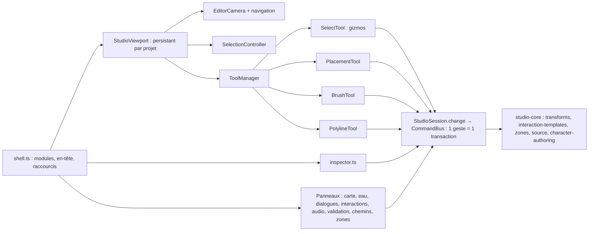

# 32 — Studio : éditeur de monde 3D (E1 → E6)

**Date : 13 novembre 2026. Branche : `claude/bold-tesla-b0pe7k` (à partir de `main` = `758b3b9`).**
Objectif : transformer le Studio V3 en éditeur 3D utilisable pour construire le contenu jouable de l'île, en réutilisant `StudioSession`, `CommandBus`, les contrats V3, les moteurs existants et la copie de test compilée. **Aucun second éditeur, moteur, historique ou système de sélection n'a été créé.**

## 1. Audit initial (état de `758b3b9`)

| Sujet | Constat | Traitement |
| --- | --- | --- |
| Vue 3D locale | `local-view.ts` : une fonction monolithique ; OrbitControls bridé à 130 m ; contenu fixe sur 160 m ; renderer, monde et PNJ **recréés à chaque changement de module** | Remplacée par un viewport persistant découpé en contrôleurs |
| `shell.ts` | Accueil, en-tête, modules, inspecteur, carte, dialogues, validation et copie de test dans un fichier | Inspecteur, bibliothèque, liste d'entités, panneaux monde et viewport extraits |
| Sélection | Une entité, sans multi-sélection (le contexte prévoyait pourtant `selectedIds`) | `toggle`, `setSelection`, `prune` + interface |
| Transformations | Gizmo de translation XZ seul ; le jeu ignorait altitude, rotation complète et échelle par axe | Gizmos complets ; transformation complète transmise jusqu'au jeu compilé |
| Caméra | Contexte = position seule | Pose complète (œil, cible, mode, zoom) persistée |
| Mines / parcelles | Contrats documentés (docs 24/25), aucun schéma codé | Contrat V3 minimal et optionnel des **limites de zones**, sans moteur |

## 2. Architecture

| Module | Responsabilité |
| --- | --- |
| [viewport/editor-viewport.ts](../src/studio/viewport/editor-viewport.ts) | Renderer unique et scène conservés entre outils et panneaux ; contenu des secteurs autour de la cible caméra (320 m) ; terrain détaillé/horizon via le moteur existant (priorité caméra, budgets) ; rafraîchissement local des retouches, chemins, eau et zones ; rendu à la demande ; routage pointeur/clavier vers l'outil actif |
| [viewport/camera-controller.ts](../src/studio/viewport/camera-controller.ts) | `EditorCamera` pure : orbite, vol libre, vue du dessus orthographique, zoom vers le curseur, transitions, contraintes (sol, emprise + marge, plafond), pose persistée |
| [viewport/navigation.ts](../src/studio/viewport/navigation.ts) | Liaisons souris/clavier de la caméra ; ne capture jamais le clic gauche |
| [viewport/selection.ts](../src/studio/viewport/selection.ts) | Picking par **ID V3** (`userData.entityId` sur la racine), contours de sélection/survol sans modifier les matériaux partagés |
| [viewport/tools.ts](../src/studio/viewport/tools.ts) | `Tool` / `ToolManager` : activation/désactivation, aucun écouteur DOM propre aux outils |
| [viewport/select-tool.ts](../src/studio/viewport/select-tool.ts) | Clic / Maj+clic / survol, gizmos déplacement-rotation-échelle multi-objets, aimantation, suivi du relief, duplication, suppression |
| [viewport/placement-tool.ts](../src/studio/viewport/placement-tool.ts), [placement-rules.ts](../src/studio/viewport/placement-rules.ts) | Fantôme coloré (valide/à vérifier/impossible), rotation avant validation, placements successifs, PNJ |
| [viewport/brush-tool.ts](../src/studio/viewport/brush-tool.ts) | Relief (élever, abaisser, aplanir, lisser) et biotopes ; aperçu du trait ; [ ] et - + |
| [viewport/polyline-tool.ts](../src/studio/viewport/polyline-tool.ts) | Points au sol : ajout, déplacement par poignée, retrait, validation (Entrée), diagnostic en direct |
| [inspector.ts](../src/studio/inspector.ts) | Propriétés contextuelles : nom, position, rotation (°), échelle, alignement, duplication, suppression, interaction en un clic, personnage (apparence, routine, trajet) |
| [library.ts](../src/studio/library.ts), [entity-list.ts](../src/studio/entity-list.ts), [world-features.ts](../src/studio/world-features.ts) | Bibliothèque d'assets avec aperçus ; recherche et filtres ; panneaux chemins/rivières et zones |
| [studio-core/transforms.ts](../src/studio-core/transforms.ts), [edit.ts](../src/studio-core/edit.ts) | Transformations, duplication, suppression ; brouillon par secteur → patchs → **une** transaction (extrait de `StudioSession.change`, testable en Node) |
| [studio-core/interaction-templates.ts](../src/studio-core/interaction-templates.ts) | Templates collecte / livraison / porte / levier partagés par le panneau et l'inspecteur |
| [studio-core/zones.ts](../src/studio-core/zones.ts) | Contrat V3 optionnel `libraries.zones` (parcelle agricole, mine + niveaux) : polygone simple fermé, aire, emprise |

## 3. Commandes

| Action | Contrôle |
| --- | --- |
| Sélectionner / ajouter / retirer | Clic gauche / Maj+clic |
| Orienter (orbite ; regard sur place en vol) | Clic droit + glisser (ou Alt + clic gauche) |
| Vol libre | Clic droit maintenu + ZQSD/WASD (positions physiques), E / Q (A en AZERTY) ou PgHaut/PgBas, Maj = ×4 |
| Déplacer la vue | Clic molette + glisser |
| Zoom vers le curseur | Molette |
| Centrer la sélection / vue du dessus | F / 7 (bascule) |
| Gizmo : déplacer / pivoter / échelle | W / E / R (hors vol) |
| Dupliquer / supprimer | Ctrl+D / Suppr |
| Annuler l'opération en cours, sinon la sélection | Échap |
| Pinceaux : rayon / force | [ ] / - + |
| Placement : pivoter | R / Maj+R |
| Tracés : retirer le dernier point / valider | Retour arrière / Entrée |
| Annuler / refaire / sauvegarder | Ctrl+Z / Ctrl+Maj+Z ou Ctrl+Y / Ctrl+S |
| Outils | V sélection · M carte · B objets · T relief |

## 4. Statut par lot

Légende : **IMPLEMENTED** codé et intégré ; **TESTED** couvert par des tests automatisés exécutés ; **BENCHMARKED** mesuré avant/après ; **RELEASED** publié sur GitHub Pages. Rien n'est RELEASED : la branche n'est pas fusionnée.

| Lot | Fonction | IMPLEMENTED | TESTED | BENCHMARKED |
| --- | --- | --- | --- | --- |
| 1 · E1 | Navigation orbite/libre/dessus, zoom curseur, F, 7, Échap, pose persistée, streaming autour de la caméra | Oui | Unitaires (caméra) + navigateur (vol de 370 m à travers plusieurs secteurs, restauration après rechargement et après « Jouer ici ») | Oui (§5) |
| 1 · E2 | Sélection par ID, contours, Maj+clic, Échap, clic vide, recherche, filtres, compteur | Oui | Navigateur | — |
| 1 · E3 | Bibliothèque, fantôme, rotation avant validation, placements successifs, gizmos multi-objets, aimantation, suivi du relief, duplication, suppression avec avertissement ; transformations complètes jusqu'au jeu | Oui | Unitaires (transactions, changement de secteur, ZIP, runtime) + navigateur (gizmo + annuler/refaire, déplacement de 260 m, Ctrl+D, Suppr) | — |
| 2 · E4 | Pinceaux élever/abaisser/aplanir/lisser, biotopes + densité, aperçu du trait, invalidation locale, végétation rafraîchie | Oui | Unitaires (trait, moyenne locale) + navigateur (un trait = une transaction, navigation sans conflit) | — |
| 2 · E5 | PNJ placé en 3D, apparence et routine dans l'inspecteur, trajet tracé dans la scène, dialogue, interaction en un clic | Oui | Unitaires + navigateur (objet collectable utilisé avec E dans la copie de test) | — |
| 3 · E6 | Chemins et rivières (tracé, déplacement de points, diagnostic du profil), zones parcelles/mines | Oui | Unitaires (contrat de zone, références de secteurs, rééchantillonnage) + navigateur (tracés, édition, contour invalide signalé, persistance) | — |

**Suites exécutées** (Chromium/SwiftShader, serveur de développement, et build de production pour `published` et `editor`) : `npm test` 187/187 ; typecheck ; build + vérification statique ; navigateur : editor 37, editor-content 12, editor-world 9, legacy 16, published, studio 17, gameplay 12, environment 6, local 10, characters 6, water 11, audio 12, island 11, storage 20, audio-engine, water-engine. Les nouvelles suites sont ajoutées à la CI.

## 5. Mesures

[Rapport](benchmarks/2026-11-13-studio-viewport.json), outil [benchmark-studio.mjs](../tools/benchmark-studio.mjs) : scénario de référence, même entité, 1440 × 900, SwiftShader (logiciel, **pas une mesure GPU**).

| Mesure | Avant (`758b3b9`) | Après |
| --- | --- | --- |
| Ouverture de la vue 3D | 4,4–4,9 s | 2,0–2,2 s |
| Retour carte → 3D (médiane de 5) | 4,4 s | 0,6 s |
| Contextes WebGL créés après 5 allers-retours | 6 | 1 |
| Tas JS | 28–31 Mio | 20 Mio |
| Appels de rendu à l'ouverture (cadrage différent, indicatif) | 185 | 117 |

Contrôle d'accumulation : 48 changements d'outil et 3 ouvertures de la carte laissent identiques le nombre d'objets de scène (7) et de géométries GPU (90). Les outils sont activés et désactivés par paires.

## 6. Limites connues

- Les secteurs hydratés par la session ne sont jamais évincés (limite S-11 existante) ; l'horizon de l'éditeur reflète les retouches des secteurs chargés seulement.
- Les PNJ sont affichés immobiles dans l'éditeur ; le trajet n'est visible que pendant son édition. Le gizmo ne modifie pas l'orientation d'un PNJ au runtime (le moteur PNJ n'utilise que la position).
- La duplication copie apparence et transformation, pas la logique (interactions, dialogues, états).
- La suppression d'un élément référencé est confirmée puis laisse des références signalées par la validation ; aucun nettoyage automatique.
- Les profils d'eau détaillés (niveaux manuels, décalage) restent dans le panneau Eau 2D ; jonctions et lacs ne sont pas traités.
- Les zones ne sont que des données auteur : pas d'excavation, de cultures ni d'état de partie.
- Les catégories de la bibliothèque dérivent des préfixes d'ID et le catalogue ne compte que 6 assets ; pas d'import GLB.
- La mise en page mobile n'est pas une cible ; le Studio suppose un PC avec souris.
- Pas de qualification sur GPU intégré ni Firefox.

## 7. Prochain lot recommandé

1. **Données et streaming Studio** : éviction des secteurs hydratés, horizon mis à jour depuis les retouches non chargées, affichage permanent des trajets PNJ et des déclencheurs.
2. **Prefabs et kit de village** (S-07, V-01) : variantes éditables, groupes et ancrages, pour construire une place de village en quelques gestes.
3. **Mine et agriculture** : moteurs minimaux branchés sur `libraries.zones` (docs 24/25), avec états de partie séparés.
