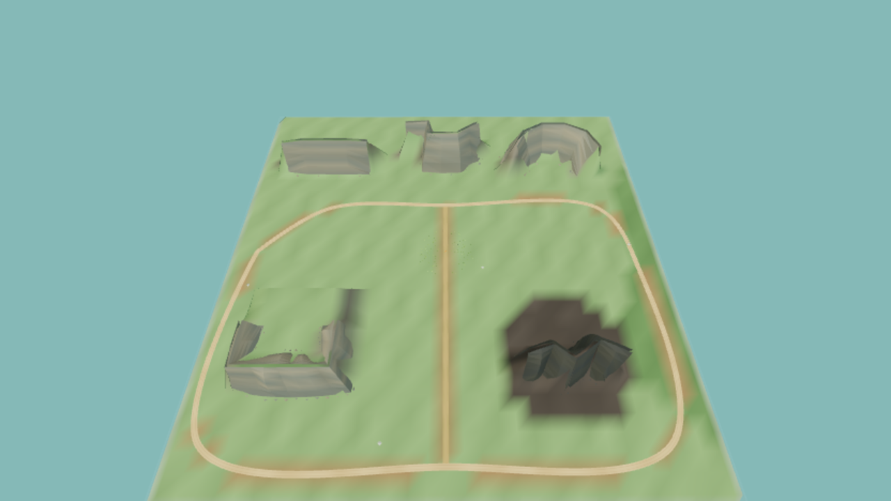
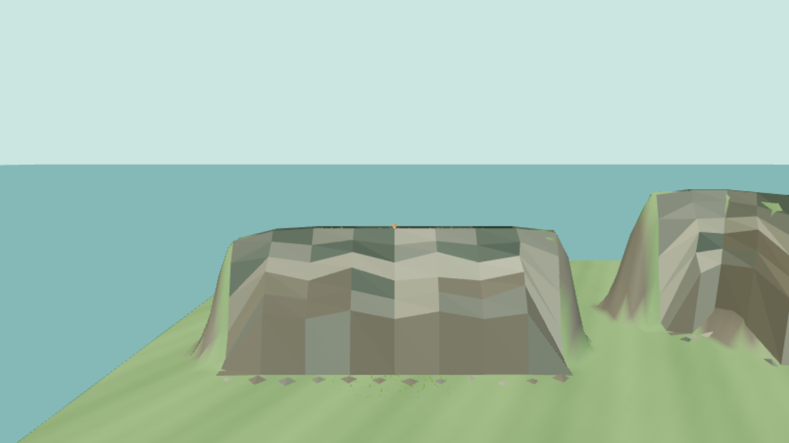
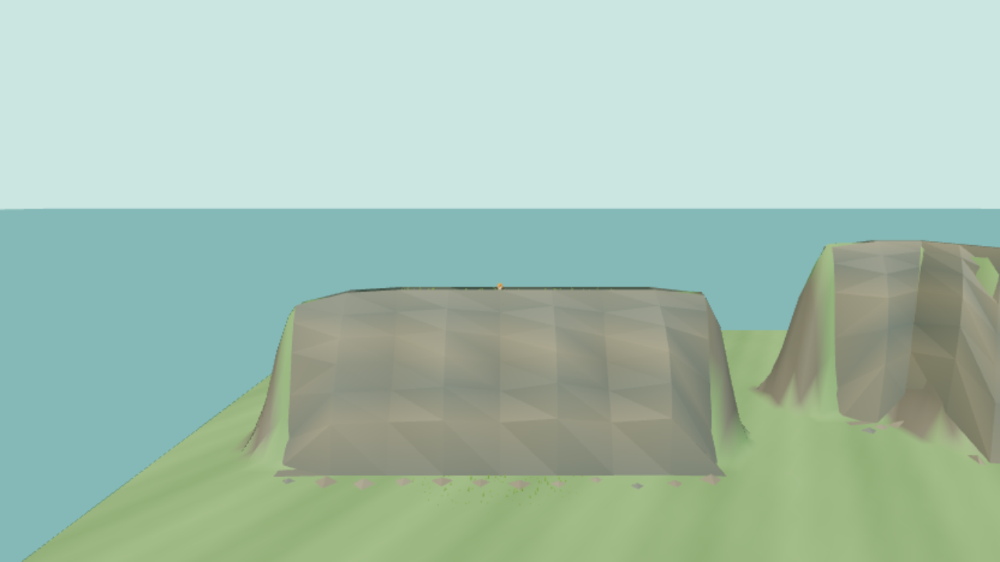
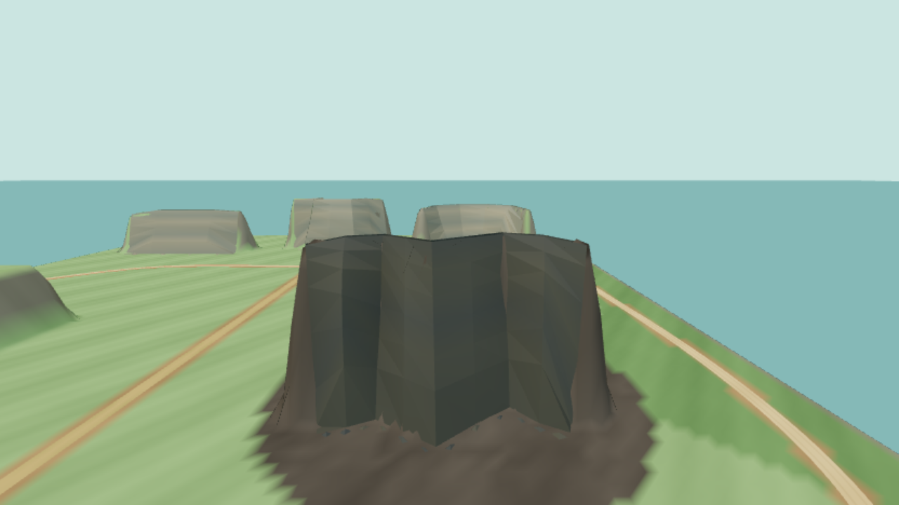

# Laboratoire de falaises low-poly

Scène V3 de **280 × 280 m**, indépendante de l'île jouable. Elle utilise le même
heightfield, le même rendu de faces rocheuses et les mêmes lecteurs/compilateurs que
le Studio et le jeu. Aucun format, shader, texture ou système de collision ajouté.

## Ouvrir et circuler

Depuis l'accueil du Studio : **Scène de référence Falaises**. Le projet est copié dans
le stockage local du navigateur ; ses cinq tracés `rl-cliff-lab-*` restent éditables
avec les outils de relief existants. Comme les autres références, une réouverture
conserve les modifications locales ; utiliser un navigateur vierge pour repartir de
la référence livrée, ou importer `maps/cliff-reference.project.json`.

Dans le jeu, charger la version compilée avec le paramètre :
`?world=maps/cliff-reference/manifest.json&spawn=0,0&metrics=1`.
Le préfixe du site reste `/little-world/`. Le chemin en boucle et sa traversée centrale
relient les cinq zones ; les commandes usuelles du jeu et du Studio s'appliquent.

| Zone | Centre approximatif (X, Z), mètres | Situation |
| --- | --- | --- |
| Droite | −85, −78 | Paroi simple, strates et pied |
| Cassée | −10, −80 | Décrochements, angles droits, raccords |
| Courbe | 77, −91 | Arc polygonal, continuité des normales de tracé |
| Plateau | −79, 80 | Plateau heightfield à 24 m, rebord rocheux en U |
| Volcanique | 63, 74 | Tracé anguleux étroit et haut, palette basaltique sombre |

Le contexte est volontairement sobre : sol herbeux, deux chemins, quatre rochers
originaux du catalogue. La densité automatique est à zéro pour ne pas cacher les
parois ni confondre le coût des éboulis intégrés avec celui de rochers dispersés.
Le secteur unique de 280 m évite les limites internes de tuiles dans ce petit banc.
Ce choix n'est pas une recommandation pour les grandes cartes.

## Sources, export et captures

- Générateur : `tools/generate-cliff-reference.mjs` ; `npm run generate:cliffs`.
- Source rééditable : `maps/cliff-reference.project.json`.
- Copie chargée par le Studio : `public/maps/cliff-reference.project.json`.
- Monde compilé : `public/maps/cliff-reference/manifest.json` et ses paquets.
- Sept points de vue : `tools/cliff-views.json` (général, droite, cassée, courbe,
  plateau, volcanique, lointain). Caméra orbitale existante, `spawn/yaw/pitch/dist`.

Depuis la racine du dépôt, avec Node 22 et `npm ci` :

```sh
npm run dev -- --host 127.0.0.1 --port 5173 --strictPort
# Dans un autre terminal :
npm run test:cliffs
```

Cette vérification ouvre réellement la référence dans le Studio, attend les faces,
exporte puis relit son ZIP, et capture les sept vues du monde compilé. Elle échoue si
une vue ne se stabilise pas, charge une ressource en erreur, perd des tronçons ou
dépasse le budget rocheux ou le plafond de contrôle de la scène complète
(60 000 triangles, 64 draw calls). Les vues rapprochées peuvent naturellement
évincer des tronçons d’autres zones hors rayon ; la vue générale garde les 27. Les PNG et `views-report.json` vont dans
`/tmp/little-world-cliffs` (`ARTIFACTS_DIR` pour changer ce dossier,
`WORLD_URL` pour un autre serveur, notamment `npm run preview`).

`npm run test:cliffs -- --check-report` vérifie uniquement un rapport déjà généré,
sans relancer le Studio ni le rendu.

`npm run capture:cliffs` effectue uniquement les captures, sans le contrôle Studio.
Pour une sélection ou une autre résolution :

```sh
CLEAN_CAPTURE=1 VIEWS=cliffs-curved,cliffs-lod WIDTH=1600 HEIGHT=900 \
  node tools/capture-world-views.mjs http://127.0.0.1:5173/little-world/ \
  /tmp/cliff-detail tools/cliff-views.json
```

Le HUD est masqué uniquement dans la page de capture ; les compteurs sont conservés
dans le rapport. Les images de contrôle livrées sont dans `docs/captures/cliffs/`.

## Budget et continuité

Les cinq falaises totalisent **27 tronçons**, chacun avec **un `BufferGeometry` non
indexé**, un unique matériau Lambert partagé à couleurs de sommets et des normales
plates. Les éboulis sont des triangles du même maillage : pas d'objets ni de draw calls
supplémentaires par pierre. Aucune ombre supplémentaire ni texture.

| Niveau | Stations × bandes par côté | Éclats par côté | Triangles par tronçon |
| --- | --- | --- | --- |
| LOD 0 | 3 × 7 | 3 | 66 |
| LOD 1 | 2 × 7 | 1 | 30 |

Budget rocheux maximal de cette scène : **1 782 triangles, au plus 27 draw calls**
avant culling. Les plafonds généraux restent 32 tronçons et trois constructions par
mise à jour. Le LOD dépend maintenant de la caméra réelle, y compris en vue orbitale.
Les triangles et appels de toute la scène sont distincts de ce budget : ils incluent
terrain, chemins, personnage et contexte. Le rapport contient les deux mesures.
`window.littleWorldMetrics.cliffs` (`?metrics=1`) et le `data-cliffs` du canvas Studio
exposent les tronçons résidents, triangles, LOD 0/1 et constructions en attente.
`visible` désigne ici les maillages résidents, pas les draw calls après frustum culling.

Les anneaux de bord ont sept sommets aux deux LOD pour éviter les fissures aux
jonctions mixtes ; la simplification porte sur les stations intérieures et les éclats.
Les extrémités ouvertes retombent sur le terrain au lieu de laisser un bord flottant.
La palette sombre est dérivée du périmètre des volcans déjà présents dans la source,
sans nouvelle propriété à exporter. Le masque d'horizon a également été corrigé pour
retirer tous les blocs recouverts par une grande tuile, évitant un chevauchement
coplanaire dans ce laboratoire.

## Mesures de la série livrée

Chromium/SwiftShader, 1 280 × 720, compteurs d'une frame après stabilisation :

| Vue | Draw calls scène | Triangles scène | Triangles rocheux résidents |
| --- | ---: | ---: | ---: |
| Générale | 42 | 14 735 | 1 134 |
| Droite | 19 | 43 200 | 1 350 |
| Cassures | 22 | 43 656 | 1 314 |
| Courbe | 20 | 42 698 | 1 278 |
| Plateau | 35 | 44 568 | 1 008 |
| Volcanique | 32 | 38 692 | 954 |
| Lointaine | 41 | 14 532 | 846 |

Les budgets de contrôle sont des plafonds de régression de cette scène, pas des
objectifs universels. La qualité adaptative existante et le culling expliquent la
variation du coût total ; les chiffres ne sont pas une mesure de temps GPU.



## Validation et limites visuelles

Les tests couvrent reproductibilité des JSON, ZIP V3, lecture compilée, relief réel,
budget commun aux cinq zones, normales plates, couleurs, raccord courbe entre LOD,
extrémités ouvertes et couverture d'horizon sur le secteur unique.

Les captures servent à comparer la silhouette, les cassures, les bandes, le pied et
la transition herbe/terre/roche. Restent à affiner artistiquement : variété des silhouettes et des fractures de basalte,
densité/lisibilité des petits éboulis et douceur du raccord au rebord herbeux. Le plateau reste un relief natif
bordé d'une crête, sans surplomb ; les parois ne constituent pas des colliders séparés.
Les captures SwiftShader vérifient le rendu et les régressions, pas une performance
GPU intégrée ni un objectif FPS sur matériel réel.


## Essai visuel : couleurs continues et fractures verticales

Le rendu applique maintenant trois ajustements à la génération du même maillage :

- Strates calculées selon l'altitude du monde, légèrement ondulées, avec une palette
  resserrée et une interpolation par sommet. Les limites des tronçons ne tirent plus
  une couleur au hasard par quadrilatère : l'effet damier/rayures est atténué.
- Assombrissement léger du pied et des creux directement dans les vertex colors.
  C'est une suggestion d'occlusion intrinsèque, sans direction solaire précalculée,
  SSAO, texture, lumière ou passe de rendu supplémentaire.
- Déplacement des sommets existants en colonnes cohérentes le long du tracé. Les
  fractures sont plus profondes pour le basalte. Les coordonnées cumulées conservent
  la continuité des positions et des couleurs aux jonctions et entre LOD.

Le nombre de triangles, les draw calls des faces rocheuses et la taille des attributs
restent identiques : **7 128 octets au LOD 0**, **3 240 au LOD 1** par tronçon.
Les nouvelles opérations s'exécutent seulement à la construction/invalidation du
maillage ; aucun calcul d'occlusion ni de géologie n'est ajouté à chaque frame.
Les normales restent plates ; les couleurs peuvent varier à l'intérieur d'une face.

Comparaison aux mêmes points de vue (images initiales conservées au commit `0edac2b`) :

| Avant | Après |
| --- | --- |
|  |  |
|  |  |

Les tests complémentaires vérifient les couleurs communes aux frontières et aux LOD,
l'orientation des colonnes, l'assombrissement du pied et le budget exact des attributs.
Les éboulis regroupés et la bande de terre/mousse au rebord restent des pistes pour
une prochaine itération ; cet essai se concentre sur les trois ajustements ci-dessus.

Validation de cet essai : 447 tests unitaires, TypeScript, build statique, ouverture/
export ZIP du Studio et sept captures validés. Les compteurs de triangles et de draw
calls de la scène entière sont identiques à la série initiale pour les sept vues.
