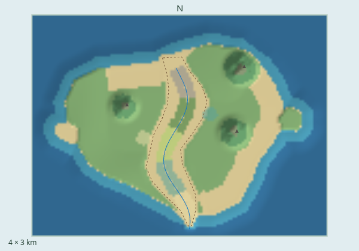
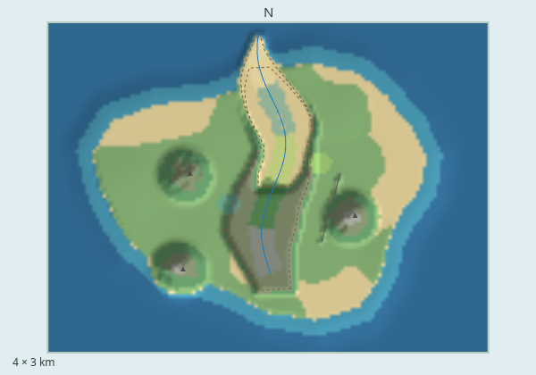
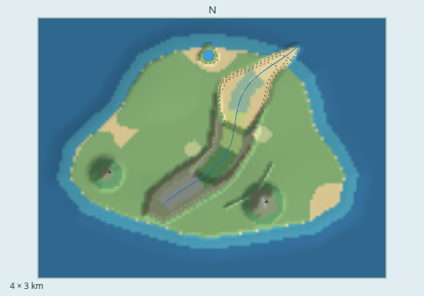
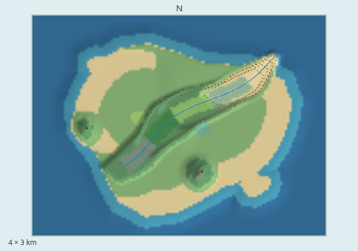
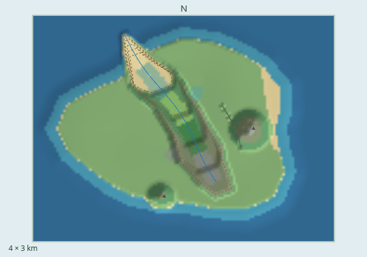
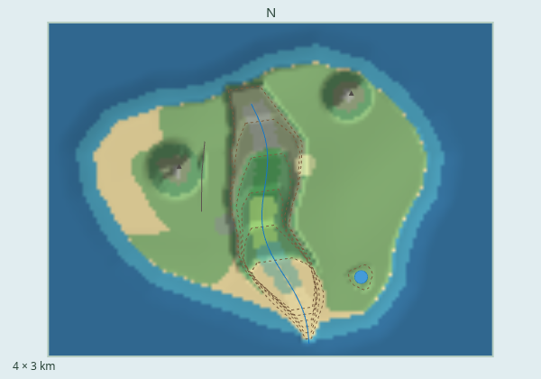

# Génération géographique guidée V3

Branche `feat/guided-world-composition`, depuis `main` à `c40a8a8`.
L'île officielle `maps/island.project.json` et ses données publiques ne sont pas modifiées.

## Audit des capacités existantes

| Source auditée | Capacité réutilisée et limite |
| --- | --- |
| `studio/home-welcome.ts` | Assistant Canvas2D existant, anciennement trois étapes et relief seul. La création directe avancée et le terrain vierge restent disponibles. |
| `studio-core/world-onboarding.ts`, `world-start.ts` | Création V3, validation, anciens presets éditables. Les grandes formes étaient fixes entre graines ; ces API restent compatibles avec les anciens tests et placements. |
| `geography/archipelago.ts`, `archipelago-params.ts` | Générateur analytique, polygones, plateaux, massifs, vallées et crêtes ; 64 formes, 12 terres, 32 points par ligne. Composition native : plateaux, soulèvements, creusements, volcans. |
| `watershed-analysis.ts`, `watershed-rivers.ts` | D8 borné et sources candidates, propositions réutilisant `guided-river.ts` / `hydro-trace.ts`. Les propositions seules ne garantissent ni exutoire ni absence de contre-pente. |
| `guided-river.ts` | Traçage descendant et compilation WATER, désormais sans clamp de niveau à 100 m. Les petits reliefs peuvent encore nécessiter l'édition manuelle hors de ce générateur. |
| `basin-lakes.ts`, `lake-outflow.ts` | Contour radial conservateur, berges fermées, déversoir et sortie explicites. Un lac latéral fermé ne constitue pas une chaîne lac/rivière connectée. |
| `region-recipes.ts`, `region-batch.ts` | Prescriptions, transitions probabilistes, masques 16 × 16 et ownership. 16 régions par lot ; 256 secteurs par région ; cellules manuelles protégées. |
| `relief-lines.ts`, `render/cliff-view.ts` | Crêtes `rl-cliff-*`, parois locales et LOD existants, sans nouveau moteur de falaises. |
| `water/profile.ts` | Réseau, profils, creusement, raccords, cascades et diagnostics partagés par le compilateur/runtime. Anciennes limites 100/150 m incohérentes avec l'enveloppe du terrain. |

Les contrats V3, décisions techniques, LOW-RESOURCE et documents récents 50–54/61 guident cette évolution : un seul moteur géographique, sources auteur séparées du runtime, hydratation bornée et historique commun. Aucun second WebGL, worker supplémentaire ou objet par végétal.

## Architecture réalisée

- `map-requirements.ts` : besoins strictement validés et versionnés, paysages obligatoires/facultatifs, dimensions, graine, relief, eau, terrasses, falaises et succession personnalisée. Stockage facultatif `world.generation` ; les anciens fichiers n'en ont pas besoin.
- `world-terrain-planner.ts` : sous-graines indépendantes topologie/relief, mélange déterministe avec avalanche pour décorréler deux graines voisines. Familles vallée centrale, sinueuse, plateau découpé et massifs multiples. Contours, orientations, amplitudes, nombre de massifs, plateaux et cours principal varient réellement. Ces familles partagent les mêmes règles natives plutôt que des cartes préfabriquées.
- Les terrasses longitudinales sont des plateaux qui se recouvrent de l'amont vers l'aval. Le dernier plateau natif gagne : le thalweg est descendant avant tout creusement WATER. Les berges irrégulières et les extrémités effilées évitent les longs rectangles. Des plateaux latéraux peuvent être demandés ; une crête `rl-cliff-*` est ajoutée selon l'importance des falaises et utilise le renderer existant.
- `world-hydro-planner.ts` : cours principal issu du corridor calculé, vrais objets WATER à profil terrain et exutoire marin. Compilation entre les points de contrôle ; refus des erreurs **et** de `WATER_LOCAL_RISE`. D8 et traçage existants pour les cours supplémentaires. Trois essais maximum, en réduisant seulement la largeur de transition des terrasses lorsque le raccord hydrologique échoue ; jamais de validation désactivée ni de rivière en échec sauvée.
- Les lacs facultatifs utilisent un plateau de berges, une cuvette native placée à distance des massifs, puis le contour et la validation de `proposeBasinLakes`. Une proposition qui ne ferme pas est diagnostiquée. Les cascades passent par l'assistant existant ; toute modification introduisant une contre-pente est rejetée.
- `world-biome-planner.ts` : régions polygonales suivant les berges amont/aval, plus régions de versants latérales. Les recettes, masques, écotones probabilistes et profils de végétation existants sont l'autorité. Hors des prescriptions, la classification native altitude/pente/eau continue de s'appliquer. Une succession personnalisée mettant un marais haut ou une côte loin de la mer est diagnostiquée.
- `world-composition.ts` : plan unique, diagnostics et métriques. Un besoin obligatoire absent bloque `projectFromComposition`. La confirmation copie le **plan déjà affiché** ; elle ne relance pas un générateur différent. Normalisation JSON de `-0` avant aperçu pour un export/import strictement stable.

Les besoins ne sont pas un langage de script. Aucun champ inconnu, graine non finie ou valeur hors bornes n'est accepté. L'algorithme de composition version 1 doit être conservé ou migré explicitement lors de futures évolutions pour garder les recettes régénérables.

## Parcours Studio

1. **Monde** : île/archipel, dimensions et relief. Vallée et région continentale sont signalées comme non prises en charge et bloquent la création.
2. **Paysages** : sélection et statut obligatoire/facultatif.
3. **Organisation** : automatique ou liste réordonnable, cours principaux, terrasses, falaises ; détails facultatifs pour affluents, diversité, lacs et cascades.
4. **Aperçu et création** : relief ombré et teinté par les masques réels, eau, lacs, terrasses et crêtes, massifs, légende et diagnostics. Autre variation fonctionne à toutes les étapes. Aucun stockage IndexedDB avant confirmation.

Le Canvas échantillonne jusqu'à 128 × 128 points et utilise la géographie réelle du projet, y compris le lit WATER. Les temps et budgets restent dans « Détails du calcul ». Une erreur de génération laisse le bouton de création désactivé.

## Édition et recomposition

`world-recomposition.ts` + panneau **Recomposer le monde** :

- comparaison Canvas avant/après sans modifier le document ; application dans un seul `session.change` / `CommandBus`, Undo/Redo commun ; aperçu périmé refusé ; une sauvegarde qui incrémente seulement la révision du manifeste n'invalide pas les données auteur ;
- recomposition globale à dimensions identiques, protégée dès que les reliefs/eaux/régions générés ont été retouchés ou supprimés, qu'une retouche terrain existe ou que des objets ont été placés ;
- les masques manuels sont conservés via l'ownership natif ; les régions/eaux ajoutées indépendamment sont conservées et le réseau final est revalidé ;
- rafraîchissement des **biomes actuels** : conserve les recettes modifiées et les régions supprimées, le relief, l'eau et les retouches de cellules. Il ne change pas la graine ni la topologie ;
- les secteurs sont explicitement chargés avant comparaison. Le redimensionnement et les anciens projets dépourvus de besoins demandent un nouveau projet, sans effacer le contenu utilisateur.

## Enveloppe WATER

Les niveaux de plans d'eau, profils manuels et cascades utilisent l'enveloppe verticale existante `[-300, 1500]` m dans les validateurs V2/V3, les assistants et l'interface. `guided-river` et les propositions de lacs n'appliquent plus de clamp à 100 m. Le compilateur consomme ces mêmes validateurs et conserve les niveaux. Les règles de pente, profondeur, raccord et creusement restent actives. Un test compile et relit réellement un cours manuel à 450 m avec une cascade à 400 m.

## Validation et mesures

Commandes :

```sh
npm run typecheck
npm test
npm run build
# Serveur de développement déjà démarré :
npm run test:studio
npm run test:composition
npm run benchmark:composition
```

La campagne de 30 graines combine îles/archipels, relief doux/varié/accidenté, 1–6 terrasses, trois intensités de falaises et lacs facultatifs. Chaque cours accepté est recompilé et contrôlé sur tous ses échantillons : aucun ERROR, aucune contre-pente locale, niveaux non croissants et exutoire marin. Tests supplémentaires : succession de masques sur le corridor, sous-graines, différence de topologie pour deux graines adjacentes, champs invalides, critères manquants, ZIP, ancien V3, aperçu pur, protection des retouches, stale preview et Undo/Redo.

Mesures de cette machine Node 24.22.1 / Chromium headless, [rapport détaillé](captures/composition/report.json) :

| Mesure | Résultat |
| --- | ---: |
| Compositions prêtes / signatures géographiques distinctes | 30 / 30 |
| Génération p50 / maximum | 63,8 / 155,5 ms |
| Aperçu Canvas p50 / maximum | 15,4 / 71,7 ms |
| Maximum de formes natives / limite | 13 / 64 |
| Maximum de secteurs auteur créés | 86 |
| Maximum de sources V3 sérialisées | 194 876 octets |
| Analyse D8 | ≤ 1 024 cellules |

`sourceBytes` est la taille sérialisée, pas la RAM/VRAM. `heapDeltaBytes` du rapport mesure les variations observées du tas JS ; le GC rend possible une valeur négative. Le Canvas garde une grille Float32 et un tampon RGBA de 128² au plus (environ 128 Kio hors contexte et index hydrologique). Les secteurs ne contiennent pas de végétaux individuels. Ces mesures ne qualifient aucune cadence du rendu 3D ni GPU intégré.

### Exemples réellement calculés

Les six graines et paramètres exacts sont inclus dans le rapport. Les images ne sont pas des maquettes.

| Graine 101 | Graine 8 020 | Graine 15 939 |
| --- | --- | --- |
|  |  |  |

| Graine 23 858 | Graine 31 777 | Graine 39 696 |
| --- | --- | --- |
|  |  |  |

## Limites et statuts

**P0 réalisé et testé** : besoins typés, composition relief/eau/régions, assistant, aperçu exact, confirmation V3, compatibilité et déterminisme. Le scénario par défaut est 4 × 3 km avec montagne, forêt, prairie, marais, trois terrasses et un cours principal valide.

**P1 partiel** : terrasses, crête rocheuse native, variation macro et lacs latéraux. Les rivières supplémentaires et affluents sont des propositions D8 conservatrices, sans garantie du compte demandé ; le compte manquant bloque explicitement la création. Les lacs sont des bassins latéraux fermés ; le parcours `rivière → lac → déversoir → rivière` n'est pas composé automatiquement. Une succession comportant un lac affiche cet écart. Les cascades qui réintroduiraient une contre-pente sont refusées avec avertissement ; les ruptures restent alors des rapides inclinés. La géographie continentale/grande vallée n'est pas livrée. L'organisation écologique reste une prescription de corridors et de versants, pas une simulation de climat, d'exposition ou de débit.

**P2 partiel** : comparaison, recomposition globale protégée et rafraîchissement des régions actuelles. Pas de remaniement topologique local avec fusion de reliefs/eaux retouchés ; le refus conservateur protège ces projets. Pour une nouvelle composition incompatible, créer un autre projet reste la voie sûre. Les générations sont synchrones et bornées ; pas de prétention de traitement interactif à cadence constante sur toute machine.

Le code n'est ni fusionné ni publié sur GitHub Pages par cette mission.

### Résultats de la vérification finale

- `npm run typecheck` et `npm run build` : réussis ; `verify-static-build` réussi.
- `npm test` : **553 réussis, 0 échec, 0 ignoré**.
- `npm run test:studio` : **17 contrôles, 0 erreur navigateur**.
- `npm run test:composition` : **8 contrôles, 0 erreur navigateur**.
- `npm run benchmark:composition` : **30/30 compositions prêtes**, signatures distinctes.

Les captures de parcours du navigateur sont produites sous `/tmp/little-world-composition/` ; les images comparatives et mesures de campagne sont versionnées dans `docs/captures/composition/`.
