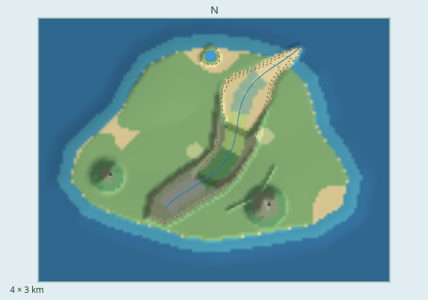
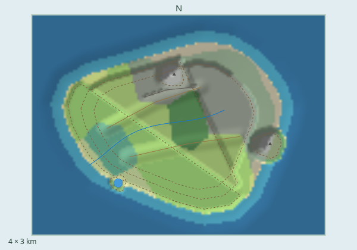
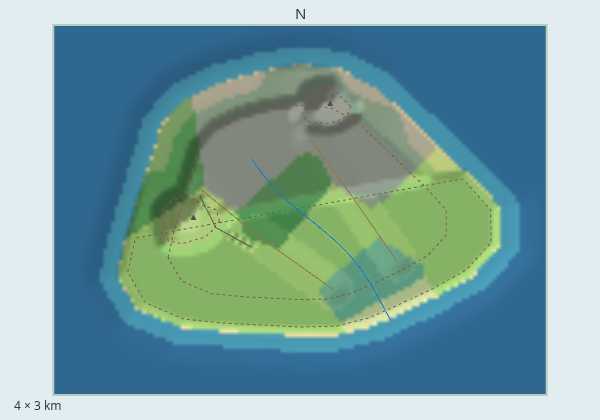
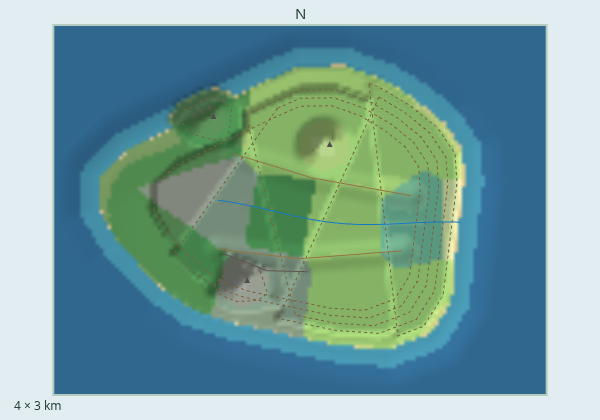

# Plateaux, plaines et biomes : composition en provinces

Évolution locale de la génération guidée : le relief et les biomes ne sont plus
limités au ruban d'une rivière. Les données de l'île officielle et la configuration
publiée de l'environnement ne sont pas modifiées.

## Ce qui change

| Première composition | Composition en provinces |
| --- | --- |
| Longs plateaux étroits suivant la rivière | Grands étages occupant l'intérieur de l'île, avec fronts obliques et emprises différentes |
| Quelques petits reliefs latéraux | Massifs décentrés, plateaux latéraux et vallées secondaires traversant les étages |
| Biomes en bandes sur les berges | Partition complète de l'île en régions polygonales, avec paysages successifs et mosaïque latérale |
| Biomes latéraux tirés dans la liste demandée | Choix selon altitude, pente, distance à l'eau, humidité et exposition estimées |
| Cours prolongé au large | Premier point marin atteint : arrêt près du véritable rivage |

### Même graine et mêmes besoins, avant et après

Exemple 15 939 : 4 × 3 km, relief accidenté, trois terrasses, lac facultatif.
Le changement de version est explicite ; ces images proviennent des plans V3 réels.

| Composition initiale | Provinces V2 |
| --- | --- |
|  |  |

| Graine 8 020 | Graine 31 777 |
| --- | --- |
|  |  |

## Relief avant hydrologie

`world-terrain-planner.ts` construit d'abord une emprise terrestre irrégulière,
puis des étages larges et des fronts obliques non parallèles. Chaque étage inférieur
s'étend plus loin vers les côtes que l'étage supérieur : la disparition simultanée
de tous les plateaux ne forme plus un rebond de hauteur près de l'embouchure.
La largeur des raccords tient compte du nombre de niveaux, du relief et des falaises.

Des plateaux latéraux créent des replats distincts. Les massifs se placent à distance
du drainage principal. Les vallées secondaires creusent les versants et les fronts
des étages ; leur profondeur est adaptée au terrain existant, y compris les extrémités
arrondies des tracés. Elles ne doivent pas creuser une plaine basse sous le niveau
marin et créer une mer intérieure accidentelle.

Toutes ces données restent des `plateau`, `mountain`, `hill`, `valley` et `ridge`
natifs, éditables dans le Studio. Les falaises utilisent toujours le renderer local
et ses LOD. Aucun nouveau moteur de terrain, grille dense persistante ou objet
individuel de végétation n'est ajouté.

Le cours principal traverse ce relief déjà composé. Il est compilé et contrôlé par
WATER comme auparavant : aucune contre-pente locale acceptée, exutoire marin réel.
En V2, le tracé s'arrête dès l'arrivée dans l'océan ; le contrôle vérifie aussi la
côte native, pour ne pas confondre une dépression intérieure avec une embouchure.

## Régions écologiques en deux dimensions

`world-provinces.ts` partitionne le contour terrestre en cellules de Voronoï
convexes : au maximum 16 provinces, sans recouvrement ni trou géométrique. Les
stations demandées le long de la rivière et des sites périphériques déterminent
les provinces ; leurs formes couvrent aussi les plateaux, les versants et les plaines.
Le cours d'eau ne définit plus les bords de chaque région.

Le choix des biomes latéraux utilise une estimation locale : altitude, pente,
proximité de l'eau, humidité et exposition. Les replats ouverts favorisent les
prairies ; les terrains plus humides et abrités favorisent les forêts ; les reliefs
hauts ou raides favorisent les biomes rocheux. Les marais automatiques sont placés
sur les étages bas proches du drainage. Une côte demandée en dernier suit le
rivage réel, même dans une succession personnalisée.

Les recettes et masques natifs restent l'autorité. Leurs transitions probabilistes
créent des écotones ; la végétation conserve les profils procéduraux instanciés.
L'humidité et l'exposition sont des heuristiques, pas une simulation météorologique
ou d'érosion. La pente est échantillonnée ; ces passages ne constituent pas une
certification de navigation pour toutes les morphologies de personnages.

## Compatibilité et recomposition

Les besoins gardent `version: 1` et ajoutent `compositionVersion?: 1 | 2` :

- champ absent ou `1` : ancien algorithme figé dans `world-terrain-legacy.ts` et
  `world-biome-legacy.ts`, afin de reproduire les projets déjà enregistrés ;
- `2` : nouvelle composition, utilisée pour les nouveaux mondes guidés.

Le panneau **Recomposer le monde** permet de choisir « Provinces, plateaux et
vallées ». Un ancien monde ne change pas automatiquement. La comparaison avant/après,
la confirmation, les protections des retouches et la transaction Undo/Redo sont
conservées. Le rafraîchissement des biomes actuels ne change pas la version du relief.
Les tests comparent les empreintes V1 au rapport déjà versionné de la première campagne.

## Contrôles et mesures

`world-composition-quality.ts` examine 2 304 points bornés sur le véritable relief
et les masques V3. Il mesure la couverture des biomes, celle des terres éloignées
de la rivière, la part de terres terrassées et les échantillons intérieurs sous le
niveau marin. Les détails du calcul du Studio montrent la couverture hors rivière.
Ces mesures sont des échantillonnages, pas une preuve continue de toute la surface.

Campagne de 30 graines, îles et archipels 4 × 3 km, trois profils de relief et
1–6 terrasses, [rapport complet](captures/provinces-v2/report.json) :

| Mesure | Résultat observé |
| --- | ---: |
| Compositions valides / distinctes | 30 / 30 |
| Couverture minimale des biomes sur les terres | 97,4 % |
| Couverture minimale hors du voisinage de la rivière | 96,7 % |
| Part minimale de terres sur les grands étages | 70,8 % |
| Échantillons intérieurs noyés involontairement | 0 |
| Formes natives, maximum observé | 16 / 64 |
| Secteurs auteur, maximum observé | 359 |
| Sources V3, maximum observé | 793 384 octets |
| Génération p50 / maximum | 179,6 / 373,6 ms |
| Aperçu Canvas p50 / maximum | 17,1 / 44,1 ms |

Les îlots éloignés conservent leur classification native, ce qui explique une
couverture prescrite légèrement inférieure à 100 % dans les archipels. Le nombre
de secteurs augmente parce que les recettes couvrent maintenant l'île entière,
et non seulement ses berges ; ces sources ne sont pas des maillages GPU. Les
mesures de génération/Canvas sur cette machine ne qualifient pas les performances 3D.

Commandes reproductibles :

```sh
npm run typecheck
npm test
npm run build
# Avec le serveur de développement lancé :
npm run test:studio
npm run test:composition
npm run benchmark:composition -- /tmp/little-world-provinces-v2
```

Les tests couvrent la partition en surface, les biomes hors rivière, la succession
amont/aval, le rivage réel, l'absence d'étendue marine parasite échantillonnée,
les limites natives, les cartes 500 m et 8 km, la compatibilité V1 et le passage
explicite V1 → V2 avec annulation. Les limites existantes concernant les réseaux
lac–rivière, les affluents garantis et la recomposition locale de relief retouché
restent celles décrites dans le document 62.

### Résultats de validation

- TypeScript, build Vite et contrôle des fichiers statiques : réussis.
- Suite Node complète : **558 tests réussis, aucun échec ni test ignoré**.
- Parcours Studio existant : **17 contrôles**, aucune erreur navigateur.
- Parcours de composition : **10 contrôles**, y compris la couverture hors rivière,
  l'export du plan exact, la version du générateur et la recomposition annulable.
- Aucun fichier de `maps/`, `public/` ou des comparaisons V1 n'a été modifié.
