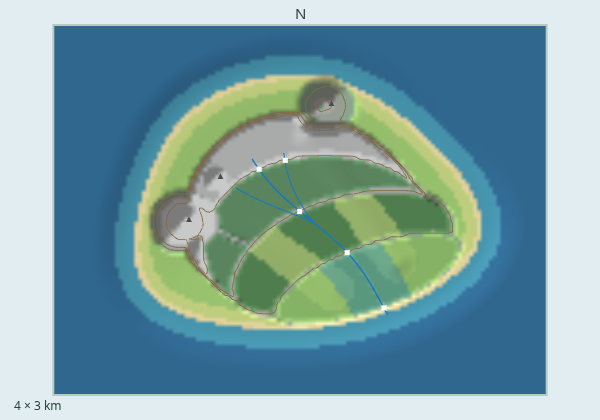
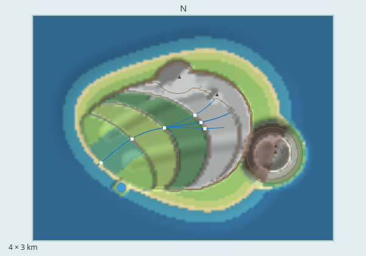

# Îles en étages aux contours organiques — composition V3

Statut : implémenté et vérifié localement ; non publié. Les compositions V1/V2 restent reproductibles. La carte officielle et les captures précédentes sont conservées.

## Identité géographique

Le nouveau défaut compose une île de 4 × 3 km, cinq étages descendants, une rivière principale et deux affluents raccordés. Les montagnes alimentent les forêts, puis les plaines, les zones humides et la côte. Trois étages minimum sont nécessaires pour cette composition.

Les plateaux utilisent des volumes ovales, arrondis ou allongés, intersectés avec la côte puis lissés. Ils remplacent les grandes coupes diagonales des anciennes compositions. Chaque contour conserve 64 points maximum ; les guides de vallées et de crêtes sont courbés avec 24 points. L’aperçu dessine les courbes du relief réellement visible plutôt que les empreintes cachées des primitives.

Les séparations automatiques des biomes suivent l’altitude réelle, les pentes, la proximité de l’eau et l’influence volcanique. Une largeur commune de zone humide évite les raccords droits dus aux anciennes frontières de provinces. Un volcan demandé occupe un district latéral, sans remplacer la succession écologique principale.

Les affluents et cascades sont des objets WATER natifs. Le compilateur contrôle leur raccordement et leur descente ; aucune remontée locale n’est acceptée. Les cascades explicites correspondent aux ruptures de relief. La recomposition respecte les cellules retouchées et les recettes régionales modifiées à la main.

## Exemples issus du générateur

Ces vues sont calculées à partir des sources générées, sans illustration ajoutée.

Autres exemples : [101](captures/organic-identity-v3/seed-101.png), [23858](captures/organic-identity-v3/seed-23858.png), [31777](captures/organic-identity-v3/seed-31777.png), [39696](captures/organic-identity-v3/seed-39696.png).

## Mesures et limites

Le [rapport de 30 graines](captures/organic-identity-v3/report.json) couvre trois intensités de relief, des archipels, des lacs optionnels et des volcans optionnels : 30 compositions prêtes et distinctes, au moins deux affluents et quatre cascades par carte, aucun échantillon intérieur sous le niveau marin. Génération médiane : 463 ms, maximum : 688 ms sur cet environnement. Maximum : 18 primitives de terrain et environ 902 ko de sources. Ces mesures ne constituent pas une qualification FPS sur GPU intégré.

Les tests vérifient aussi les contours arrondis, les séparations de biomes, les protections des retouches et la reproduction des anciennes compositions. Le système conserve le moteur natif, sans entités par plante, grille persistante supplémentaire ni second contexte WebGL.

Cette version apporte la structure géographique de l’image de référence. Elle ne génère pas encore ses villages, mines ou sources thermales. Les lacs optionnels restent des bassins latéraux : les chaînes rivière–lac–émissaire restent à développer. Les règles écologiques sont des heuristiques, sans simulation climatique ou d’érosion.
