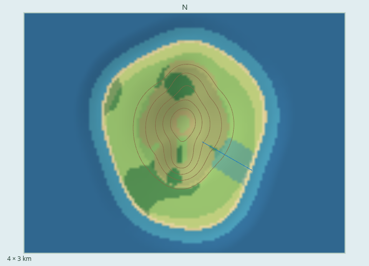
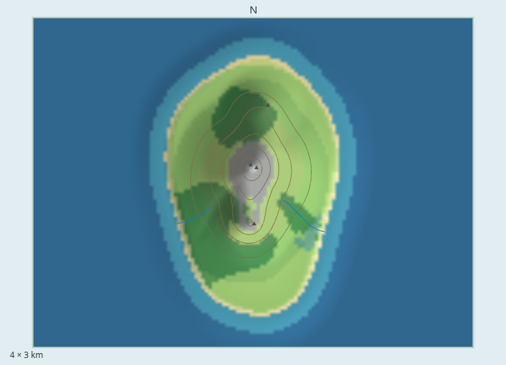
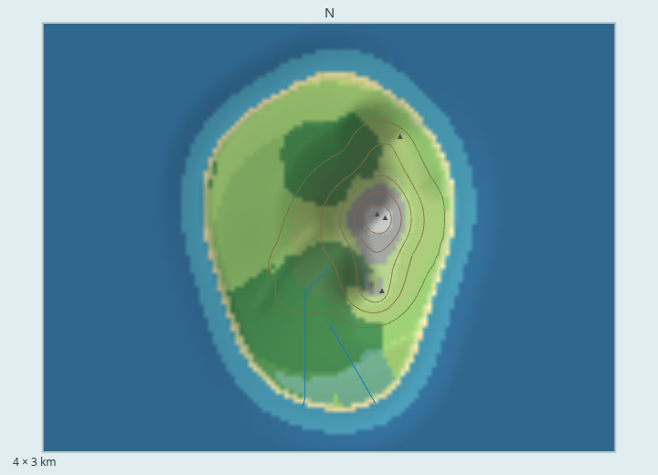
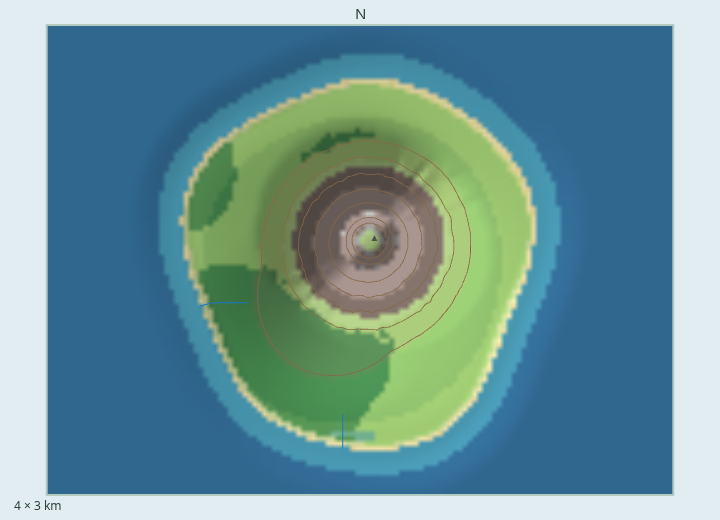
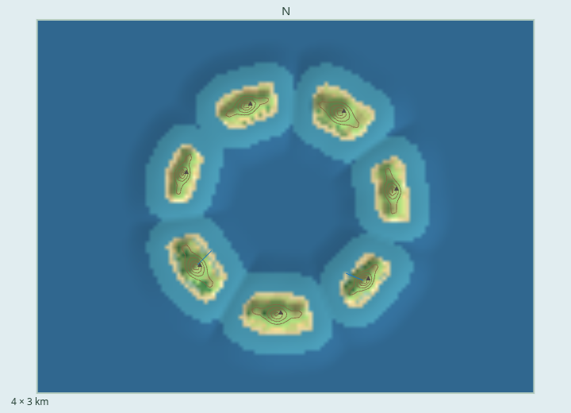
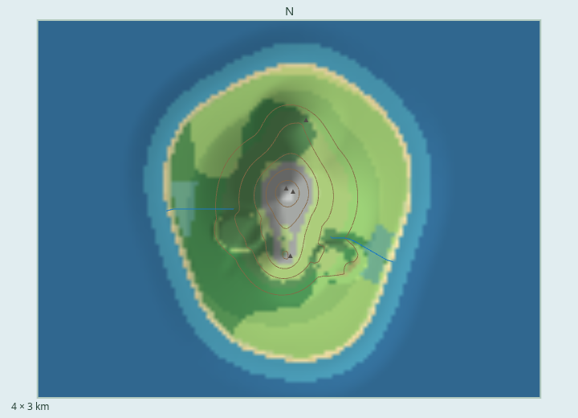

# Styles d’îles — composition V4

Statut : implémenté et testé sur la branche de travail ; aucun déploiement de l’environnement ou remplacement de l’île officielle. Suite de l’[audit des besoins](65-ISLAND-STYLES-AUDIT.md).

## Créer ou recomposer

Dans **Créer un monde → Monde → Style de l’île**, choisir un modèle :

| Modèle | Relief | Altitude cible initiale |
|---|---|---:|
| Île douce | Collines larges, piémonts et basses terres | 110 m |
| Île allongée · massif central | Dorsale et plusieurs sommets, versants sur les deux côtés | 420 m |
| Île à massif latéral | Points hauts décentrés, plaine sur le long versant | 480 m |
| Île volcanique | Édifice principal, cratère, écoulements rayonnants | 620 m |
| Archipel de caldera ancienne | Cinq à sept fragments inégaux, passes marines et lagune | 230 m |
| Île illustrée · plateaux locaux | Massifs continus et quelques replats interrompus | 440 m |

Les altitudes sont des paramètres de création, pas des mesures d’îles réelles. Le générateur calibre la hauteur cumulée des primitives, puis l’aperçu indique le maximum effectivement mesuré. L’orientation zéro suit l’axe vertical de la carte. L’allongement est calculé en mètres, avec une adaptation à l’emprise et à l’orientation.

Choisir explicitement un modèle réinitialise ses suggestions de paysages et d’eau. Les modifications suivantes de l’altitude, de l’orientation ou des réglages locaux conservent les autres choix de l’auteur. Les paramètres de versants et de plateaux ne sont affichés que pour les modèles qui les utilisent ; les anciens paramètres communs restent dans le format pour compatibilité.

Les vues **Milieux et relief**, **Altitude seule**, **Pentes** et **Cours d’eau** sont calculées depuis le même projet. Deux coupes centrales nord–sud et est–ouest montrent le relief réel sur une échelle verticale commune. Il s’agit de Canvas2D, sans second contexte WebGL.

Dans **Recomposer le monde**, le modèle peut être modifié avec une comparaison avant/après. Les générations historiques restent accessibles. Le mode **Rafraîchir les biomes actuels** désactive les changements de graine et de style et conserve le terrain et l’eau. La confirmation applique le plan comparé dans l’historique commun.

## Géographie et eau

V4 construit la silhouette et les points hauts avant le drainage. Les montagnes, collines, crêtes larges et piémonts se combinent en versants continus ; aucun plateau emboîté n’est imposé aux modèles naturels. Les vallées sont courtes et peu profondes. Les plateaux sont des formations locales facultatives.

La caldera utilise plusieurs contours non convexes et des reliefs de rebord distincts. Elle ne pose pas un grand volcan sous la lagune. L’option native `coastalReliefFadeM` fond les reliefs dans le rivage et empêche les primitives de relever la mer à l’extérieur des terres. L’absence de ce paramètre conserve exactement le comportement antérieur.

L’analyse D8 travaille sur au plus 4 096 cellules. Des sources supplémentaires, spatialement séparées et échantillonnées sur le terrain, permettent de traiter les petits bassins insulaires ignorés par l’analyse principale. Les tracés utilisent le guide descendant existant et deviennent des objets WATER natifs. Chaque proposition est compilée avec tout le réseau ; erreurs et remontées locales sont rejetées. Les confluences éventuelles sont explicites, sans raccordement entre îles à travers la mer. Les cascades ne sont ajoutées que si les ruptures réelles le permettent.

Par défaut, les nombres de cours d’eau sont des **souhaits**. Un manque est affiché avec son nombre réel. Le réglage **Nombres strictement obligatoires** transforme ce manque en erreur bloquante. Les nouveaux modèles suggèrent un ou deux cours d’eau indépendants ; les affluents restent demandables, sans garantie de confluence sur un relief radial. Aucun quota n’est atteint en aplatissant arbitrairement le relief.

## Milieux et retouches

Les masques utilisent l’altitude, les pentes, l’exposition, une humidité spatiale continue, la proximité de l’eau et l’influence volcanique. Les marais exigent une zone basse et peu pentue. Un sommet bas n’est pas automatiquement transformé en biome montagnard. Le volcan ancien peut porter de la forêt, alors que l’option actif favorise le milieu volcanique au sommet.

Les recettes natives sont réparties en tuiles d’édition pour respecter la limite de 256 secteurs par recette. Ces tuiles ne décident pas du biome : la classification est calculée dans les coordonnées du monde. Les masques marins vides sont retirés des enregistrements générés. Les exigences de paysages portent sur les surfaces réellement peintes et échantillonnées, plus sur les seuls noms des recettes.

La propriété des cellules générées est conservée. Les cellules peintes à la main, les recettes modifiées et les régions supprimées restent protégées lors du rafraîchissement. Une recomposition globale reste refusée lorsque le relief généré, l’eau, les recettes ou les objets ont été retouchés selon les protections existantes.

## Exemples réellement générés

Même graine 4242, emprise 4 × 3 km, suggestions de chaque modèle :

| Île douce | Massif central |
|---|---|
|  |  |
| Massif latéral | Île volcanique |
|  |  |
| Caldera ancienne | Plateaux locaux |
|  |  |

Les vues d’[altitude du massif central](captures/island-styles-v4/central-massif-altitude.png), de [pente](captures/island-styles-v4/central-massif-slope.png) et ses [coupes](captures/island-styles-v4/central-massif-sections.png) permettent de vérifier la structure sans se fier à la coloration des biomes.

## Vérification et budgets

Commande reproductible : `npm run benchmark:styles -- /tmp/little-world-style-final` avec le serveur Vite disponible sur le port 5173. `STYLE_SEEDS=1` produit uniquement la planche de six modèles. `benchmark:composition` conserve la campagne du modèle étagé V3.

Le [rapport](captures/island-styles-v4/report.json) couvre **180 compositions distinctes : 30 graines par modèle**, trois amplitudes, orientations 0/35/90° et emprises 1,2 × 0,8, 4 × 3 et 6 × 2,5 km. Résultats :

- 180 compositions créables, aucun réseau WATER invalide ou avec remontée accepté.
- Aucun échantillon intérieur sous le niveau marin ; maximum d’altitude dans la tolérance vérifiée de 8 % + 3 m autour de la cible sur cette matrice.
- Couverture des biomes au moins 95,8 % des échantillons terrestres ; les petites zones côtières restent limitées par la résolution des masques.
- Sept petites calderas de 1,2 × 0,8 km n’ont aucun cours d’eau retenu ; le souhait non satisfait est signalé. Les six exemples de 4 × 3 km possèdent de l’eau.
- Au plus 14 primitives de relief et 1 032 059 octets de sources. Génération médiane : environ 590 ms, maximum : 1 143 ms sur cet environnement.

Validation locale : **576 tests automatisés**, **18 contrôles navigateur de composition**, **17 contrôles navigateur du Studio**, typage et build statique réussis.

Les tests couvrent aussi une création complète 8 × 8 km avec plus de seize recettes natives, les emprises extrêmes du terrain, la lagune ouverte, la conservation des versions antérieures, l’archive, les retouches et les comparaisons périmées. Les budgets natifs restent de 12 terres, 64 formes, 64 points par contour et 32 par ligne. Pas d’entités par plante, de grille écologique persistante supplémentaire ou de nouveau moteur physique.

## Limites conservées

Cette version ne simule ni érosion ni climat physique et ne reproduit pas une île réelle. La côte reste une forme procédurale guidée ; les cours d’eau peuvent être courts et les confluences ne sont pas promises. Les cascades demandées restent des souhaits si aucune rupture ne convient.

Les nouveaux modèles ne creusent pas encore automatiquement un lac avec chaîne rivière–lac–émissaire ; une demande de lac non satisfaite est signalée, et un lac obligatoire bloque la création. Les outils Bassins et Eau restent utilisables après création.

La succession personnalisée est une préférence par altitude sur les versants, soumise aux conditions du milieu. Le choix d’un bassin particulier pour cette succession, les cartes de style avec miniatures dans le sélecteur et le raffinement hydrologique adaptatif restent des suites possibles de l’audit. La planche de comparaison est disponible ici et l’aperçu change réellement avec chaque modèle.

Les temps mesurés concernent la création, pas les FPS sur GPU intégré. L’île publique et les fichiers runtime officiels n’ont pas été régénérés.
