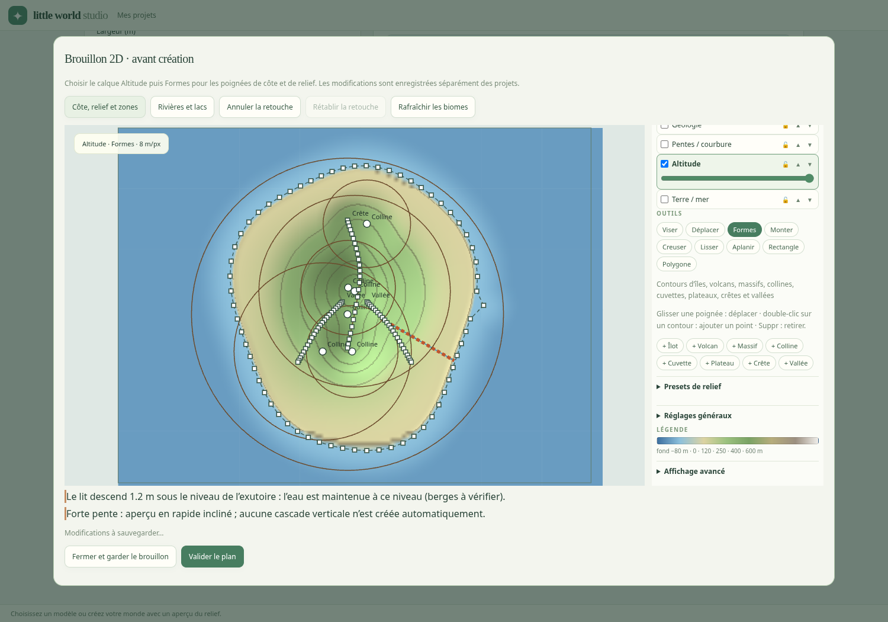

# Brouillon 2D avant création — premier lot

Statut : implémenté et vérifié sur `feat/stepped-island-identity`. Les 22 commits de `main` ont été intégrés sans conflit au début de ce lot. La synchronisation finale inclut aussi les commits supplémentaires de `main` jusqu’à `4ea3503`. Aucun déploiement ni remplacement de la carte officielle.

Ce lot livre la première étape du [plan d’îles composées](67-COMPOSED-ISLANDS-EDITABLE-DRAFT.md). Il prépare les futures silhouettes en croissant et en tortue ; ces deux nouveaux générateurs, les réservations de port et les passages automatiques ne sont pas encore implémentés.

## Utilisation

1. Dans **Créer un monde**, choisir un modèle et sa graine, puis **Retoucher le brouillon 2D**.
2. Le calque Altitude et l’outil Formes sont ouverts par défaut. Glisser un point de côte, déplacer une forme ou sélectionner un massif pour régler sa hauteur. Les outils Monter, Creuser, Lisser, Aplanir, Rectangle et Polygone sont ceux de la carte globale existante.
3. Choisir **Rivières et lacs** pour modifier les tracés, largeurs, niveaux et raccordements avec leur profil. Cliquer **Appliquer le tracé** avant de changer de vue. Un tracé non appliqué bloque le changement de vue et la confirmation ; il peut être explicitement abandonné.
4. Utiliser **Annuler la retouche**, **Rétablir la retouche** ou les raccourcis de l’historique lorsque la carte a le focus. **Rafraîchir les biomes** réutilise la recomposition protégée, sans remplacer les retouches manuelles.
5. **Valider le plan** revient à l’assistant avec les sources modifiées. **Créer et ouvrir le monde** enregistre ce plan exact ; la génération n’est pas relancée depuis la graine.

## Sauvegarde et remplacement

L’ouverture explicite du brouillon crée une sauvegarde dans une base IndexedDB distincte du catalogue principal. Les transactions et checkpoints sont conservés par le `ProjectStore` existant. La fermeture attend la sauvegarde ; l’accueil permet de **Reprendre le brouillon** après rechargement.

La simple consultation des aperçus ne crée toujours pas de projet. Après création réussie du monde, son ancien brouillon et ses secteurs, contexte, journal et checkpoints sont supprimés du stockage séparé. Le projet créé reste intact dans la base principale.

Après validation d’un brouillon retouché, changer la graine ou les paramètres ne remplace pas silencieusement les sources. L’assistant demande de garder le plan retouché ou de le remplacer par la nouvelle génération. Le brouillon enregistré reste récupérable tant qu’il n’a pas servi à créer le projet.

## Validation des sources retouchées

Le validateur contrôle le document natif, les contours croisés ou dégénérés, les plateaux et le réseau WATER entier. Les remontées locales sont bloquantes à la confirmation. Les quantités strictement demandées et les surfaces de paysages sont réévaluées ; les souhaits restent des avertissements. Un manque de couverture de biomes est signalé.

Une configuration intermédiaire invalide reste éditable et sauvegardable, mais ne peut pas être confirmée. La modification du relief ne déplace pas automatiquement les rivières : l’auteur garde son tracé et voit les incompatibilités à corriger.

Les mesures d’altitude et le rafraîchissement écologique prennent désormais en compte les coups de pinceau auteur, et plus seulement les primitives du générateur. Les centres des retouches entrent également dans la recherche du maximum pour ne pas manquer une modification étroite entre les échantillons.

## Architecture et limites

Le brouillon utilise un `ProjectDocument`, `StudioSession`, `CommandBus`, les tuiles géographiques et l’éditeur WATER existants. L’éditeur de brouillon est chargé à la demande. Aucun second moteur géographique, format parallèle complet ou contexte WebGL n’est ajouté. Les réglages de calques du brouillon ne remplacent pas ceux de la carte globale principale.

Ce lot conserve les contrôles existants de hauteur par curseur et les opérations d’aplanissement. Il n’ajoute pas encore de poignées verticales dédiées, de graphe des accès, de terrassement automatique pour les chemins ni d’autocorrection partielle des rivières. La sélection d’une zone d’usage agricole et ses contraintes restent une étape ultérieure.

La sauvegarde est locale au navigateur, avec les mêmes contraintes de quota que les projets. Les changements du tracé d’eau doivent être appliqués explicitement pour rejoindre le document sauvegardé.

## Vérifications

- **604 tests automatisés réussis** : incluent les cinq nouveaux tests du brouillon, les six styles, les contours invalides, les altitudes avec retouches et l’interdiction de confirmer une eau montante.
- **15 contrôles navigateur du nouveau parcours** : déplacement de côte, hauteur, Undo/Redo, édition d’eau et protection de son état non appliqué, reprise après rechargement, protection contre la nouvelle graine, ZIP exact et nettoyage du stockage séparé. Commande : `npm run test:composition-draft`.
- **18 contrôles de composition** : création, archive, recomposition et changement de style existants conservés.
- **30 contrôles de carte globale** : exécutés sur un aperçu statique isolé avec les fixtures historiques préparées par `tools/stage-test-maps.mjs dist/maps`. La première exécution en développement s’arrêtait sur l’ancienne scène de référence non préparée ; l’exécution avec les fixtures réussit intégralement.
- Typage, build et vérification du build statique réussis. Les fixtures ne sont jamais ajoutées au workflow de publication.

Le [rapport du nouveau parcours](captures/composition-draft/report.json) et sa capture proviennent des tests navigateur réels.
