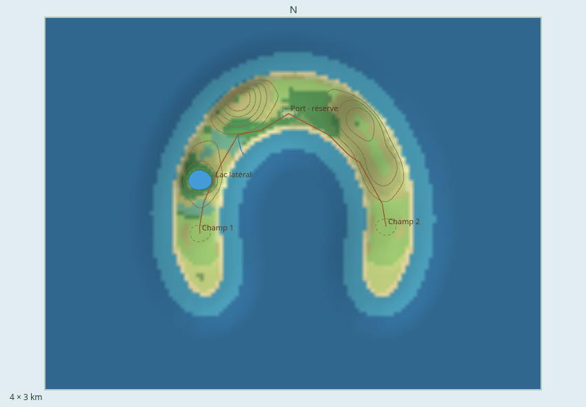
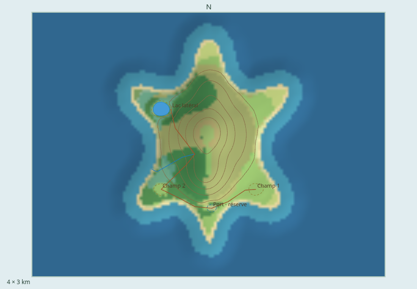

# Îles composées V5 — formes, réservations et accès

Statut : implémenté sur `feat/stepped-island-identity`, testé localement ; aucun déploiement demandé. `main` a été intégré jusqu’à `5b03538`. Cette étape prolonge [l’alignement terrain/établissements](73-TERRAIN-SETTLEMENTS-ALIGNMENT.md), sans prétendre livrer les établissements des docs 65–72.

## Créer puis retoucher une île

Dans **Créer un monde**, choisir le modèle de relief, puis la silhouette : naturelle, croissant ou tortue. Le modèle reste indépendant de la silhouette : relief doux, massif central ou décentré, île allongée et archipel peuvent fournir la base. La caldeira conserve sa silhouette naturelle. L’orientation tourne l’ensemble. Le croissant ouvre sa baie vers le bas avec l’orientation par défaut ; le port est recherché sur sa rive intérieure centrale. Les côtes sont des contours organiques fermés, sans auto-intersection ; les satellites d’un archipel sont conservés.

Dans **Zones utiles et accès**, demander un emplacement portuaire, jusqu’à quatre champs, un lac et des liaisons à pied. Le planificateur cherche des emplacements assez larges, secs et compatibles avec le relief ; il ajoute des replats locaux et leurs talus. Il ne transforme pas toute l’île en marches régulières. Le lac dispose d’un fond, d’une berge et d’une entrée sèche. Les rivières naturelles tiennent compte des réservations.

Ouvrir **Retoucher le brouillon 2D → Zones utiles et accès** :

- sélectionner une zone ou déplacer sa poignée directement sur la carte ;
- changer son altitude et la largeur de son talus ;
- déplacer ensemble le replat, le fond du lac, son eau, son entrée et la parcelle agricole liée ;
- recentrer l’entrée, supprimer le groupe, ou verrouiller sa géométrie et son eau ;
- créer explicitement une **parcelle native plantée de blé**, puis la recaler si nécessaire ;
- proposer les nouveaux accès, examiner leur bilan, puis les appliquer.

Les outils relief et eau du brouillon restent disponibles pour retoucher la forme générale et les cours d’eau. Une liste **Forme sélectionnée** permet d’atteindre les primitives superposées. Les verrous sont vérifiés dans la transaction commune du Studio : un autre outil ne peut pas modifier une réservation verrouillée. Les modifications sont annulables et sauvegardées ; la création et l’export utilisent exactement le brouillon validé.

## Contrats et validation

La composition V5 est explicite et optionnelle ; les générateurs V1–V4 restent disponibles. Le contour, les replats, l’eau, les chemins et les parcelles utilisent les formats natifs. `libraries.terrainPlans` ne contient que les liens stables, les entrées et les contraintes ; il ne duplique pas les géométries. Les altitudes des entrées sont dérivées du terrain final.

Les chemins sont des sentiers natifs. La recherche bornée vérifie le terrain final, les eaux, la pente et la largeur utile, y compris entre les points et sur les côtés. Elle ne crée pas de pont, escalier ou traversée d’eau implicite. Une liaison impossible reste signalée. L’option **accès obligatoires** bloque la validation et la compilation quand ces accès manquent ou deviennent invalides. Une berge de lac réservé ouverte est également bloquante.

Les chemins générés sont identifiés par leur empreinte. Une régénération refuse d’écraser un chemin retouché manuellement. Le déplacement d’une zone recalcule les biomes dans son voisinage et préserve les masques et recettes personnalisés. La suppression groupée refuse de casser un réseau d’eau encore lié. Les réservations devenues impossibles sont signalées plutôt qu’ajoutées sans place disponible.

Le port est une **réservation de terrain et d’approche maritime**. Les quais, bâtiments, colliders d’établissement, interactions, accès bateau et qualification PNJ relèvent encore des [contrats collisions](67-SETTLEMENTS-COLLISIONS-INTERACTIONS.md) et de la [roadmap de tests](68-SETTLEMENTS-ROADMAP-TESTS.md). Les sentiers sont validés contre le terrain et l’eau ; les futurs obstacles bâtis devront entrer dans la qualification des accès. Aucun nouveau moteur physique, rendu ou génération agricole par entité n’est ajouté.

## Mesures et preuves

Le [rapport reproductible](captures/composed-islands-v5/report.json) couvre **60 compositions**, avec deux silhouettes, plusieurs graines, orientations, tailles et reliefs :

| Mesure | Résultat |
| --- | ---: |
| Contours simples / sources validables | 60 / 60 |
| Sources distinctes | 60 |
| Quatre réservations obtenues | 48 |
| Quatre réservations et toutes leurs liaisons obtenues | 11 |
| Plans avec au moins une liaison manquante | 37 |
| Chemins acceptés mais invalides | 0 |
| Maximum de primitives de relief | 14 |
| Génération médiane / maximum observé | 944 / 2 254 ms |

Les zones sont des souhaits : les petites îles et les reliefs prononcés n’offrent pas toujours la place ou une liaison praticable. Les 60 sources sont validables en mode souhaits ; cela ne signifie pas 60 plans entièrement connectés. Ces temps Node sont indicatifs, sans qualification FPS ou GPU intégré.

Les exemples doux 4 × 3 km de la graine 4242 fournissent chacun le port, deux champs, le lac et trois chemins valides :

Commandes : `npm test`, `npm run typecheck`, `npm run build`, `npm run test:composition`, `npm run test:composition-draft`, `npm run test:composed-islands`, `npm run benchmark:composed-islands`. Les tests navigateur nécessitent le serveur de développement sur le port 5173 ; le benchmark écrit son rapport et ses captures hors des cartes officielles.

Validation locale : **615 tests unitaires**, vérification TypeScript et build réussis ; **18 contrôles navigateur de composition**, **15 du brouillon** et **10 des îles composées** réussis, ainsi que **30 contrôles de la carte 2D** sur le build statique de validation. Le [rapport du parcours composé](captures/composed-islands-v5/editor-report.json) accompagne la [capture de son éditeur](captures/composed-islands-v5/editor.png).

Les tests couvrent notamment les anciennes versions, les contours extrêmes, les satellites, les pentes et eaux bloquantes, la compilation native, les réservations, les verrous inter-outils, la protection des chemins manuels, l’archive exacte et la parcelle AGRI. Les captures du présent dossier sont des aperçus 2D du générateur, pas des promesses de rendu 3D.
