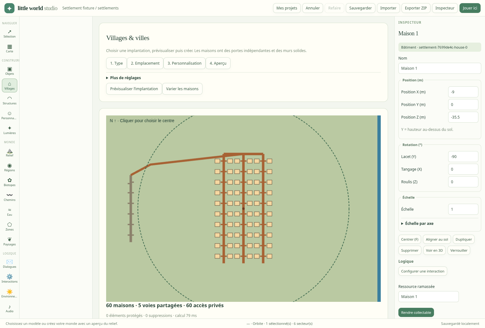
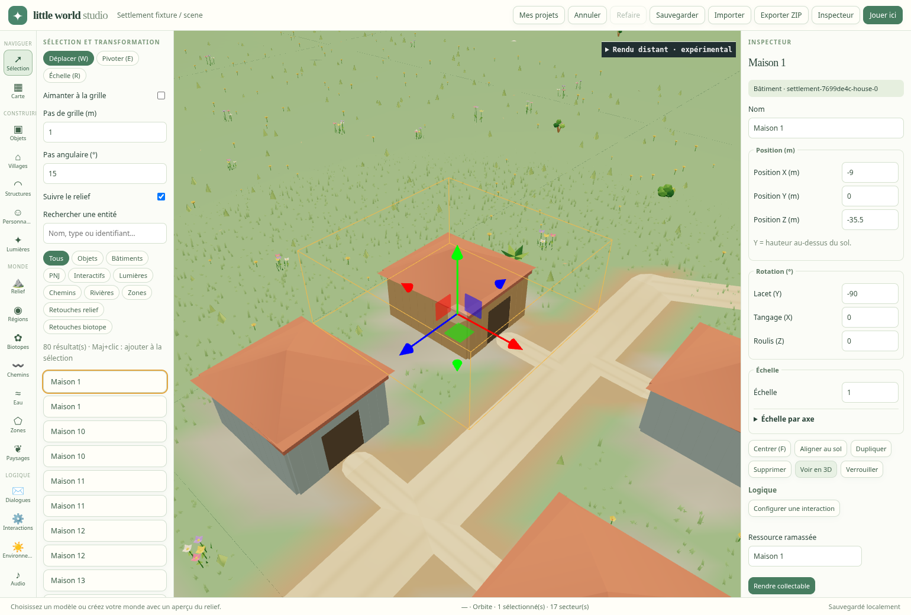
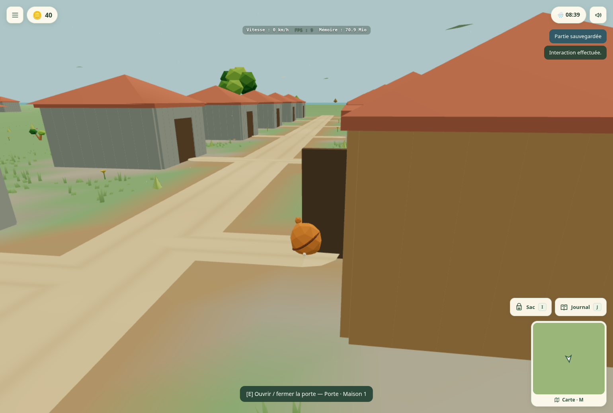

# Villages et villes de surface V1 — premier parcours utilisable

> Suite implémentée : [76 — places, équipements et comptoirs](76-SETTLEMENTS-SERVICES-V1.md). Les statuts ci-dessous décrivent la première livraison.

18 novembre 2026. Branche `feat/stepped-island-identity`. **Implémentation locale, non déployée.** Ce lot suit les [contrats 70](70-SETTLEMENTS-TECHNICAL-CONTRACTS.md), le [fast-track 71](71-SETTLEMENTS-FAST-TRACK.md), l’[UX 72](72-SETTLEMENTS-STUDIO-UX.md) et la [coordination terrain 73](73-TERRAIN-SETTLEMENTS-ALIGNMENT.md). Il ne clôture pas toute la roadmap SET.

## Utilisation dans le Studio

Ouvrir une carte existante puis **Construire → Villages & villes** :

1. Choisir **Hameau**, **Village** ou **Bourg / petite ville**. Les tailles proposées vont de 8 à 80 maisons ; 80 est un plafond de cette version, pas une qualification de grande ville.
2. Choisir l’emplacement sur le plan. **Voir toute l’île** permet de changer de région ; **Chercher un emplacement** propose un sol suffisamment sec et plat. Centre, rayon et orientation restent réglables.
3. Choisir taille, style (bois, pierre, enduit clair ou mixte), richesse et activité dominante. La richesse adapte actuellement le revêtement des rues ; agriculture adapte l’espacement. Les activités ne créent pas encore de PNJ, métiers ou économie locale.
4. **Prévisualiser l’implantation**, lire les erreurs, puis **Créer dans le monde**. Le plan affiche les empreintes, les voies communes et les dessertes privées. Une erreur d’accès bloque la création ; un manque de place réduit le nombre de maisons avec un avertissement.

Le panneau liste les implantations du projet. **Modifier** recharge une recette ; **Varier les maisons** et les changements de style préservent la géométrie des rues. Une maison verrouillée, retouchée ou portant une interaction personnalisée reste conservée. Les chemins modifiés manuellement restent également protégés ; s’ils ne desservent plus les maisons, la régénération demande une correction.

Choisir une maison puis **Modifier cette maison en 3D** pour utiliser l’inspecteur habituel. Déplacement et rotation verticale entraînent sa porte ; l’échelle reste native afin de garantir l’ouverture. Après déplacement, prévisualiser de nouveau pour reconnecter l’entrée. **Supprimer cette maison** retire le groupe, sa porte, son interaction et son accès ; le slot supprimé ne réapparaît pas lors d’une régénération. Un lien extérieur ou une interaction retouchée empêche une suppression silencieuse. La suppression d’une implantation conserve les éléments repris par l’auteur et leurs voies.

Création, modification et suppression passent par **une transaction Studio**, avec Annuler/Refaire et sauvegarde locale. Les verrous sont aussi vérifiés lorsque la modification vient d’un autre outil. Le ZIP conserve la recette, les maisons, les portes, les suppressions et les références natives. **Jouer ici** compile une copie et utilise l’entrée nommée de la maison sélectionnée comme point d’arrivée ; le projet auteur reste distinct de la sauvegarde de partie.

## Maisons et physique

Les nouveaux habitats sont des **maisons procédurales originales simples**, creuses, avec plancher, murs, ouverture et toiture ; aucun ancien GLB à façade fermée n’est annoncé traversable. Les trois palettes partagent la même géométrie. Les murs sont regroupés visuellement, avec géométries et matériaux partagés, et non dessinés comme une scène indépendante pour chaque module.

Le composant optionnel `Habitat {version:1, doorId}` référence une **porte V3 indépendante**. La porte porte son collider, son interaction déclarative et la persistance de `open`. Le bâtiment possède des volumes statiques dérivés de la même description que le rendu. L’ouverture de la porte ne désactive jamais les murs. Les petites subdivisions des parois limitent l’élargissement conservateur des AABB tournées ; il ne s’agit pas d’une physique OBB ou de collision triangle.

Le compilateur conserve les composants et leurs références ; le lecteur compilé et le playtest produisent les mêmes volumes. Les anciennes cartes sans `Habitat` ou `libraries.settlements` restent lisibles sans migration destructive. Les colliders simples existants restent inchangés.

Le ciblage d’interaction utilise le voisinage spatial des ancres, puis un segment contre les obstacles physiques actifs et le relief. Le propre collider de la cible est ignoré, les murs voisins restent bloquants. Une porte peut être utilisée des deux côtés de son ouverture ; un mur ne permet pas d’activer une cible derrière lui. Les futurs comptoirs exigeront encore leurs poses d’usage métier.

## Placement et circulation

Le solveur est borné à 80 slots, sans DOM ni scène Three.js. Il pose des maisons le long de rues longitudinales partagées, reliées transversalement selon la taille. Chaque entrée dispose d’une courte desserte vers ces rues. Une liaison régionale facultative rejoint une voie existante en contournant les obstacles physiques. Le réseau logique piéton est dérivé des chemins et de leurs raccords explicites ; un simple croisement de traits ne crée pas une connexion multi-niveaux.

Le terrain final et les eaux proviennent du moteur existant. L’emprise orientée et son enveloppe de sécurité doivent rester sèches, assez plates et libres de volumes occupés. Les parcelles agricoles, mines et replats réservés aux champs sont exclus. Aucun terrassement n’est appliqué silencieusement. Le placement peut donc être partiel sur une île naturelle, même si la cible est de 60 maisons.

Avant commit et compilation, les accès passent les contrôles de pente, d’eau, de largeur, de connexion et un **balayage du volume du personnage** contre les colliders et les plafonds. La validation réévalue aussi les portes et leurs ouvertures après édition. Une preview dont la source ou la recette a changé est rejetée.

## État de la roadmap

| Lot | État de cette livraison |
| --- | --- |
| F0 / CT-0 | Schémas optionnels, anciennes cartes, baseline de tests et fixtures isolées vérifiés. |
| F1 / CT-1–2 | Maison de surface et porte indépendante, angles 0/30/45/90°, déplacement rapide, murs et plafond testés. |
| CT-4 | Occlusion physique et voisinage des interactions implémentés ; comptoirs avec poses métier encore à livrer. |
| F2 | Parcours Studio, preview, création, modification, sauvegarde, archive, Undo et playtest implémentés. |
| F3 | Rues et dessertes de surface, entrées, verrous, suppression et raccord régional implémentés. Quartiers, places et parcelles polygonales éditables restent à enrichir. |
| F4 | Trois palettes simples et revêtement selon richesse ; variantes de volumes, usure et matériaux détaillés restent à faire. |
| F5–F8 | Équipements métier, ports bâtis, défenses, camps, terriers, grottes et villes de 150–600 bâtiments restent à réaliser. |

Il n’y a pas de pont ou d’escalier implicite, de navmesh PNJ nouveau, de bateau/quai qualifié, de grotte traversable ou d’intérieur meublé. Le graphe livré concerne uniquement les chemins de surface. L’optimisation à grande échelle et la qualification GPU intégré restent ouvertes ; les données auteur chargées et les colliders sont encore soumis aux budgets du runtime existant.

## Vérification et preuves

- Suite complète : **631 tests réussis**, dont les tests de physique et de génération d’établissements ; vérification TypeScript et build réussis.
- **20 contrôles navigateur dédiés** couvrent création, Undo/Redo, protection d’une maison, styles, édition 3D, porte dans le contrôleur de jeu, sauvegarde, rechargement, ZIP et coexistence de deux implantations. Le rapport associé est dans [les captures](captures/settlements-surface-v1/browser-report.json).
- La [matrice CPU](captures/settlements-surface-v1/benchmark-report.json) porte sur **30 implantations sur plaine**, dix graines par taille de 12/60/80 maisons et quatre orientations. Les 30 cibles sont entièrement placées et leurs accès validés. Le maximum est de **3 040 volumes physiques** pour 80 maisons, sans sérialiser un mur par entité. Les temps détaillés, poids source et journal Undo sont dans le rapport. Ces mesures Node ne constituent pas une qualification FPS, GPU ou mobile.

Les maxima observés sur cette matrice sont de 14 ms pour le plan, 776 ms pour la transaction validée, 262 ko de source et 292 ko de journal. Le maximum des p95 des balayages physiques échantillonnés est de 2,50 ms. Ces mesures concernent le processus Node de cet environnement, sans garantie par frame sur une autre machine.

Deux cas supplémentaires utilisent les **vraies îles naturelles V5**, modèle doux et graine 4242 : croissant au centre `(0, -940)` et tortue au centre `(640, 500)`. Chacun accepte 12 maisons avec accès validés, sans terrassement ; [rapport](captures/settlements-surface-v1/natural-islands-report.json). Les cas sont aussi couverts par les tests de génération.

Les régressions du jeu existant passent **12 contrôles navigateur**, et celles des chemins **8 contrôles**. Le jeu et le Studio utilisent les JS/CSS compilés sous `/little-world/` ; aucune fixture technique n’est incluse dans le build public nettoyé.







Commandes :

```sh
npm test
npm run typecheck
npm run build
node tools/verify-static-build.mjs dist
npm run test:settlements
npm run benchmark:settlements
```

Les tests navigateur utilisent le serveur de développement sous `/little-world/` (`WORLD_URL` configurable). Le benchmark et les captures écrivent sous `/tmp/little-world-settlements` par défaut. La fixture de plaine est technique, indépendante de la carte officielle ; aucune génération du monde publié ni modification de ses fichiers n’est incluse.

Évolution du placement : [77 — implantation organique et édition directe](77-ORGANIC-SETTLEMENT-PLACEMENT.md). Les descriptions du modèle aligné ci-dessus restent celles de la livraison initiale.
