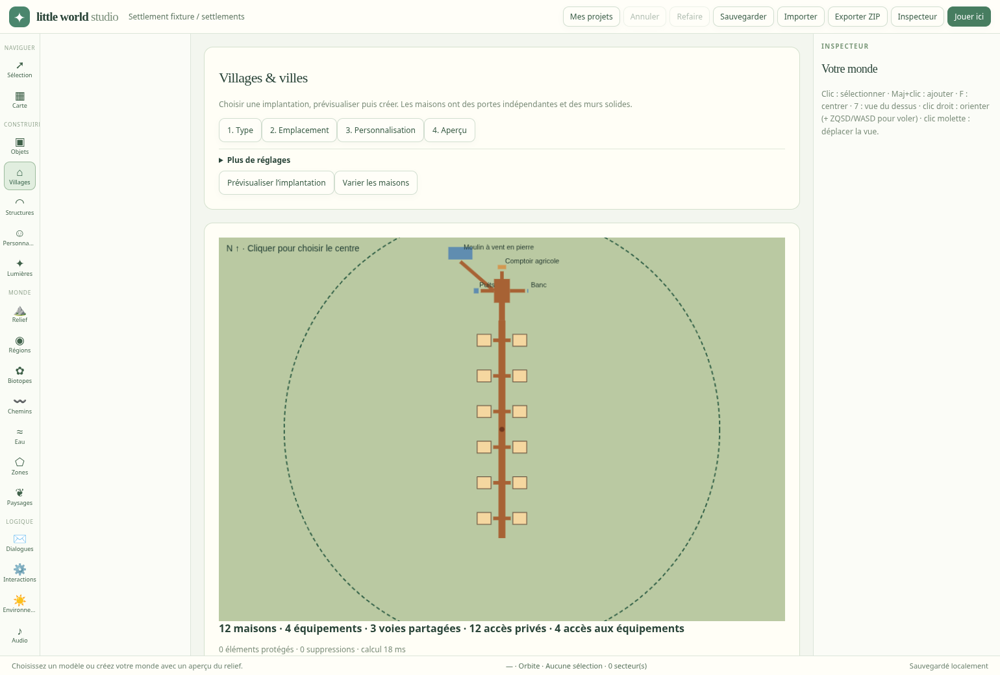
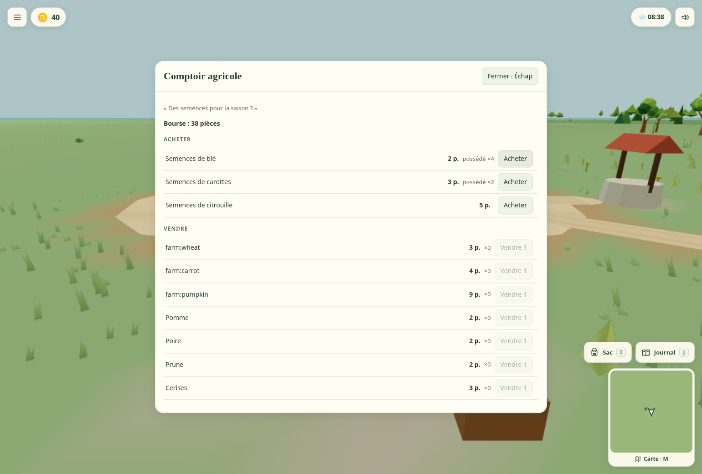

# Places, équipements et comptoirs — établissements V1

18 novembre 2026. Implémenté sur `feat/stepped-island-identity`, non déployé. Suite de [75 — villages de surface](75-SETTLEMENTS-SURFACE-V1.md), conformément aux lots F3/F5 et au contrat CT-4 des [roadmaps 70–72](71-SETTLEMENTS-FAST-TRACK.md). Ce document remplace les mentions « aucun équipement métier » de la première livraison pour le périmètre ci-dessous.

## Parcours livré

Dans **Construire → Villages & villes → Personnalisation**, cocher **Ajouter une place et des équipements**. Le rayon proposé passe au minimum à 110 m pour laisser de la place ; aucun terrassement n’est appliqué. L’option reste désactivée sur les recettes historiques qui ne la possèdent pas : leurs implantations restent identiques.

La proposition ajoute une place à l’entrée de l’implantation, reliée aux rues, un puits et un banc. Le choix **Activité dominante** adapte les équipements :

| Activité | Équipements proposés en plus du mobilier commun |
| --- | --- |
| Mixte / Commerce | Étal du marché, catalogue d’achat/vente existant |
| Agriculture | Comptoir agricole et moulin à vent du catalogue |
| Forêt | Comptoir forestier et feu de camp |
| Mine | Comptoir minier, si une zone de mine se trouve à proximité |
| Pêche | Comptoir de pêche, si une eau se trouve à proximité |

Les ressources sont vérifiées dans les sources natives : zone de mine à moins de 300 m ; échantillonnage borné des eaux et du relief jusqu’à 240 m. Ce sont des critères de proximité, **pas** un calcul de coût de transport vers un gisement ni une qualification de navigation maritime. Une ressource manquante, un modèle absent, un manque de place ou un accès impraticable produit un diagnostic explicite. Aucun faux bâtiment de forge, quai ou métier n’est inséré à sa place.

Le moulin et le feu utilisent les assets existants, avec leur présentation habituelle. Le moulin n’introduit pas encore de transformation des récoltes ; le feu, le puits et le banc ne déclenchent pas d’action métier nouvelle. Les champs existants restent protégés ; aucune parcelle agricole n’est créée par cette option.

## Édition et conservation

Le plan 2D affiche les équipements, leurs empreintes et leurs dessertes. Le bilan distingue maisons, équipements, voies communes, accès privés et accès aux équipements. La place et les chemins utilisent `PathDefinition` ; les équipements sont des entités V3 ordinaires. Pas de nouveau renderer, stockage ou moteur routier.

Dans la liste de l’implantation, **Équipement à modifier** permet de sélectionner, verrouiller, ouvrir dans l’inspecteur 3D ou supprimer un élément. Une transformation manuelle ou un verrou conserve l’objet lors de la régénération. Le recalcul remet son entrée en relation avec la place ; un chemin déjà retouché reste protégé. Une suppression explicite est mémorisée pour ne pas recréer l’équipement au prochain tirage.

Le retrait de l’option supprime seulement le contenu encore automatique. Un équipement repris par l’auteur et les voies nécessaires sont conservés. Une suppression totale d’implantation conserve également les éléments personnalisés ou verrouillés ; les références extérieures empêchent une suppression silencieuse. Les opérations utilisent le CommandBus et les sauvegardes du Studio.

## Comptoir utilisable et pose d’usage

Le composant optionnel `ShopAccess` décrit une pose locale : décalage, orientation, largeur et portée. La projection conserve cette ancre dans l’index logique, la compilation et le lecteur du jeu. Les équipements non marchands utilisent aussi l’ancre pour leur desserte ; seul `State.initial.shop` active le catalogue commercial existant.

Le runtime indexe les ancres commerciales spatialement. Avant de proposer **Commercer**, il vérifie distance 3D, côté d’usage, largeur et occlusion contre les mêmes obstacles que le personnage. L’ouverture du panneau ne donne pas une autorisation permanente : chaque achat ou vente revérifie la proximité et l’accès avant d’appeler l’économie existante. Monnaie et inventaire restent modifiés atomiquement.

Les points d’usage sont placés hors de l’enveloppe physique réelle, y compris à 45°. Les AABB conservatrices du moteur peuvent imposer davantage de recul que l’empreinte visuelle. Les grands chemins et la place sont vérifiés par bandes bornées compatibles avec le balayage physique, sans dépasser le rayon maximal du moteur. Les murs restent actifs ; l’état d’une porte ne supprime pas les obstacles des équipements.

**Jouer ici** sur un équipement sélectionné utilise son point d’usage comme arrivée. Le joueur peut ouvrir le comptoir avec E, acheter/vendre et conserver l’inventaire dans une sauvegarde de partie séparée du projet auteur. Les anciens comptoirs sans pose restent compatibles avec leur portée historique ; ils bénéficient du contrôle d’occlusion et de la revérification des échanges, sans réécriture de la carte officielle.

## Vérification

- **640 tests réussis**, dont neuf tests dédiés aux équipements, usages, ressources, rotations, conservation, déplacement, archive, compilation et transaction économique. Vérification TypeScript, build et contrôle du build statique réussis.
- Le parcours existant des villages passe à nouveau **20 contrôles navigateur**, y compris le déplacement maison/porte, le village de 60 maisons et le playtest.
- Régression de l’économie existante : **14 contrôles navigateur réussis** sur l’île officielle (achat de hache, vente de bûches, collecte et coffre).
- **10 contrôles navigateur dédiés** : création du village agricole, équipements natifs, verrous, suppression conservée, ZIP, playtest compilé, achat de semences à 2 pièces, sauvegarde et réouverture. [Rapport](captures/settlement-services-v1/browser-report.json).
- [Matrice de 24 implantations](captures/settlement-services-v1/benchmark-report.json) : activités mixte/agricole/forestière/commerçante, 12/60/80 maisons, orientations 0/45°. **24 implantations validées, 24 cibles de maisons atteintes**, jusqu’à quatre équipements et 3 043 volumes physiques. Les temps et poids sont mesurés sous Node sur une plaine technique ; ils ne garantissent aucun FPS ou budget GPU.





## Suite de la roadmap

Cette étape livre une première spécialisation fonctionnelle des villages, avec place et commerce. Restent notamment : quartiers et parcelles polygonales éditables, diversité de volumes et matériaux, habitants et routines métier, équipements de production, quais et embarquement, camps, défenses, terriers/grottes et qualification des grandes villes. Aucun jalon F5–F8 complet n’est annoncé.

Commandes :

```sh
npm test
npm run build
node tools/verify-static-build.mjs dist
npm run test:settlement-services
npm run test:settlements
npm run benchmark:settlement-services
```

Le benchmark et les captures écrivent dans `/tmp/little-world-settlement-services`. Les fixtures techniques restent isolées des cartes publiées.

Évolution du placement : [77 — implantation organique et édition directe](77-ORGANIC-SETTLEMENT-PLACEMENT.md). Les descriptions du modèle aligné ci-dessus restent celles de la livraison initiale.
