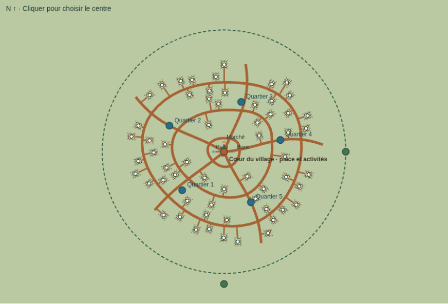

# Implantations organiques autour d’un point d’intérêt

## Implémenté sur `feat/stepped-island-identity`, sans publication

Le nouveau brouillon propose une organisation relativement concentrique autour d’un seul centre : place commune, marché ou activité. Les voies radiales courbes rejoignent des passages périphériques irréguliers ; les maisons cherchent une position libre et orientent leur entrée vers le réseau réel. Les quartiers déforment cet ensemble, sans créer de centres satellites. Les rectangles pointillés de l’aperçu indiquent une enveloppe de placement, pas un cadastre ajouté au projet.

À taille, graine et espacement identiques, le village s’étale davantage que la ville ; le profil « ville fortifiée » resserre encore l’implantation et les rues. Ce dernier est **un profil de placement seulement** : aucune enceinte, porte fortifiée ou réservation de rempart n’est générée. La densité reste réglable indépendamment du type. Le nombre demandé est une cible : un terrain, des obstacles ou une forte densité peuvent réduire le nombre de maisons proposé.

## Utilisation

Dans **Construire → Villages & villes**, choisir le type, l’organisation et le point d’intérêt, puis l’emplacement et la taille. L’aperçu contrôle les chemins et les collisions avant d’autoriser la création.

- Déplacer le centre, modifier le rayon ou tourner l’implantation avec les poignées.
- Déformer un quartier ou déplacer une maison ; ses accès sont recalculés au relâchement.
- Dessiner une zone de 3 à 32 sommets, terminer avec Entrée ; les empreintes et voies internes doivent rester dans cette zone. Le raccord régional peut en sortir.
- Suggérer un emplacement : recherche bornée dans le terrain réel et validation complète du meilleur candidat retenu.
- Varier l’implantation séparément des façades ; sauvegarder, exporter et rouvrir le même plan.

Les retouches restent un brouillon jusqu’à « Créer dans le monde » ou « Appliquer les changements ». Une manipulation du plan ne modifie pas directement les sources. Une retouche impraticable affiche son erreur et bloque l’application. Les bâtiments et équipements verrouillés ou modifiés manuellement restent protégés.

## Contrats et compatibilité

`SettlementRecipe.layout` est facultatif et versionné. Il conserve organisation, espacement, variation, point d’intérêt, déformations des quartiers, zone et déplacements individuels. Son absence conserve l’ancien modèle aligné ; ouvrir un ancien établissement ne le convertit pas automatiquement. L’ancien modèle reste sélectionnable.

Les résultats utilisent les entités V3, `Habitat`, portes indépendantes, équipements et `PathDefinition` existants. Aucun moteur physique, stockage ou réseau de chemins parallèle. Les limites restent 80 maisons et 100 points par chemin. Le contrôle des accès emploie le terrain natif et les volumes de collision du jeu, avec portes ouvrables exclues comme dans la validation existante. Les opérations d’application passent par la transaction partagée du Studio.

La recherche de parcelles est bornée et déterministe. Elle n’effectue aucun terrassement et ne promet pas de remplir une zone impossible. Une voie périphérique peut être omise lorsque le relief ou un équipement la bloque ; les accès restants doivent néanmoins passer la validation du réseau. Les ponts, ports bâtis, murailles, grottes et simulation urbaine restent hors de cette livraison.

## Vérification reproductible

- `npm test`, `npm run typecheck`, `npm run build`.
- `npm run test:organic-settlements` : manipulations directes, zone dessinée, sauvegarde, façades, export/réouverture et porte dans le jeu compilé.
- `npm run benchmark:organic-settlements` : profils village/ville/fortifiée, deux organisations et deux graines, puis implantation sur des îles naturelles croissant et tortue ; rapporte les cibles partielles et les erreurs sans les masquer.
- Les régressions navigateur des établissements et services conservent explicitement l’ancien modèle pour vérifier sa compatibilité.

Les rapports et captures de qualification sont dans [captures/organic-settlements-v1](captures/organic-settlements-v1/). Ces mesures qualifient les sources et les interactions testées, sans garantie de FPS ou d’acceptation artistique de toutes les graines.

Qualification de cette livraison : 648 tests unitaires réussis, typecheck et build réussis ; 14 contrôles navigateur organiques, 10 contrôles de services et 20 contrôles de compatibilité de l’ancien modèle réussis. La matrice native comporte 24/24 propositions valides, dont 16 atteignent entièrement la cible ; les deux îles naturelles trouvent une implantation validée de 12 maisons. Les captures comparatives demandent 60 maisons à la même échelle : 60 pour le village, 53 pour la ville et 50 pour le profil fortifié. Les rayons moyens sont respectivement 87,0 m, 62,9 m et 58,6 m. Les valeurs partielles restent visibles dans le Studio.

Comparer avec [la ville](captures/organic-settlements-v1/town-preview.png) et [le profil fortifié](captures/organic-settlements-v1/fortified-preview.png), à la même échelle.

Suite : [78 — village-rue, montagne, rivière et pêcheurs](78-CONTEXTUAL-SETTLEMENT-PATTERNS.md). Le modèle concentrique décrit ici reste un choix parmi ces organisations.
