# Villes sur deux rives, diversité et vie locale — étude de structuration

18 novembre 2026. Référence : `feat/stepped-island-identity` @ `cb11487`. **Étude et proposition d’architecture ; aucune nouvelle fonctionnalité de cette étude n’est implémentée.** Complète les contrats [70](70-SETTLEMENTS-TECHNICAL-CONTRACTS.md), la roadmap [71](71-SETTLEMENTS-FAST-TRACK.md) et les livraisons [77](77-ORGANIC-SETTLEMENT-PLACEMENT.md) / [78](78-CONTEXTUAL-SETTLEMENT-PATTERNS.md).

## 1. Diagnostic du code actuel

| Domaine | Existant vérifié | Adaptation nécessaire |
| --- | --- | --- |
| Rivière | `settlements/corridor.ts` suit une berge sèche ; les maisons sont réparties autour d’un seul axe. | Identifier les deux rives et construire un réseau de quartiers reliés par des franchissements explicites. |
| Ponts | Assets bois/pierre dans le registre ; `studio-core/modular-construction.ts::bridgePlan` et outil manuel `studio/construction-panel.ts`. Le calcul limite la portée à 2–30 m, l’étirement à 0,6–2,5 et l’écart de hauteur des rives à 3 m. Son commentaire précise que ce n’est pas une preuve de traversabilité. | Profils physiques qualifiés par modèle : tablier, appuis et raccords aux rives ; intégrer les ponts à la génération et à sa provenance. Ces limites de pose ne garantissent pas qu’un asset convient à toute portée autorisée. |
| Chemins et graphe | `PathDefinition` contient XZ, largeur, revêtement et lissage. `settlementTransportGraph` calcule Y depuis le terrain. Le validateur refuse eau et pente, avec sweeps à la hauteur du sol. | Distinguer sol et support surélevé ; déterminer la hauteur réelle du tablier et connecter seulement ses extrémités. Un tracé couleur bois au-dessus de l’eau ne suffit pas. |
| Physique | `WorldCollisionQuery.surfaceAt` gère notamment les dessus de boîtes et le plafond ; des tests élémentaires existent pour tablier/hauteur libre. | Prouver la traversée d’un pont généré, orienté et raccordé, avec le contrôleur réel. `colliderFor` produit une enveloppe générique : insuffisant pour garantir forme du tablier, garde-corps et dessous. |
| Maisons | `settlements/habitat.ts` : un gabarit creux 6 × 7 m, porte indépendante, trois apparences bois/pierre/enduit. | Plusieurs archétypes avec empreintes, accès et collisions propres ; changer le matériau ne suffit pas à varier les bâtiments. |
| Services et habitants | `services.ts` : équipements et comptoirs. Économie, dialogues, objectifs, interactions, personnages animaux existent. `landscape-presets.ts` possède des helpers locaux d’habitants et de donneurs de quêtes. | Extraire les mécanismes réutilisables ; les helpers locaux ne sont pas encore une bibliothèque de vie urbaine intégrée au générateur d’établissements. |
| Régénération | Recette, graine, variations, IDs, hashes, verrous, suppressions et application transactionnelle existent. | Étendre la provenance aux quartiers, ponts, bâtiments spécialisés, habitants et contenus déclaratifs ; protéger aussi les liens fonctionnels. |

Le changement central est de passer de **« une forme de rue + des maisons »** à **« un site + un réseau praticable + des quartiers spécialisés + des bâtiments et usages »**. Les sorties restent les sources V3 existantes ; pas de second moteur de routes, de physique, d’économie ou de sauvegarde.

## 2. Chaîne de génération recommandée

```mermaid
flowchart LR
    A[Analyser relief, eau, réservations et routes] --> B[Choisir les pôles et franchissements possibles]
    B --> C[Valider ponts et raccordements physiques]
    C --> D[Construire le réseau des deux rives]
    D --> E[Délimiter des quartiers et réserver les activités]
    E --> F[Choisir les archétypes et placer les parcelles]
    F --> G[Ajouter équipements, habitants et interactions]
    G --> H[Valider le parcours complet puis prévisualiser le diff]
```

Réserver les bâtiments importants **avant** de remplir les parcelles résidentielles. Sinon, marché, moulin ou auberge ne trouvent plus leur place et deviennent des objets ajoutés dans les espaces restants.

## 3. Organisation autour de l’eau et ponts

Proposer un réglage **Occupation de la rivière** : « une rive », « deux rives si possible », « deux rives requises ». Les recettes anciennes restent sur une rive. Ajouter « franchissements automatiques / manuels / aucun » ; ne pas rendre le pont obligatoire pour tout village de pêcheurs.

1. Identifier une rivière native et son tronçon local, la largeur mouillée réelle, le niveau d’eau, les berges sèches, les replats, les confluences, cascades et obstacles. Les deux rives sont locales au tronçon : ne pas les définir par un simple signe X ou Z sur une rivière sinueuse.
2. Échantillonner un nombre borné de sections transversales. Chercher des appuis secs et stables de chaque côté ; privilégier une traversée courte, proche des routes et des futurs pôles. Éviter confluence, chute, falaise, réserve agricole et collision existante.
3. Évaluer les modèles de pont qualifiés pour cette portée, largeur et altitude. Valider niveau d’eau sous le tablier, accès sur chaque rive, largeur utile, hauteur libre, garde-corps et support du joueur. Pour le premier lot, n’accepter que des rives proches en altitude, un tablier simple et des raccords dont le contrôleur prouve la praticabilité. Les rampes complexes et grandes travées restent des lots séparés.
4. Construire les rues de chaque rive **depuis les raccords du pont**, puis répartir l’habitat : par exemple un bourg principal et un petit quartier de pêche ou d’artisans en face. Ne pas dupliquer en miroir la première rive.
5. Placer un second pont seulement si la taille et le détour le justifient. Un à trois candidats retenus est un budget de prototype à mesurer, pas une règle systématique ni une capacité de performance annoncée.

Si aucun franchissement n’est praticable : « deux rives si possible » revient explicitement à une rive avec avertissement ; « deux rives requises » bloque la création. Ne jamais compter une maison isolée en face comme desservie. Un pont manuel peut être réutilisé seulement si ses appuis et supports sont qualifiés ; sa seule présence visuelle ne suffit pas.

### Contrat technique du franchissement

Décision recommandée : une **source de pont versionnée réutilisable par l’outil manuel et le générateur**, portée par une entité V3, avec modèle physique, appuis et points de raccord nommés. Sa description produit les volumes de collision et supports via l’adaptateur existant, sur le principe des maisons `Habitat`. Le champ/composant exact doit être figé après le prototype physique, avant extension du parser.

Étendre ensuite le contrat natif de chemin avec une référence facultative au support pour les tronçons concernés ; ne pas copier un second profil d’altitude indépendant. Sol = terrain, pont = support dérivé de l’entité. La représentation visuelle du chemin doit suivre ce même support ou s’arrêter aux appuis lorsque le tablier fournit déjà le revêtement. Le graphe conserve XYZ, identité du support et raccords explicites : deux passages qui se croisent en XZ à des hauteurs différentes ne se connectent pas.

La dérogation au contrôle « sol sec » s’applique **uniquement** à une arête de pont possédant un support continu, chargé et validé. Tous les raccords et autres chemins gardent les contrôles actuels. Supprimer le pont, changer son altitude ou modifier la rivière invalide les arêtes et quartiers dépendants ; aucune suppression automatique d’un quartier retouché par l’auteur.

## 4. Variété organique : varier la structure avant les façades

Dissocier trois dimensions actuellement trop liées :

- **Organisation** : noyau autour d’une place, village-rue, ruban de berge, quartiers autour des appuis d’un pont, flanc à replats ou combinaison de ces structures.
- **Identité locale** : activité principale et secondaire, matériaux dominants, richesse, densité, taille des jardins, silhouettes et importance des équipements.
- **Terrain** : réseau réellement praticable, poches constructibles, vues, eau, champs, pentes et réserves. Ces contraintes ont priorité sur les tirages aléatoires.

Introduire plusieurs familles de topologie pour un même modèle : village avec pont au milieu ou à une extrémité, petite rive secondaire, marché près d’un appui, bourg ancien plus dense et extension aérée, quartiers artisanaux en lisière. Mélanger une à trois activités compatibles et une densité locale décroissante ou irrégulière, plutôt qu’un seul coefficient sur tout le village. Les nombres sont des paramètres de composition à qualifier.

Les rues secondaires relient des destinations utiles, contournent les obstacles et créent des boucles quand elles réduisent les détours. Les parcelles ont des retraits, orientations et tailles variables, avec petites cours et jardins ; elles suivent la rue sans former systématiquement deux rangées équidistantes. Conserver des espaces vides intentionnels : jardin, rive accessible, verger, place ou vue.

L’aléatoire reste **déterministe et stable** : graines dérivées séparément pour topologie, quartier, parcelle, archétype, apparence et vie locale. Des clés sémantiques stables évitent qu’ajouter un banc décale tous les tirages suivants. « Varier le plan », « Varier les bâtiments », « Varier les apparences » et « Varier la vie locale » doivent agir séparément et respecter les verrous. Ajouter un bâtiment plus grand peut exiger une nouvelle parcelle : afficher le diff et les conflits, sans promettre une conservation géométrique impossible.

Pour éviter les répétitions sur une même carte, calculer une petite signature de composition (topologie, répartition entre rives, activités, palette et catégories de bâtiments), comparer aux établissements voisins et essayer un nombre borné de variantes. Il s’agit d’une diversité mesurable, pas d’une garantie mathématique d’unicité de toutes les cartes. La recette finalement retenue doit être enregistrée et reproductible.

## 5. Catalogue de bâtiments et rôles

Créer des archétypes déclaratifs indépendants des assets visuels et des activités :

| Métadonnée | Utilité |
| --- | --- |
| Rôle et tags | logement, ferme, commerce, auberge, atelier, stockage, équipement commun ; contextes et styles compatibles. |
| Empreinte et dégagements | polygone/volume, cour éventuelle, retrait aux routes/rives, support de fondation, pente acceptable. |
| Accès nommés | porte, comptoir, livraison, emplacement de dialogue, poste de travail ; orientation et largeur utile. |
| Profil physique | volumes, support, porte indépendante si ouvrable ; intérieur jouable, extérieur seulement ou décor explicitement déclaré. |
| Variantes visuelles | assets, matériaux, tailles réellement qualifiées, enseignes, usure ; ne pas étirer arbitrairement les ouvertures. |
| Services et capacités | références vers commerce, dialogue, interaction ou activité existants ; pas de comportement inféré depuis le nom du mesh. |
| Coûts et provenance | budget objets/PNJ/lumières, références générées, verrous et suppressions. |

Auditer les assets existants en trois classes : **habitat jouable qualifié**, **bâtiment extérieur avec interaction accessible**, **décor seulement**. Les maisons GLB, moulin à eau, auberge, ferme et autres assets présents dans le registre ne deviennent pas automatiquement creux ni utilisables. Commencer par quelques gabarits d’habitat à dimensions différentes et plusieurs rôles extérieurs fiables.

Composer le programme du village avant son plan : besoins minimaux + choix pondérés + limites par rôle, en conservant une majorité de logements. Exemple de pêche : logements, stockage/filets, comptoir, point de pêche et éventuellement auberge ; commerce : étals, auberge, stockage et artisanat ; rivière : moulin seulement si implantation et accès conviennent ; montagne : logements compacts sur replats et activité compatible avec les ressources. Une grande ville ajoute des services et spécialisations par quartier ; elle ne multiplie pas uniformément le même bâtiment.

Les quotas et éventuelles activités obligatoires doivent être visibles dans l’aperçu. Un rôle obligatoire impossible à placer bloque ou demande une alternative explicite ; un équipement facultatif omis produit un diagnostic.

## 6. Vie locale et interactions utiles

Associer chaque lieu utile à un petit ensemble cohérent **bâtiment + équipement + personnage animal éventuel + interaction + accès**.

| Lieu | Premier usage à viser | Dépendances et limites |
| --- | --- | --- |
| Marché / comptoir de pêche | achats et vente de produits locaux | économie et `ShopAccess` existants ; catalogue et proximité revérifiés. |
| Auberge extérieure | dialogue, renseignements, livraison de provisions | commerce `inn` existant ; repos ou intérieur à spécifier et qualifier séparément. |
| Moulin / ferme | collecte ou livraison liée aux récoltes | templates d’interaction et objectifs existants ; transformation de ressources seulement après ajout d’un contrat d’activité testé. |
| Atelier | demande de matériaux, récompense ou échange | quêtes déclaratives existantes ; ne pas annoncer un système complet de craft/forge. |
| Place / rive | habitant qui renseigne, petite mission locale, point d’activité | dialogues cohérents avec les lieux réellement créés et atteignables. |

Extraire les helpers locaux d’habitants/quêtes de `landscape-presets.ts` en générateurs partagés de contenus déclaratifs, sans appeler le gros preset de ville ni copier ses layouts. Générer des IDs stables et enregistrer la provenance des personnages, dialogues, interactions, objectifs et items spécifiques. Préserver la persistance de partie lors d’un reroll cosmétique.

Commencer par quelques personnages utiles aux accès vérifiés, puis routines locales bornées. Les trajets sur ponts ne deviennent possibles qu’après validation de la navigation correspondante ; ne pas supposer que le graphe du générateur pilote déjà les PNJ. Éviter une simulation de tous les habitants en continu. Aucun nouveau moteur d’économie, aucune population humaine et aucune quête impossible faute de ressource ou destination accessible.

## 7. Données, modules et interface Studio

Extensions **proposées**, pas schémas déjà acceptés par le parser :

- Recette : préférences de rives/franchissements, identité/palette, activités pondérées, composition et intensité de vie locale ; valeurs facultatives avec comportement historique conservé.
- Instance : provenance et dépendances de quartiers, franchissements, bâtiments spécialisés et groupes de contenu ; conserver les entités et bibliothèques natives comme sources réelles.
- Plan temporaire : candidats, raisons de rejet, graphe de supports, réservations, contraintes satisfaites, dépendances et diff. Pas de deuxième monde persistant à synchroniser.

Répartir la logique dans `settlements/` : analyse du site → franchissements → réseau → quartiers → programme de bâtiments → parcelles → vie locale → validation. `planner.ts` orchestre ; `authoring.ts` conserve le commit unique et le rollback ; le registre d’archétypes ne dépend pas de l’interface ni du rendu. Les supports physiques et profils de chemins restent des contrats partagés avec le compilateur/runtime, pas des exceptions privées du village.

Dans le Studio : choix d’un modèle simple, options avancées facultatives ; aperçu montrant les deux rives, les ponts proposés/refusés, pôles, rôles de bâtiments et accès interrompus. Déplacer un appui ou un pôle recalcule son voisinage. Verrouiller pont, rue, quartier ou bâtiment. Choisir un rôle/archétype pour un bâtiment et ajuster une parcelle. Toute variation affiche les ajouts, suppressions et conflits avant application transactionnelle ; les contenus retouchés restent protégés.

## 8. Ordre d’implémentation recommandé

| Lot | Résultat concret | Critère de sortie |
| --- | --- | --- |
| A — pont physique réutilisable | Un petit pont généré et manuel utilisant le même contrat de supports. | Le joueur traverse entre deux berges dans les deux sens, sans nage imposée, blocage, chute ni faux raccord ; source → compilation → jeu → sauvegarde/Undo vérifiés. |
| B — établissement sur deux rives | Un pont validé, deux quartiers asymétriques, accès à chaque entrée. | Déplacer/supprimer le pont ou modifier l’eau invalide les dépendances ; fallback et mode requis corrects. |
| C — composition et diversité | Plusieurs topologies par contexte, graines séparées, quartiers et espaces libres variés. | Reproductibilité, différences structurelles sur plusieurs graines, rerolls ciblés, retouches et verrous préservés. |
| D — catalogue d’archétypes | Quelques silhouettes/empreintes et rôles qualifiés, bâtiments spéciaux réservés avant les logements. | Placement et porte/interaction adaptés à chaque empreinte, compatibilité des anciens projets et export. |
| E — vie locale | Quelques services, habitants animaux et missions cohérents avec la composition. | Interactions accessibles, échanges atomiques, quêtes terminables, persistance et régénération sélective. |

Préparer les métadonnées du catalogue et les contrats de provenance dès A, mais livrer chaque lot comme un parcours utilisable. Ne pas coupler le premier pont à une refonte complète de tous les bâtiments.

## 9. Qualification à prévoir

- **Ponts** : ruisseau étroit, rivière oblique, rives décalées en altitude, méandre, confluence/cascade rejetée, portée trop grande, approche bloquée, tablier/largeur/hauteur libre ; chargement des collisions entre secteurs et état correct avant entrée du joueur. Passage dessous uniquement si le profil le permet et si ce parcours est testé.
- **Connectivité** : toutes les entrées utiles reliées au réseau ; croisement sous le pont sans connexion fictive ; deuxième rive refusée si isolée ; pont supprimé/verrouillé et eau modifiée.
- **Diversité** : mêmes sources et graines → même plan ; graines différentes → différences de topologie/composition mesurées ; palette cohérente ; pas de copies en miroir ; échecs de placement et temps de recherche rapportés.
- **Bâtiments et vie** : empreintes différentes, entrée obstruée, comptoir derrière un mur refusé, dialogue/quête sans référence cassée, transaction et progression conservées, reroll de façade sans déplacement d’habitant ni remise à zéro de quête.
- **Studio et budgets** : preview fidèle au commit, Undo/Redo, ZIP/réouverture/Jouer ici ; limites explicites de recherche, ponts, bâtiments, PNJ actifs et lumières, puis mesures CPU/GPU sur scènes comparables. Le plafond actuel de 80 maisons reste inchangé avant qualification d’un autre budget.

**Prochaine livraison recommandée : A puis B**, avec une fixture de village asymétrique sur deux rives. C et D apportent ensuite une variété structurelle et fonctionnelle ; E anime ces lieux avec les systèmes déjà présents.

Première mise en œuvre et limites : [88 — ponts, vie locale et intégration des ports de main](88-VILLAGES-RIVER-LIFE-MAIN-INTEGRATION.md).
