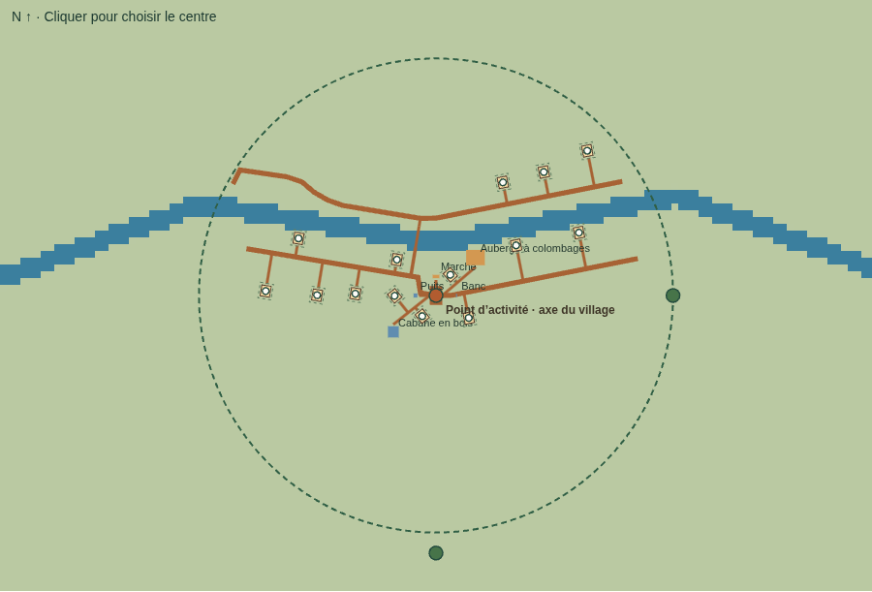

# Villages sur deux rives, vie locale et réutilisation des ports de main

Implémenté sur `feat/stepped-island-identity`, sans déploiement. Ce lot poursuit [79 — étude](79-RIVER-TOWNS-DIVERSITY-LIFE-PLAN.md) et intègre `main` @ `de0832e` par la fusion `64a14ea`. Les descriptions historiques des documents 75–79 restent celles de leurs livraisons respectives.

## Livré dans le Studio

Dans **Villages & villes → Organisation → Village de rivière**, le réglage **Occupation des rives** propose une rive, deux rives si possible ou deux rives requises. Le défaut historique reste une rive.

La proposition cherche une petite traversée et des appuis secs. Elle crée un pont piéton en bois avec tablier et garde-corps, une liaison depuis le réseau principal et un second quartier sur la rive opposée, sans copie en miroir. Les entrées des maisons doivent rejoindre le réseau validé. La cible de maisons peut être partiellement remplie.

Cette première version limite volontairement les ponts générés à une portée de 3–28 m, une différence de niveau des appuis de 15 cm maximum, un tablier au-dessus de l’eau et des approches terrestres praticables. Aucune grande travée ni rampe complexe. Si le site ne convient pas, le mode facultatif avertit ; le mode requis bloque. Les ponts existants du kit et les ponts naturels ne sont pas automatiquement déclarés praticables par ce nouveau générateur.

Dans **Personnalisation**, deux options supplémentaires proposent :

- **Bâtiments d’activité variés** : auberge et bâtiment extérieur adapté à l’activité, en plus des services existants. Réservation avant les maisons ; omission avec diagnostic si le terrain ne convient pas. Il ne s’agit pas encore de nouveaux gabarits d’habitats jouables ni d’intérieurs d’auberge.
- **Habitant avec dialogue local** : un écureuil à un accès public, avec informations liées aux lieux effectivement présents. Le personnage reste au repos ; aucune routine qui traverserait implicitement le pont ni nouvelle quête n’est annoncée.

Les marchés, stocks, prix, ateliers, recettes, horloge et sauvegardes viennent des systèmes intégrés depuis `main`. Le comptoir d’auberge porte le type `inn`, donc il utilise la cuisine/boulangerie déjà définies dans `economy/workshop-services.ts`. Le comptoir de pêche conserve `port`, avec sa vannerie existante. Aucun second moteur économique ni inventaire n’est ajouté.

## Support physique commun et conservation des sources

`Bridge` version 1 est un composant V3 facultatif. Son transform décrit une longueur de 3–30 m et une largeur de 2,5–6 m. Le visuel procédural et l’adaptateur de collision utilisent un tablier plat de 20 cm et des garde-corps latéraux. Les volumes sont découpés en petites sections pour éviter une grosse boîte diagonale condamnant le passage ou offrant une immense surface invisible.

`PathDefinition.supportId` référence explicitement l’entité pont. Sa hauteur provient du transform et du terrain sous son ancre ; elle n’est pas dupliquée dans un profil indépendant. Le validateur vérifie largeur, emprise, terrain, eau native actuelle et sweeps au niveau du tablier. Seul ce tronçon bénéficie d’un support au-dessus de l’eau. Les raccords à moins de 20 cm du tablier sont reliés explicitement dans le graphe ; un croisement XZ quelconque ne devient pas un raccord.

Le chemin sur tablier n’ajoute pas un second ruban plaqué au fond de la rivière : le tablier assure son rendu. Compilation et lecture utilisent les sources et collisions natives. Le pont, les équipements et le personnage ont une provenance et des verrous. Un pont protégé peut être conservé pendant un reroll de façades ; si ses accès deviennent invalides, l’application est bloquée. Le dialogue retouché est protégé par sa provenance. Supprimer un ensemble non retouché nettoie aussi ses dialogues et ses chemins ; les dépendances extérieures empêchent une suppression silencieuse.

Les anciennes recettes restent compatibles : `riverBanks`, `variedServices`, `localLife`, `maritimePort`, `Bridge` et `supportId` sont facultatifs. Les plafonds de 80 maisons et de recherche bornée restent inchangés.

## Ports et commerce maritime : réutiliser main

Sources relues : [83 — ateliers](83-ECONOMY-WORKSHOPS-PLAYABLE-V1.md), [84 — marchés](84-ECONOMY-ISLAND-MARKETS-V1.md), [85 — cargo](85-ECONOMY-MARITIME-CARGO-V1.md), [86 — implantation N1–N3](86-MARITIME-TRADE-PLACEMENT-N1-N3.md), [87 — runtime N1](87-MARITIME-PORT-N1-RUNTIME.md).

L’option **Préparer le raccord au port N1 existant** réutilise `archipelago/port-n1-plan.ts::planPortN1`, ses profils de côte, longueurs modulaires, sockets et contraintes. Elle borne la recherche au voisinage du village et rejette les réservations/obstacles ; si un site convient, elle ajoute un raccord terrestre, réserve l’emprise du stand pour les maisons proposées et conserve une ancre native dans une entité V3.

Le survey des îles publiées dans `main.ts` peut reprendre ces ancres via `authoredPortAnchors`, puis réutilise **le même** `createPortN1View`, `assembleDock`, `attachPortN1Collisions`, les présences de marchand/rameur et le service cargo existants. L’ancre est une préférence soumise à la revalidation runtime, pas une autorisation d’ignorer un site devenu incompatible.

**Limite importante : ce bouton prépare un raccord ; il ne constitue pas encore un générateur auteur complet de quai N1 dans le Studio.** Sur un brouillon sans île maritime active, il n’invente ni ferry, ni marchand itinérant, ni cargaison. Un site côtier incompatible conserve le refus du survey N1 et produit un avertissement. Les variantes N2/N3 ne sont pas activées par ce lot et aucun nouveau modèle portuaire n’est fabriqué.

Le commerce local `ShopKind='port'` reste distinct de l’import maritime. Les lots importés restent ceux du cargo réellement reçu ; ni une ancre ni un bâtiment 3D ne crée de stock. Le niveau visuel N1–N3 n’est pas assimilé au niveau de quai/ferry. Le statut d’accès des anciens appels de commerce de `main` et les contrôles de proximité des nouveaux comptoirs sont conservés lors de la fusion.

## Qualification et suite

`tests/river-town-evolution.test.mjs` couvre deux quartiers connectés, la traversée réelle du contrôleur dans les deux sens à 20/30/60 Hz, le refus des sites incompatibles, la suppression du support, la montée de l’eau, les verrous, le dialogue, la compilation avec vérification des vrais GLB, le nettoyage et le refus d’un raccord portuaire impossible.

`tests/port-n1-plan.test.mjs` conserve les tests de main et ajoute le bornage/rejet de candidats auteur et les ancres typées. Le test navigateur `tools/test-river-town-browser.mjs` passe par le vrai formulaire, le ZIP, le verrou de pont, la variation des façades et le lecteur de jeu compilé. Le parcours maritime existant est vérifié séparément par `npm run test:ferry` sur le build statique, avec les modèles et services de main.

Les captures de la nouvelle implantation sont sous `docs/captures/river-town-evolution-v1/`. Pas de nouvelle qualification FPS ni de grande ville revendiquée.

Restent à livrer : nouveaux gabarits de maisons et parcelles, davantage de topologies organiques, bâtiments d’activité réellement spécialisés, quêtes locales, routines de PNJ sur supports qualifiés, édition complète des ports N1–N3 dans le Studio et grandes traversées. Ces points ne sont pas déduits de la présence des assets ni des options de ce lot.

Qualification de cette livraison : **714 tests unitaires réussis**, typecheck/build statique réussis, **7 contrôles navigateur** du nouveau village, **14 contrôles** de régression organique et **10 contrôles** des services et **20 contrôles** de compatibilité du modèle historique réussis. Le parcours navigateur maritime existant (`test:ferry`, build servi localement) passe aussi après fusion : registre publié, vrai port N1, accès marchand, imports cargo et voyage. Le test des services vérifie le prix annoncé par le marché local, plutôt qu’un ancien prix fixe. Les tests navigateur ont été adaptés au démarrage automatique de main.

L’exemple de village qualifié contient 14 maisons sur la cible de 20, une auberge, un bâtiment extérieur, un habitant et un pont. La validation du contrôleur de traversée est un test physique natif ; la capture de jeu atteste le chargement compilé, sans prétendre être une traversée clavier du pont dans le navigateur.

[Vue Studio](captures/river-town-evolution-v1/studio.png) · [Jeu compilé](captures/river-town-evolution-v1/playtest.png) · [Port N1 de main, test maritime distinct](captures/river-town-evolution-v1/port-n1-runtime.png)

Suite : [89 — port natif dès création, caldeira variable et quartiers organiques](89-COMPLETE-ISLAND-START-CALDERA-PORT-VILLAGES.md). Le raccord N1 décrit ici est désormais complété par la génération source du port.
