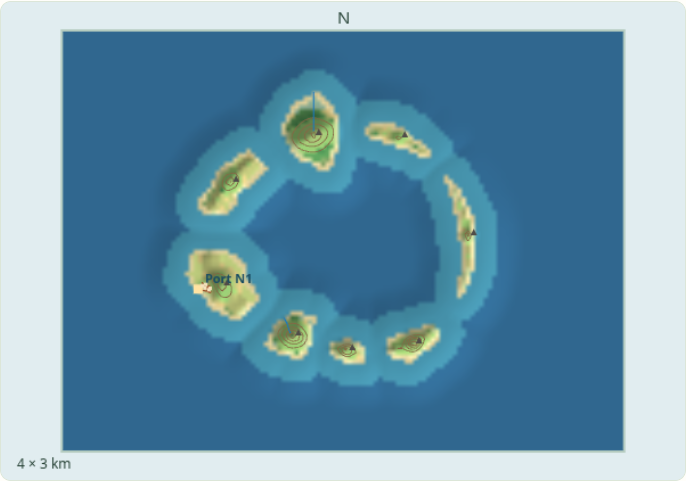
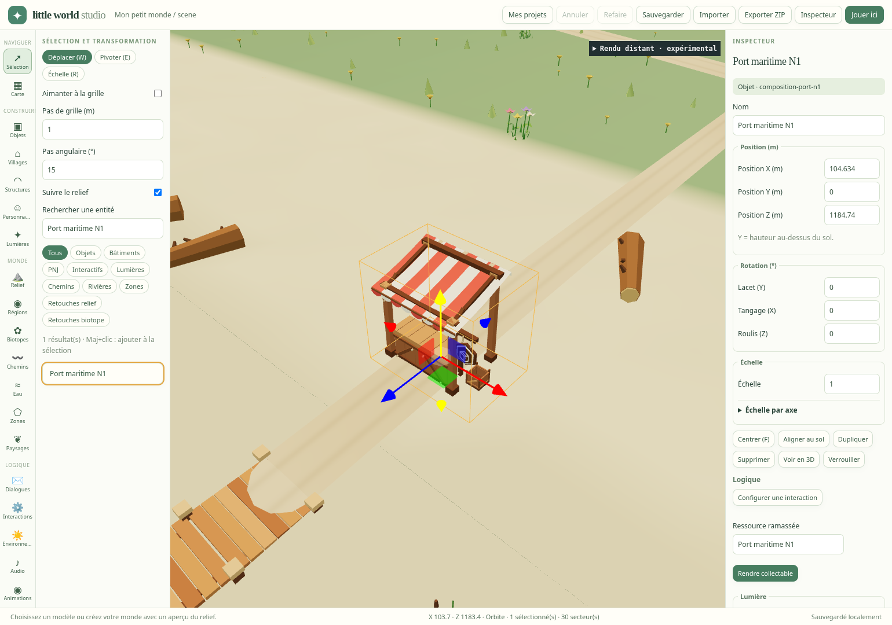
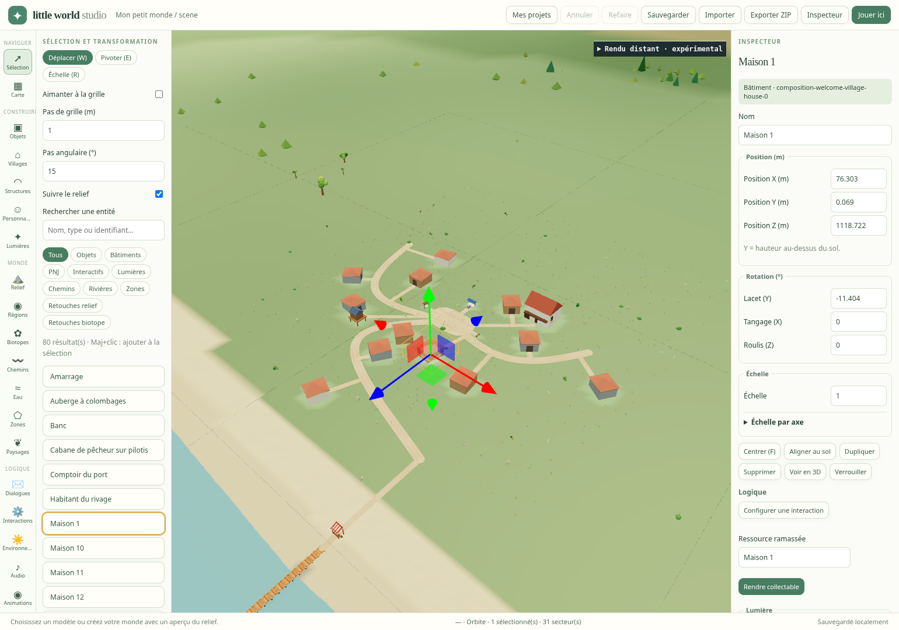

# Création complète : caldeira, port N1 et villages

La création d’une nouvelle île V5 propose désormais un port maritime N1 bâti et un hameau d’accueil. Les anciens projets conservent leur recette et leur géométrie. Ce lot complète [88 — villages, ponts et intégration maritime](88-VILLAGES-RIVER-LIFE-MAIN-INTEGRATION.md).

## Caldeira variable

Le choix « organique » produit 5 à 8 secteurs autour d’un lagon : arcs de longueurs différentes, ouvertures, contours arrondis, épaisseur et altitude variables. Une île large et une île mince structurent l’ensemble, sans répéter une couronne de morceaux identiques. La graine pilote ces différences. Le réglage historique reste disponible ; sans `calderaShape: organic`, l’ancienne géométrie reste identique.

Un petit replat côtier natif peut accueillir le village sur l’île principale lorsque port et village sont demandés. Il ne transforme pas toute la caldeira en plateaux réguliers.

## Port dès la création

Dans « Zones utiles et accès », le port N1 et le hameau sont activés pour une nouvelle création. Le port réutilise le survey N1 et les modèles GLB existants : comptoir, dalles, poteaux, bollard et collisions natives. La jetée modulaire choisit de 3 à 32 cellules selon la côte. Les positions de commerce, d’embarquement et d’accès terrestre sont conservées dans le projet source, indépendamment du joueur.

Le générateur cherche une côte réelle, un accès terrestre et une arrivée navigable. Les réservations d’eau intérieure ne deviennent pas un port maritime. Un port obligatoire introuvable bloque la validation ; les éditions qui enterrent le quai, déplacent le comptoir ou invalident les accès sont signalées. Le runtime réutilise la géométrie source, sans doubler le quai.

Le commerce inter-îles et les voyages continuent d’utiliser le catalogue publié, les niveaux de port et les services cargo/ferry existants. Un brouillon local ne fabrique ni destination ni cargaison. Un port principal est créé par monde ; les îlots d’une caldeira ne deviennent pas chacun une destination indépendante. Les ports N2/N3 ne sont pas ajoutés ici.

## Villages et quartiers organiques

Le nouveau modèle « Quartiers organiques » répartit les maisons le long de rues courbes, connectées et de longueurs inégales, autour d’un centre de services. Les quartiers ont leurs propres variations de retrait et d’orientation. Les modèles existants de rivière, montagne, pêcheurs et village-rue restent disponibles.

Le village d’accueil recherche plusieurs emplacements terrestres près du port. Il utilise les maisons, services, activité de pêche et interactions natives existantes. Le hameau vise 12 maisons, le village 24 ; le terrain peut réduire ce nombre. Sous quatre maisons valides, l’accueil n’est pas appliqué et un avertissement reste visible. Les deux essais volcaniques n’ont pas trouvé de site convenable : aucun village n’est forcé sur leurs pentes.

« Route à rejoindre » permet de cibler un chemin précis. Le village d’accueil cible l’accès du port et vérifie le raccord. Les retouches de maisons restent relatives à leur lot réel, y compris dans les quartiers secondaires. Ce lot n’ajoute pas toute la roadmap urbaine, de nouvelles familles de bâtiments ni des quêtes.

## Édition et recomposition

Les entités, chemins, assets, interactions et index sont des sources natives. La recomposition remplace les éléments générés intacts et protège les modifications manuelles et verrous. Elle retire les anciens liens générés. Le brouillon et la compilation revérifient le port.

Le port n’a pas encore d’éditeur de déplacement groupé recalculant tous ses sockets : déplacer seulement le comptoir ou une dalle peut invalider son contrat. Annuler ou recomposer les sources intactes permet de retrouver un ensemble cohérent.

## Vérifications

- 722 tests unitaires réussis ; compilation et vérification TypeScript réussies.
- 16 contrôles navigateur : création caldeira et île douce, réglages, export source, port natif, village, scène Studio et « Jouer ici ».
- Parcours navigateur ferry existant réussi : catalogue publié, carte, commerce et embarquement.
- 12 générations, six modèles × deux graines : 12 ports, 12 projets prêts sans erreur de validation. Dix ont un village de 5 à 12 maisons ; les deux volcaniques signalent l’absence de village.
- Les durées du rapport mesurent la génération CPU, pas les FPS ni une garantie de performance.

Rapports : [génération](captures/complete-island-start-v1/benchmark-report.json), [navigateur](captures/complete-island-start-v1/browser-report.json). Commandes : `npm test`, `npm run build`, `npm run test:complete-island-start`, `npm run benchmark:complete-island-start`. Le script navigateur utilise le serveur Studio local, comme les autres contrôles navigateur du dépôt.

Aucune carte officielle ni aucun asset GLB existant n’a été réécrit. Aucun déploiement n’est effectué dans ce lot.
