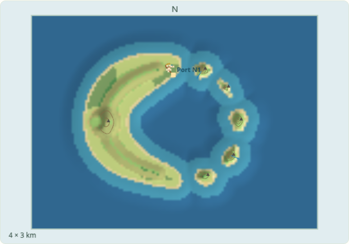
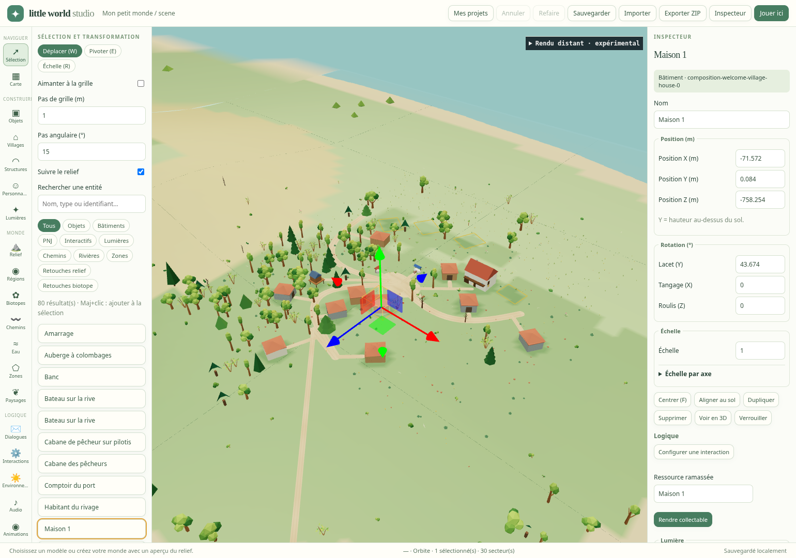

# Jardins, abords portuaires et caldeira à île dominante

Ce lot complète [89 — création complète](89-COMPLETE-ISLAND-START-CALDERA-PORT-VILLAGES.md) sur `feat/stepped-island-identity`.

## Parcelles autour des implantations

Les nouvelles implantations créées dans le Studio et les villages d’accueil proposent « Parcelles du joueur et des habitants ». Le hameau vise un jardin joueur et trois champs PNJ. Le village vise deux jardins joueur et trois champs PNJ ; les villes et implantations fortifiées visent deux jardins et cinq champs PNJ. Ces nombres ne dépendent pas de l’activité principale : les pêcheurs ont aussi leurs cultures.

Le placement recherche des sols secs, suffisamment plats et proches des rues, sans occuper les bâtiments, les chemins, les réservations ou les autres parcelles. Les orientations, dimensions et positions varient avec la graine. Une création avec cultures activées exige au moins un jardin joueur et deux champs PNJ ; sinon le plan signale une erreur et demande un autre emplacement ou la désactivation de cette option. Les objectifs supplémentaires peuvent rester partiels avec avertissement.

Ce sont des zones agricoles natives, utilisant le système existant de semis, arrosage, croissance et récolte. Les jardins joueur commencent vides ; les champs des habitants commencent avec des cultures variées. Dans l’inspecteur agricole, « Attribution » permet de choisir Joueur ou Habitants. Le runtime refuse les actions du joueur sur les champs PNJ, y compris si l’action contourne l’aperçu UI. Les parcelles anciennes sans attribution conservent leur fonctionnement.

Les cultures PNJ utilisent la simulation agricole existante ; ce lot n’ajoute pas de routine autonome de semis ou d’entretien des habitants. Leur réservation ne signifie pas qu’un PNJ précis possède une routine de travail dans chaque champ.

Les zones portent une provenance de génération : retouches manuelles préservées, suppression volontaire non recréée, suppression du village retirant uniquement les champs intacts. Les références extérieures empêchent une suppression destructive. Les changements de relief ou d’eau incompatibles avec les champs sont signalés à la validation. La carte globale distingue les jardins joueur en bleu et les champs PNJ en ocre.

## Liaison port–village

« Habiller les abords du port » utilise un port N1 réellement enregistré à proximité. Le placement réutilise les GLB du catalogue : cabane de pêcheur, barque et petit voilier échoués sur la rive. Un hameau vise trois objets, un village cinq, une ville sept. Les emplacements suivent le rivage et le niveau d’implantation, tout en laissant libres le quai, les rues, les champs et les bâtiments.

Ces éléments restent des entités natives éditables. Les retouches et verrous des équipements sont conservés pendant la régénération. Les cabanes sont du décor de rive, sans intérieur ni nouveau commerce ; les bateaux échoués ne deviennent pas des véhicules ou des ferries supplémentaires. Le commerce, les horaires et les voyages continuent d’utiliser le port maritime existant.

## Grande caldeira utilisable

La sélection du modèle Caldeira propose désormais « Grande île principale et îlots ». L’île principale occupe environ 58 à 66 % du tour, avec une ouverture et un littoral ondulé ; trois à cinq petites îles complètent la couronne. Sa surface dépasse la somme des îlots dans les graines vérifiées. Le port de ce modèle est recherché sur l’île principale.

Le survey cherche plus finement la ligne côtière peu profonde et l’accès terrestre peut remonter plus loin vers un sol sec. Le village recherche également des centres plus à l’intérieur. Les contrôles de profondeur maritime, d’enfouissement du quai et de praticabilité des chemins restent actifs.

La forme est enregistrée par `calderaShape: dominant`. Les valeurs `organic` et `regular` conservent leurs anciennes géométries ; aucun projet existant n’est automatiquement transformé.

## Vérifications et limites mesurées

- 726 tests réussis, compilation TypeScript et build réussis.
- 20 contrôles navigateur : créations Caldeira et île douce, parcelles joueur/PNJ et décor dans l’export, scène Studio et jeu compilé, aucune erreur JavaScript.
- Douze générations, six modèles sur deux graines : douze ports et douze projets valides. Onze villages placés, chacun avec un jardin joueur, trois champs PNJ et trois objets de rivage. Une île volcanique ne trouve toujours aucun site de village ; l’avertissement reste visible.
- Les deux caldeiras vérifiées ont dix et sept maisons, un jardin joueur, trois champs PNJ, une cabane et deux bateaux sur la rive.
- Les tests ciblés vérifient aussi les deux jardins d’un village, la protection des champs retouchés/supprimés et le refus des actions agricoles sur les champs PNJ.

Rapports : [matrice de génération](captures/settlement-surroundings-v1/benchmark-report.json), [navigateur](captures/settlement-surroundings-v1/browser-report.json). Les temps de génération CPU ne constituent pas une mesure des FPS.

Commandes : `npm test`, `npm run build`, `npm run benchmark:complete-island-start -- /tmp/little-world-surroundings`, puis, avec Vite démarré, `CAPTURE_DIR=/tmp/little-world-surroundings npm run test:complete-island-start`.

Aucun nouveau GLB, aucune modification de carte officielle, aucun déploiement.
