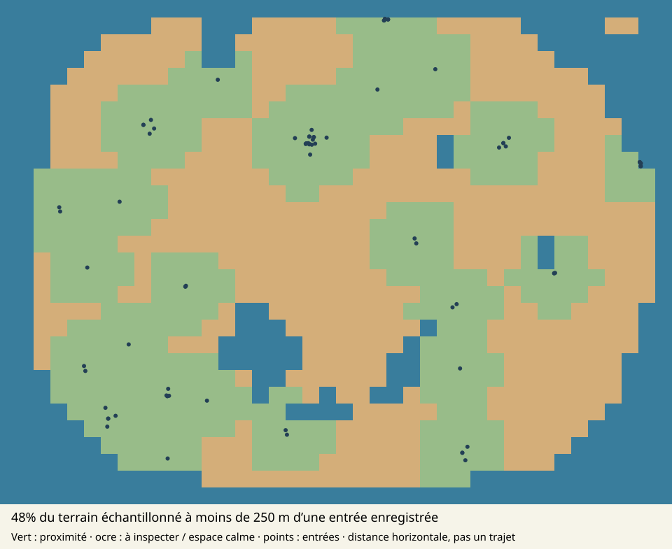
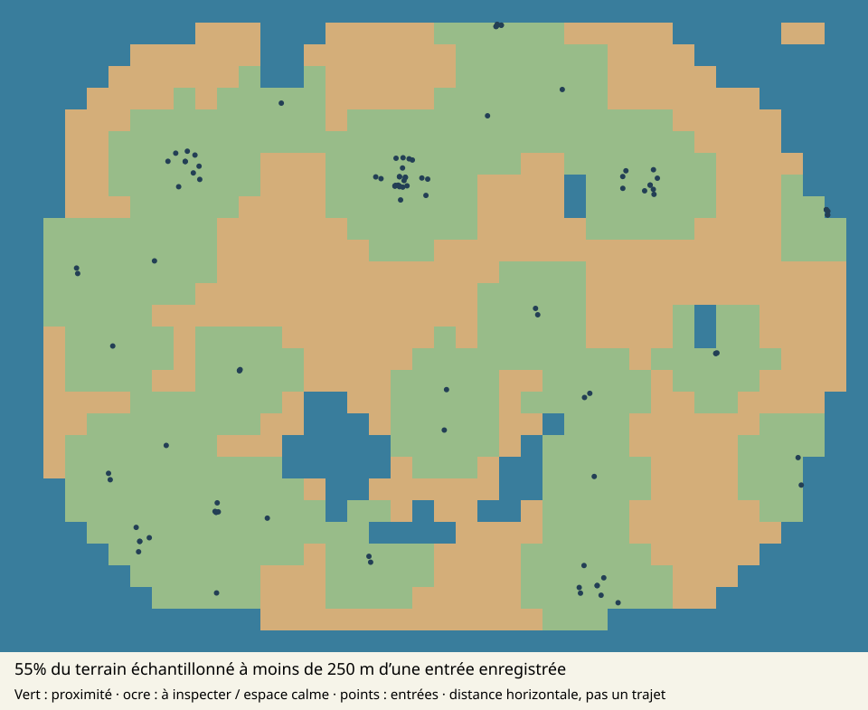

# Audit : créer des mondes complets, variés et jouables

Audit du code et des sources à `9ddaeca`, sur `feat/stepped-island-identity`. Référence : `maps/island.project.json`, île du volcan **4 × 3 km**, SHA-256 `5d85e0aaa4a5b52d26f7fd1484ba449be54d064577c2d76c953e8b3795aa900e`.

## Conclusion

Le Studio possède beaucoup des briques nécessaires. **Il ne dispose pas encore d’un coordinateur capable de composer un monde complet et de qualifier sa jouabilité.** La création guidée produit un terrain, un départ côtier et quelques activités. Elle ne répartit pas encore plusieurs villages, mines, équipements, ressources et quêtes comme un ensemble cohérent.

L’île historique constitue un meilleur socle de contenu que les nouvelles cartes générées : elle conserve 14 objectifs, 32 habitants, une mine, des champs et des lieux variés. Il faut l’enrichir et réparer ses accès, puis généraliser sa composition à des profils réutilisables. Ni multiplier les cartes spécialisées ni augmenter indistinctement les objets ne résout le problème.

Le livrable de cet audit est concret : un audit de contenu dans le Studio, des rapports reproductibles, quatre profils prospectés et une **copie enrichie compilable de l’île historique**. La copie n’est pas une carte officielle remplacée ni une certification de jeu complet.

## 1. Ce qui existe et ce qui manque

| Domaine | Capacité actuelle / contrôles | Génération / limite constatée | Prochaine action |
|---|---|---|---|
| Géographie | Six modèles de relief, silhouettes naturelle/croissant/tortue, caldeiras, altitude, orientation, allongement, vallées, plateaux locaux | Îles/archipels pris en charge ; vallée et continent affichés comme non pris en charge. Pas « tout type de carte » garanti | Profils cohérents puis compatibilité relief ↔ activités |
| Eau | Eau V3, profils, bassins, rapides/cascades, raccords | Placement et édition disponibles ; franchissements et berges doivent rester praticables | Garantir les accès aux activités d’eau et les traversées |
| Habitations | Villages modulaires, quartiers organiques, rue, rivière/ponts, montagne, pêcheurs, densité ville/fortifié, retouches/verrous | Un seul accueil automatique ; anciens presets d’habitat différents du système modulaire. Fortifié ne garantit pas une enceinte | Plusieurs pôles, rôles complémentaires, migration locale préservant les PNJ et quêtes |
| Agriculture | Semis, arrosage, croissance, récolte ; jardins joueur et champs PNJ, attribution éditable | Génération locale près des nouvelles implantations ; pas d’entretien autonome des champs PNJ | Agriculture intégrée aux besoins du village et aux échanges, sans nouvelle simulation lourde |
| Mine | Zones, niveaux, ressources, extraction, réception, commerce et monte-charge | Utilisable avec les sources anciennes ; aucune demande de mine dans la création guidée | Placement d’une entrée raccordée et d’un rôle économique, avec les primitives existantes |
| Forêt | Biotopes, bois, arbres, fruits et collecte, camps de bûcherons | Présence de forêt ≠ boucle locale complète avec outils, services et objectifs | Pôle forêt/ressources/chemins/quête, gestion des prérequis |
| Pêche | Mini-jeu, rivière/lac/mer, espèces, canne et comptoirs | Pêche libre disponible, pas de planification globale de postes de pêche ni d’itinéraires de rive | Emplacements de rive accessibles, équipement et services, puis diversification locale |
| Courses | Roulade/vol/mixte dans l’éditeur ; placement intelligent ; checkpoints, modules et chronos | Création guidée : plat/descente de roulade. Placement local sûr, pas coordinateur de parcours entre tous les pôles | Deux à quatre circuits intéressants, intégrés aux accès et aux rencontres ; ne pas viser le plafond de 64 |
| Ski | Tracé enregistré, couloir neigeux, glisse skis/snowboard, prêt, remontée prototype, édition des points | Une descente, pas de station complète ni compétition de ski ; aucun couloir valide sur la copie historique prospectée | Profil alpin compact, plusieurs pistes validées, arrivée/freinage/gares et sauvegarde à qualifier |
| Surf | Bateau et eau existent | **Aucun gameplay de surf identifié**. Snowboard et bateau ne sont pas du surf | Nouveau module distinct, après prototype de glisse sur vagues et contrôles ; ne pas le promettre dans un profil jouable |
| Quêtes | Dialogues, conditions/actions déclaratives, objectifs, récompenses, sauvegarde | Exemples surtout livraisons/collectes. Pas d’assistant global de quêtes ; pas de génération de quêtes dans le wizard | Composer des boucles locales et vérifier outils, ressources, activation, récompense et absence d’impasse |
| Commerce/ports | Services, ateliers/marchés, N1 natif, ferry/cargo et catalogue | Géométrie portuaire ≠ destination publiée active. Catalogue inspecté : deux îles, niveaux portuaires à 0 | Qualifier un vrai port et son accès, puis activation dans le catalogue lors d’une publication autorisée |
| Musique | Catalogue V2, thèmes contextuels, bruitages, éditeur Audio | Guidée : catalogue existant ou bruitages seuls ; pas de nouvelle composition générée | Cohérence des ambiances selon région/activité, mêmes moteurs et budgets |
| Validation | Schémas, références, assets, compilation, tests et diagnostics | Compilation valide ≠ parcours accessible, quête réalisable ou carte riche | Plusieurs niveaux de qualification, détaillés plus bas |

Les `libraries.activities` ne recensent que certains templates logiques (`collect/deliver/fish/puzzle`). Une bibliothèque vide ne signifie pas que le monde n’offre aucune activité : mines, champs, courses, dialogues et pêche vivent dans leurs contrats natifs. Le coordinateur doit les recenser sans les remplacer par un moteur concurrent.

## 2. Mesures sur la carte principale

| Mesure source | Île existante | Copie enrichie |
|---|---:|---:|
| Entités / PNJ / lumières | 1 511 / 32 / 54 | **inchangés** |
| Corps `Collider` source | 1 453 | **inchangé** |
| Dialogues / objectifs | 32 / 14 | **inchangés** |
| Commerces / poses d’usage explicites | 9 / 0 | 9 / **6** |
| Parcelles | 8, attribution historique | **29**, dont 7 nouveaux jardins joueur et 14 champs PNJ |
| Mines | 1 | 1, paramètres des 4 niveaux explicités |
| Courses enregistrées | 0 | **2**, plat et descente |
| Villages modulaires / ski / port natif source | 0 / 0 / 0 | 0 / 0 / 0, refus/limites conservés |
| Audio explicite | absent, repli runtime | catalogue contextuel V2 |
| Assets référencés | 65 | **65** |
| Secteurs auteur | 745 | **745** |
| Cellules terrestres proches d’une activité | 48 % | **55 %** |
| Plus grande distance horizontale à une entrée | 831 m | **831 m** |

Méthode : grille de 100 m, 875 cellules sèches, estimation de 8,75 km² de terrain sec, seuil de proximité 250 m. Sont comptés les entrées de quêtes/dialogues, commerces, interactions, champs, mine, départs/arrivées de courses et de ski. Les arbres, maisons et décorations ne deviennent pas artificiellement des activités.

**Les 52 % initiaux hors proximité ne sont pas « 52 % de carte vide ».** La pêche libre, les ressources procédurales et le paysage ne sont pas inclus dans ce pourcentage. La distance est euclidienne horizontale : falaises, ponts, détours et prérequis peuvent rendre le trajet plus long ou impossible. Le maximum restant à 831 m montre que cet enrichissement local ne règle pas encore les grands intervalles d’exploration.

### Accès et qualité du contenu

- Trois entrées sont signalées sur un sol humide ou trop bas : capitaine du port est, ermite du site nord-est et coffre voisin. Un éventuel tablier/support doit être vérifié avant de conclure qu’ils sont inutilisables.
- 28 chemins sont à revoir sur les échantillons de pente/eau. 512 segments sont contrôlés ; une partie des segments et un chemin restent hors budget. Les supports physiques complexes et tabliers ne sont pas certifiés par cette analyse : il ne s’agit pas de 28 parcours prouvés impossibles.
- Les 14 objectifs possèdent des actions structurelles d’activation et de fin. Cela ne démontre ni l’obtention des objets requis ni la possibilité de parcourir toutes les branches conditionnelles. Le texte « n’importe quels poissons » de l’aubergiste contredisait l’exigence de cinq sardines ; la consigne est corrigée dans la copie.
- Les anciennes maisons n’ont pas le contrat `Habitat` du placement modulaire. Les reconvertir automatiquement casserait potentiellement portes, PNJ, routes et quêtes.
- La carte historique n’a pas de `world.generation` : on ne doit pas inventer une recette V5 puis écraser son terrain pour obtenir les nouveaux contrôles.

## 3. Copie enrichie disponible

`node tools/audit-island-playability.mjs` produit par défaut dans `/tmp/little-world-playability-audit/` :

- `island-enriched.zip`, importable dans le Studio, et le projet JSON ; identités de projet/monde distinctes de l’original ;
- `compiled/`, compilation locale des sources et assets existants ;
- rapports avant/après, différences et cartes de proximité.

Ajouts validés sans modifier le relief ou déplacer les entités historiques : deux parcours d’environ 156 m et 215 m ; 21 parcelles autour de quatre pôles ; six poses d’usage de commerces ; configuration explicite de la mine ; catalogue musical et consigne de quête corrigée.

Refus conservés : poses de trois comptoirs non validées sans les déplacer ; aucun nouveau champ accepté au hameau ouest ; aucune descente de ski non volcanique trouvée. Aucun port supplémentaire n’a été superposé aux anciens pontons. Le brouillon conserve les limites de l’habitat historique et ses 14 quêtes, au lieu d’ajouter de fausses quêtes pour gonfler les chiffres.

### Coût mesuré des données

Comparaison des fichiers JSON non compressés : manifeste + secteurs + logique passent de **3 371 761 à 3 639 121 octets**, soit **+267 360 octets**. Les fichiers d’assets référencés restent à **496 068 octets** selon les manifestes. Aucun nouveau GLB ni fichier audio n’est produit. L’audio est référencé dans le nouveau catalogue ; ses ressources sont chargées selon leur usage et ne sont pas toutes incluses dans ce total.

Le maximum source par case de 250 m reste à 242 entités, 10 PNJ et 26 lumières. Ce ne sont pas des nombres d’objets simultanément rendus. La géométrie procédurale des nouvelles courses et leurs calculs ont un coût : **aucun gain ou maintien des FPS n’est déduit de ces comptages**.

Rapport détaillé : [report.json](audits/playable-world-v1/report.json).

## 4. Les nouveaux profils ne sont pas encore des mondes complets

Prospection reproductible par `node tools/report-world-profiles.mjs`, graine 4242, 4 × 3 km, options réellement disponibles :

| Profil candidat | Création technique | Proximité à 250 m | Pôles modulaires | Quêtes auto / mines auto | Courses / ski |
|---|---|---:|---:|---:|---:|
| Tempéré polyvalent | oui | 15 % | 1 | 0 / 0 | 2 / 0 |
| Alpin plein air | oui | 22 % | 0 | 0 / 0 | 1 / 1 prototype |
| Archipel littoral | oui | 23 % | 1 | 0 / 0 | 1 / 0 |
| Forêt, cible minière | oui | 4 % | 1 | 0 / 0 | 0 / 0 |

« Forêt, cible minière » exprime l’objectif de profil : **la mine n’est pas générée**. Le profil alpin garde l’avertissement d’absence de village. Ces chiffres montrent pourquoi un bouton de création activé ne doit pas signifier « monde complet prêt à jouer ».

Rapport : [profiles.json](audits/playable-world-v1/profiles.json). Aucun de ces quatre candidats n’est qualifié comme nouvelle carte officielle.

## 5. Organisation cible : deux familles fortes, une troisième facultative

1. **Île tempérée polyvalente** : repartir de l’île principale ; bourg central, ports/pêche, forêt/collecte, agriculture, mine et deux courses complémentaires. Les petits villages apportent chacun un service ou une rencontre différente. Le volcan, les ruines, les cascades et les vues sont des raisons d’explorer, pas des prétextes pour ajouter partout des objets.
2. **Île alpine compacte** : neige, deux ou trois pistes et une remontée qualifiée, hameau de station, bois, lac/pêche et petite activité minière si le terrain s’y prête. Une carte plus petite et riche vaut mieux qu’un grand massif avec une seule descente. Les dimensions et le nombre de pistes restent des paramètres à qualifier.
3. **Littoral/archipel facultatif** : compléter pêche, navigation, commerces et exploration des îlots. Ajouter le surf seulement quand sa mécanique et ses accès sont implémentés et testés. Ne pas créer une nouvelle île uniquement pour chaque activité.

Chaque famille doit combiner une activité dominante et des activités secondaires compatibles. Les ressources, services et objectifs doivent faire circuler le joueur entre quelques lieux cohérents. Les moments calmes doivent être explicitement assumés par l’auteur ; il ne faut pas remplir chaque case de 250 m avec un PNJ.

## 6. Coordinateur de contenu à construire

### Contrat auteur proposé — non implémenté

Un `ContentPlan` auteur, séparé des états de jeu, préciserait : profil, activités obligatoires/souhaitées, pôles, densité, budget, progression douce et espaces calmes. Il référencerait les recettes natives ; la compilation resterait une projection vers `zones`, `settlements`, `races`, `dialogues`, `objectives`, audio et entités existants. Pas de nouveau moteur pour chaque sport, ni de scripts arbitraires de carte.

### Ordre de planification

1. Lire relief, eau, pentes, biomes, occupations et retouches/verrous.
2. Choisir les pôles par adéquation au terrain et par accès ; réserver leurs emprises et respirations visuelles.
3. Former un réseau de trajets réel, incluant ponts, rampes, entrées de mine et transitions de niveau explicitement supportées.
4. Installer les activités et ressources compatibles. Interdire les superpositions champs/rues/courses/habitat ; éviter le ski sur un volcan actif.
5. Placer maisons et services selon le rôle du pôle, puis prévoir outils et parcelles joueur/PNJ.
6. Composer des quêtes à partir d’activités et ressources réellement présentes, avec actions et états existants.
7. Mesurer les intervalles sur les parcours, proposer les secteurs à enrichir ou à marquer calmes, et revérifier les budgets.
8. Présenter une prévisualisation modifiable puis qualifier le monde. Les demandes impossibles restent visibles ; pas de remplissage silencieux par décor.

Le classement des sites doit combiner adaptation physique, accessibilité, diversité, distance aux contenus existants et coût local. La graine apporte la variation dans les sites valides. Un tirage indépendant de chaque bâtiment ou activité ne produit pas une organisation cohérente.

### Quêtes et dépendances

Diversifier progressivement : rencontre/orientation, petite collecte, livraison entre services, exploration d’un point de vue, mécanisme, puis défi d’activité. Réutiliser conditions/actions et `onEvent` ; identifier explicitement les événements d’activité qui manquent au raccordement au journal.

Vérifier pour chaque objectif : donneur accessible, activation, ressource ou épreuve disponible, outil obtenable, retour/récompense, sauvegarde/reprise et absence de cycle bloquant. Par exemple, ne pas rendre l’obtention d’une canne dépendante d’un poisson qu’on ne peut pas encore pêcher. Les quêtes doivent rester facultatives et paisibles.

## 7. Priorités et critères de sortie

| Lot | Priorité | Résultat attendu | Critère de sortie |
|---|---|---|---|
| A — Audit et comparaison | livré dans ce lot | carte de proximité, inventaire, secteurs inspectables, copie enrichie | reproductible, borné, non destructif ; distances et limites explicites |
| B — Qualification de l’île principale | P0 | accès des commerces/PNJ/coffres, chemins et pontons repris ; vrai port qualifié | parcours natifs au contrôleur réel ; aucun équipement indispensable inaccessible |
| C — Coordinateur et profils | P0 | plusieurs pôles et activités complémentaires, budgets et zones calmes | demandes obligatoires satisfaites, pas de conflit d’emprises, motifs de rejet compréhensibles |
| D — Quêtes reliées au monde | P1 | diversité de boucles, ressources/outils/récompenses cohérents | scénarios complets avec inventaire, conditions, sauvegarde et reprise |
| E — Migration locale d’habitat | P1 | anciens quartiers repris par zones, pas tout le terrain recomposé | PNJ, quêtes, retouches et passages préservés ; différences inspectables et annulables |
| F — Alpin et littoral | P1/P2 | second profil riche ; surf après son prototype | glisse/remontée qualifiées ; surf jamais déclaré livré avant sa mécanique |

### Définition de « prêt à jouer »

- **Sources** : schémas, références et assets valides ; compatibilité des versions.
- **Placement** : sol/eau/pente/largeur/supports et emprises corrects.
- **Parcours** : spawn sûr, activités et services accessibles, transitions physiques réelles.
- **Boucles de jeu** : objectifs et prérequis réalisables, récompenses atomiques et sauvegarde fonctionnelle.
- **Expérience** : diversité et rythme d’exploration, espaces calmes intentionnels, pas seulement un seuil de proximité.
- **Ressources** : temps de frame, chargement, mémoire et coût local mesurés sur matériel défini ; aucun FPS garanti par la taille des JSON.
- **Livraison** : compilation, playtests et décision explicite de publication. Cet audit ne publie rien.

## 8. Ressources : enrichir les usages avant les objets

Conserver les budgets et mécanismes [LOW-RESOURCE](11-LOW-RESOURCE-POLICY.md) : une île active, chargement séquentiel des autres, LOD/instancing/culling, plafonds locaux de lumières, PNJ cadencés et lointains allégés, galeries actives seulement, index de pistes et logique différée quand possible. Le chargement initial des paquets auteur possède déjà une limite de 48 Mio ; ce n’est pas une preuve de streaming complet des entités.

Un nouvel objectif utilisant un pêcheur, une forêt et un marché existants enrichit le jeu avec peu d’objets nouveaux. Ajouter vingt PNJ pour vingt quêtes identiques augmente la charge et la répétition. Les quotas doivent être locaux et globaux ; le nombre d’îles dans le catalogue ne doit pas multiplier leur simulation simultanée.

## 9. Import Node / Chromium : blocage corrigé

Le contrôle navigateur a révélé qu’une pose d’usage calculée par Node peut différer d’un dernier bit de celle recalculée par Chromium (`-0.38941834230865047` contre `-0.3894183423086505`). La comparaison JSON exacte rejetait alors l’index logique et bloquait « Jouer ici ». Le contrôle tolère maintenant au plus `1e-9` sur les seuls champs numériques de cette pose dérivée. Les champs inconnus, poses absentes, déplacements réels et différences d’état/inventaire restent rejetés. Deux tests dédiés couvrent cette interopérabilité.

## 10. Contrôle livré dans le Studio

**Validation / compilation → Contenu jouable et espaces calmes → Auditer le contenu jouable**. Le rayon est réglable. Le rapport présente l’inventaire, la carte de proximité et des boutons pour inspecter les secteurs en 3D, les objectifs incomplets et les chemins à revoir. Aucun avertissement de densité ne bloque une carte volontairement calme ou vide.

L’analyse exige les sources hydratées, limite sa grille à 2 400 cellules par défaut (4 096 maximum), les premières entrées à 4 096 et les contrôles de chemin à 512 segments par défaut. Elle ne simule ni les conditions de quêtes ni les trajets du joueur ; les contrôles de compilation et le playtest restent distincts.

Commandes : `npm test`, `npm run build`, `node tools/audit-island-playability.mjs`, `node tools/report-world-profiles.mjs`. Vérification UI avec Vite sur le port 5176 : `node tools/test-playability-audit-browser.mjs`.

Vérification de ce lot : **824 tests unitaires**, vérification TypeScript et build réussis ; **8 contrôles navigateur** sur le Studio et ouverture du jeu de la copie enrichie, sans erreur JavaScript. [Rapport UI](captures/playability-audit-v1/browser-report.json), [audit de la copie](captures/playability-audit-v1/draft.png), [jeu compilé](captures/playability-audit-v1/playtest.png). Les mesures matérielles de FPS restent hors de cet audit.

## Consulter l’ensemble de l’archipel

Après `npm run build`, exécuter `node --experimental-strip-types tools/audit-island-playability.mjs --published dist`.
La commande vérifie la correspondance entre chaque source Studio et son
manifeste compilé, puis écrit le rapport JSON sur la sortie standard. Le rapport
contient le nombre de missions et d’activités, la proximité des activités, les
diagnostics de références et les concentrations locales de PNJ, d’entités et de
lumières. Les distances sont mesurées à l’horizontale. La qualification des
trajets et des FPS se fait en jeu.
